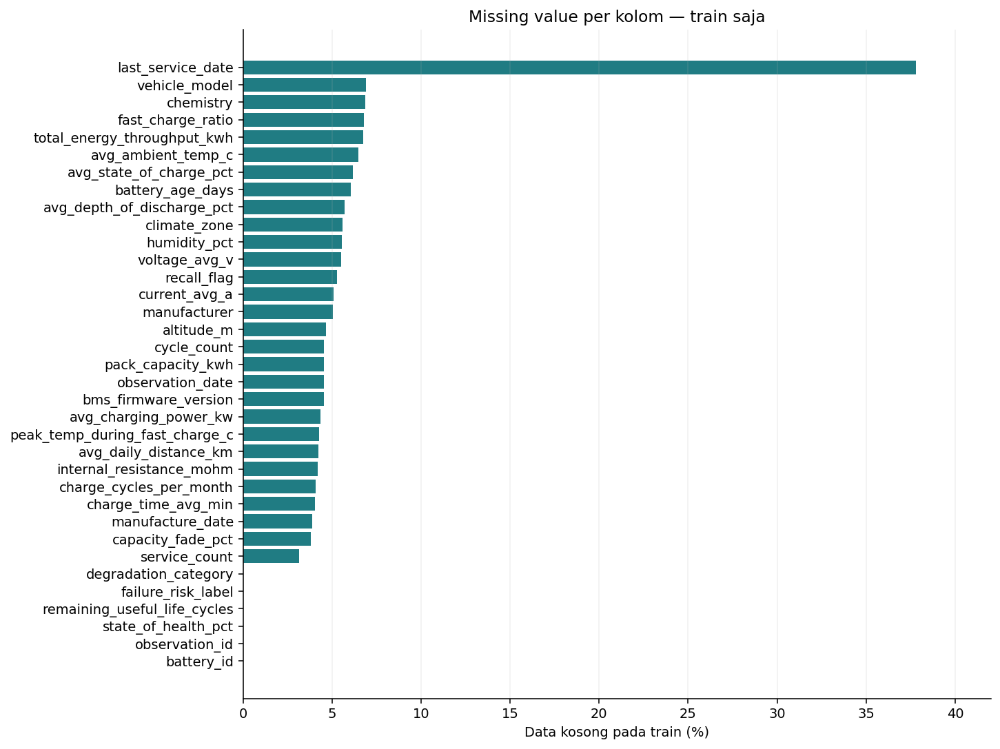
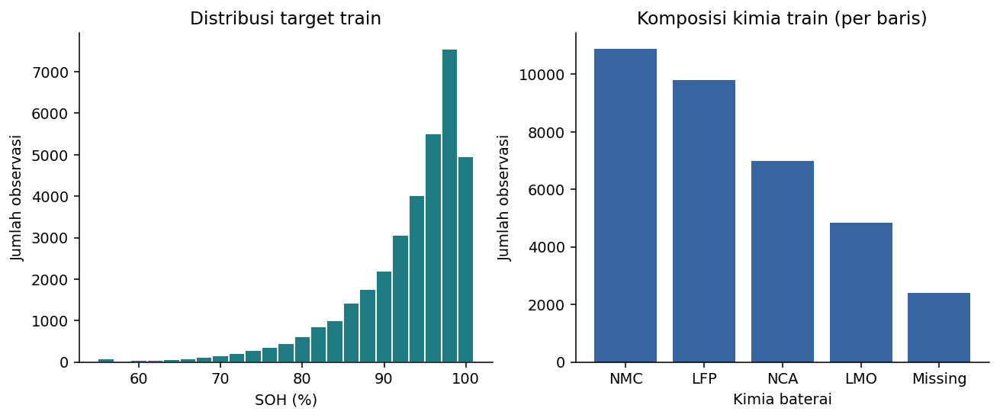
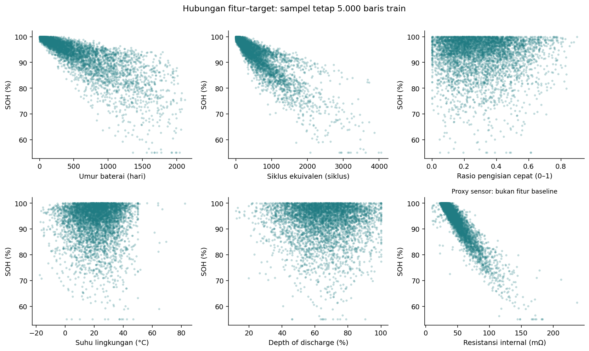
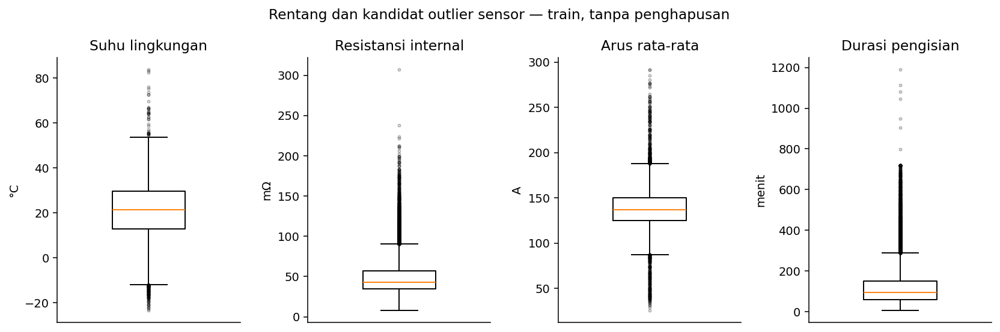

# Audit Dataset dan EDA Awal Train

## Keputusan utama

- Tugas: **regresi SOH saat observasi pada baterai baru**, target `state_of_health_pct`.
- Data sintetis menurut README sumber, bukan telemetry armada nyata. Tidak ada model dilatih pada tahap ini.
- Seluruh data: **50,000 baris, 35 kolom, 2,600 baterai**.
- Split 70/15/15 berdasarkan **battery_id**, seed 42; tidak ada baterai melintasi subset. Persentase ini berlaku pada baterai; jumlah baris tidak harus tepat 70/15/15.
- EDA distribusi/relasi dan batas IQR hanya memakai train. Pemeriksaan global dibatasi pada integritas skema, ID, tanggal, missing, rentang dasar, dan identitas target; test belum digunakan untuk seleksi atau penilaian model.
- `21` kolom kandidat baseline **sebelum encoding**. Jumlah neuron input baru diketahui setelah preprocessing fit pada train.

## Sumber dan versi

[Dataset Kaggle](https://www.kaggle.com/datasets/vinay24baghira/ev-battery-health-and-degradation-dataset). Definisi bersumber dari `data/raw/README.md` dan `data/raw/data_dictionary .csv` dalam arsip yang diunduh. README sumber menyebut lisensi **CC0** dan data sepenuhnya sintetis. Nama kamus dalam arsip memiliki spasi sebelum `.csv`; tidak diubah. Arsip tidak berisi sample notebook meskipun README menyebutnya.

SHA-256 CSV: `cacdf6afcf50db86583be3754207a89acbfd60b04dfff8f69b71e29cfd78218d`.
Lingkungan dan hash dokumentasi sumber tersimpan di `provenance.json`. Manifest split di `../../data/splits/battery_split.csv` dikunci ke versi CSV ini. Semua hasil dapat dibuat ulang tanpa mengubah CSV.

## Manifest split

| split | batteries | rows | row_pct |
| --- | --- | --- | --- |
| train | 1820 | 34929 | 69.858 |
| validation | 390 | 7499 | 14.998 |
| test | 390 | 7572 | 15.144 |

Manifest menyimpan satu baris per baterai. Untuk mengambil baris data, lakukan merge/map pada battery_id; jangan melakukan random split per observasi. Algoritma menggunakan NumPy default_rng(42), ID diurutkan sebelum permutasi, dan urutan train → validation → test. Tidak ada stratifikasi berdasarkan target dan tidak memilih seed dari skor model.

## Integritas data global

- Duplikasi seluruh baris: 0; duplikasi observation_id: 0.
- Target kosong: 0; nilai numerik tak hingga: 0.
- observation_date kosong: 2216. Duplikasi battery_id + tanggal pada baris dengan tanggal terisi: 0. Missing tanggal tidak dianggap sebagai pengukuran pada tanggal yang sama.
- Format tanggal yang terisi gagal diparse: 0.
- Observasi sebelum manufaktur: 0; servis sesudah observasi: 0; servis sebelum manufaktur: 0.
- Usia tidak sesuai selisih tanggal: 0 dari 43,199 baris yang dapat diperiksa.
- Jumlah pengamatan per baterai: 7–37, rerata 19.23. README menyebut sekitar 10–40; angka audit aktual yang dipakai.
- Tidak ditemukan konflik nilai nonkosong dalam atribut statis yang diperiksa (kimia, produsen, model, kapasitas nominal, tanggal manufaktur, iklim). Ini tidak membuktikan semua kolom selalu konstan.

## Missing value

Tabel berikut merupakan audit kualitas seluruh CSV, bukan statistik imputer. Statistik imputasi harus dihitung ulang hanya dari train.

| column | missing_count | missing_pct |
| --- | --- | --- |
| last_service_date | 18831 | 37.662 |
| vehicle_model | 3515 | 7.03 |
| chemistry | 3459 | 6.918 |
| fast_charge_ratio | 3405 | 6.81 |
| total_energy_throughput_kwh | 3370 | 6.74 |
| avg_ambient_temp_c | 3282 | 6.564 |
| avg_state_of_charge_pct | 3138 | 6.276 |
| battery_age_days | 3002 | 6.004 |
| avg_depth_of_discharge_pct | 2832 | 5.664 |
| voltage_avg_v | 2807 | 5.614 |
| humidity_pct | 2737 | 5.474 |
| climate_zone | 2719 | 5.438 |
| recall_flag | 2646 | 5.292 |
| current_avg_a | 2487 | 4.974 |
| manufacturer | 2461 | 4.922 |
| bms_firmware_version | 2328 | 4.656 |
| altitude_m | 2322 | 4.644 |
| pack_capacity_kwh | 2302 | 4.604 |
| cycle_count | 2269 | 4.538 |
| observation_date | 2216 | 4.432 |
| avg_charging_power_kw | 2140 | 4.28 |
| peak_temp_during_fast_charge_c | 2128 | 4.256 |
| avg_daily_distance_km | 2118 | 4.236 |
| internal_resistance_mohm | 2104 | 4.208 |
| charge_time_avg_min | 2091 | 4.182 |
| charge_cycles_per_month | 2054 | 4.108 |
| manufacture_date | 1910 | 3.82 |
| capacity_fade_pct | 1869 | 3.738 |
| service_count | 1600 | 3.2 |

`last_service_date` tidak selalu hilang karena kerusakan data: 18,205 baris tanggal servis kosong memiliki service_count=0, 626 juga memiliki service_count kosong, dan 0 memiliki service_count>0. Jangan mengimputasi semua tanggal sebagai tanggal servis nyata. Tanggal ini dikeluarkan dari baseline.

## Kebocoran target dan kandidat proxy

Pada 48,131 baris yang memiliki capacity_fade_pct, **capacity_fade_pct + SOH = 100** dengan maksimum selisih absolut 0.0. Ini identitas langsung, sehingga capacity_fade_pct dilarang menjadi input.

Tiga target alternatif (`remaining_useful_life_cycles`, `failure_risk_label`, `degradation_category`) juga dikeluarkan. README sumber menyatakan pengukuran listrik diturunkan dari SOH dan kimia, dengan internal resistance disebut eksplisit. Karena itu internal resistance, voltage, current, dan charge time dikeluarkan secara konservatif dari baseline dan hanya menjadi kandidat ablation sensor terpisah. Tidak diasumsikan semua empat kolom punya rumus ketergantungan yang sama. Sensor terukur dapat sah untuk estimasi saat ini jika benar tersedia, tetapi data sintetis ini membuat interpretasi proxy perlu kehati-hatian.

Daftar fitur beserta alasan tersimpan di `../../configs/feature_contract.json` dan `schema_audit.csv`. Fitur utama meliputi kimia/metadata, umur/pemakaian, dan lingkungan. Availability seluruh ringkasan pada saat observasi adalah asumsi; dokumentasi tidak menjelaskan interval agregasi sehingga belum sah untuk klaim prediksi sebelum sesi.

## Kelayakan temporal

| counter | eligible_pairs | decreasing_pairs |
| --- | --- | --- |
| cycle_count | 43017 | 7820 |
| battery_age_days | 42320 | 0 |
| total_energy_throughput_kwh | 41948 | 8923 |

Pemeriksaan membandingkan pengukuran valid berurutan setelah mengeluarkan tanggal/nilai counter yang kosong, dalam baterai yang sama, dan hanya saat tanggal bertambah. Pasangan bisa melompati observasi yang kosong. cycle_count dan throughput yang didefinisikan kumulatif ternyata sering menurun. Fakta ini perlu dibahas sebagai ketidakkonsistenan data sintetis, bukan langsung diperbaiki dengan sorting nilai, cumulative maximum, atau penghapusan massal.

**Keputusan:** baseline tabular tanpa timesteps. Forecasting/windowing ditunda sampai kualitas urutan, nilai hilang, dan makna horizon ditinjau. Group split ini menguji baterai yang belum terlihat, bukan jaminan generalisasi ke periode masa depan.

## EDA awal train

Jumlah train: 34,929. SOH train: min 55.00, median 95.23, rerata 92.92, maksimum 100.00 persen.

| soh_band_pct | train_rows | train_pct |
| --- | --- | --- |
| <70 | 525 | 1.503 |
| 70–<80 | 1697 | 4.858 |
| 80–<90 | 6412 | 18.357 |
| 90–<95 | 8264 | 23.659 |
| >=95 | 18031 | 51.622 |

Sebaran target tidak merata. Karena target kontinu, SMOTE/balancing kelas tidak diterapkan. Evaluasi akhir harus menyertakan error per rentang SOH beserta jumlah sampelnya; jangan hanya mengandalkan MAE agregat.

Missing tersebar pada fitur numerik maupun kategori. Median numerik dan kategori missing eksplisit layak menjadi baseline, tetapi belum ada imputer/scaler yang di-fit dalam audit ini.

Komposisi kimia dihitung per observasi, bukan per baterai. Observasi satu baterai saling berkaitan. Proporsi baris tidak boleh ditafsirkan sebagai prevalensi armada nyata.

Grafik memakai sampel deterministik maksimal 5.000 baris train dan mengabaikan pasangan kosong saat plotting. Pola menunjukkan hubungan observasional dalam simulator, bukan bukti sebab akibat. Resistance ditampilkan untuk membahas risiko proxy, bukan dimasukkan diam-diam ke baseline.

Titik di luar whisker adalah kandidat pemeriksaan, bukan otomatis data salah. Tabel `outlier_flags_train.csv` memakai aturan 1.5×IQR train, tanpa menghapus atau memotong nilai. Outlier sensor diinjeksi menurut sumber, tetapi sumber tidak menyediakan mask baris mana yang diinjeksi.

## Langkah berikutnya

1. Terima skenario estimasi SOH saat ini pada baterai baru dan daftar fitur utama, atau catat perubahan sebelum training.
2. Perdalam EDA **train** pada notebook 01: distribusi setiap fitur, korelasi/redundansi, kategori langka, error domain, dan temuan yang memengaruhi seleksi.
3. Buat pipeline imputasi, encoding kategori tak dikenal, standardisasi numerik, dan penanganan recall_flag. Fit hanya pada train. Jangan melatih model sebelum pipeline dan input diuji.
4. Catat p setelah encoding, lalu buat baseline MLP dan matriks eksperimen sesuai CONTEXT.md. Belum memilih framework atau mengklaim performa.

Artefak ini berisi audit dan EDA awal, **bukan EDA lengkap, preprocessing final, atau hasil prediksi**.
