# EDA Mendalam EV Battery Health

## Ringkasan yang perlu dipahami kelompok

1. Analisis ini memakai **34.929 observasi dari 1.820 baterai train**. Validation dan test tidak diringkas, divisualisasikan, atau digunakan untuk memilih pola.
2. Target SOH condong ke kondisi tinggi: median **95.23%**, rerata **92.92%**, **51.62%** observasi mencapai ≥95%, sedangkan **6.36%** di bawah 80%. Error pada SOH rendah perlu dilaporkan terpisah kelak.
3. Jumlah siklus paling kuat berkaitan dengan SOH di antara fitur utama (Spearman **-0.907**). Umur dan energi kumulatif juga kuat. Ketiganya saling berkaitan, sehingga bukan tiga bukti pengaruh yang independen.
4. Kimia baterai berbeda dalam distribusi SOH. Perbandingan dalam rentang umur yang sama dengan bobot sama per baterai masih menunjukkan perbedaan, tetapi belum mengontrol semua kondisi penggunaan. Ini pola simulator, bukan efek kausal kimia pada armada nyata.
5. Missing fitur utama menunjukkan perbedaan median SOH missing–terisi sebesar **-0.24 hingga 0.28 poin persentase**. Ini tidak membuktikan MCAR. Missing tanggal servis sangat berbeda dan berkaitan dengan tahap pemakaian.
6. Pada **31,528** pasangan berurutan bertanggal valid, SOH naik >0.01 poin pada **10,360 (32.86%)** pasangan. Interval tidak seragam dan counter kumulatif tidak konsisten; jangan langsung membangun timestep atau menyebut kenaikan SOH sebagai pemulihan fisik.
7. Belum ada preprocessing fit, feature selection final, training, atau penilaian performa. Seluruh data asli dan manifest split dipertahankan.

## 1. Pertanyaan, sumber, dan cara membaca hasil

Tujuan EDA: menjelaskan distribusi, hubungan, kualitas, dan struktur pengamatan sebelum menentukan preprocessing serta eksperimen MLP/backpropagation.

Sumber: [Kaggle EV Battery Health & Degradation](https://www.kaggle.com/datasets/vinay24baghira/ev-battery-health-and-degradation-dataset). README dan kamus di dalam arsip menyebut data **sepenuhnya sintetis** dengan lisensi CC0, missing dan outlier yang diinjeksi, serta pengukuran listrik terkait SOH/kimia. Generator dan mask injeksi tidak tersedia di proyek ini.

EDA menggunakan versi CSV dan manifest yang hash-nya dicatat pada `eda_provenance.json`. Kode membaca CSV untuk memuat train sesuai manifest, lalu seluruh fungsi EDA hanya menerima train. Tidak menggabungkan data antar-subset untuk memulihkan missing.

Ada dua unit ringkasan:
- **Observasi:** satu baris pengukuran; baterai dengan banyak baris mendapat bobot lebih besar.
- **Baterai:** unit kelompok. Untuk kurva kimia–umur, setiap baterai menyumbang satu rerata SOH per rentang umur, kemudian dirata-ratakan antar-baterai.

Label `chemistry_group` hanya dipakai untuk EDA: satu nilai kimia nonkosong yang konsisten dalam pengamatan **train** baterai tersebut. Kolom kimia asli tetap utuh dan missing-nya tetap dihitung. Ini bukan imputer untuk input model. Perbandingan kategori mentah memakai nilai baris asli, termasuk Missing.

Tidak ada uji p-value berbasis asumsi 34.929 baris independen. Korelasi dan perbedaan kelompok bersifat deskriptif. Tidak ada klaim sebab akibat atau rekomendasi keselamatan baterai dari simulator.

## 2. Distribusi target dan representasi unit

- SOH train: 55.00–100.00%, median 95.23%, rerata 92.92%.
- Nilai tepat 100%: 1,603; tepat 55%: 80. Penumpukan di batas yang teramati konsisten dengan kemungkinan pembatasan/rounding simulator, tetapi kode generator tidak tersedia untuk memastikan mekanismenya.
- Median dengan bobot sama per baterai: 95.21%. Rerata berbobot sama per baterai: 92.91%.
- Korelasi Spearman jumlah observasi dengan rerata SOH per baterai: 0.014; ini pemeriksaan potensi bias banyaknya pengamatan, bukan bukti independensi sampling.

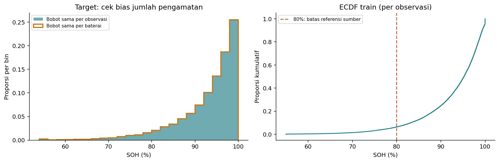

Histogram memakai bin yang sama; garis oranye memakai bobot baris 1/jumlah baris baterai. ECDF menunjukkan proporsi target pada/bawah suatu nilai. Garis 80% mengikuti referensi end-of-life dalam dokumentasi dataset, bukan ambang kelas yang baru dibuat kelompok.

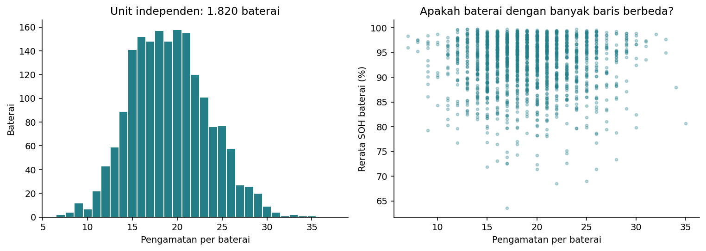

**Implikasi:** gunakan MAE/RMSE pada skala target asli; jangan memakai accuracy regresi. Pada evaluasi kelak, sertakan rentang SOH dan ringkasan per baterai. Jumlah sampel nominal bukan jumlah baterai independen.

## 3. Seluruh fitur numerik dan kategori

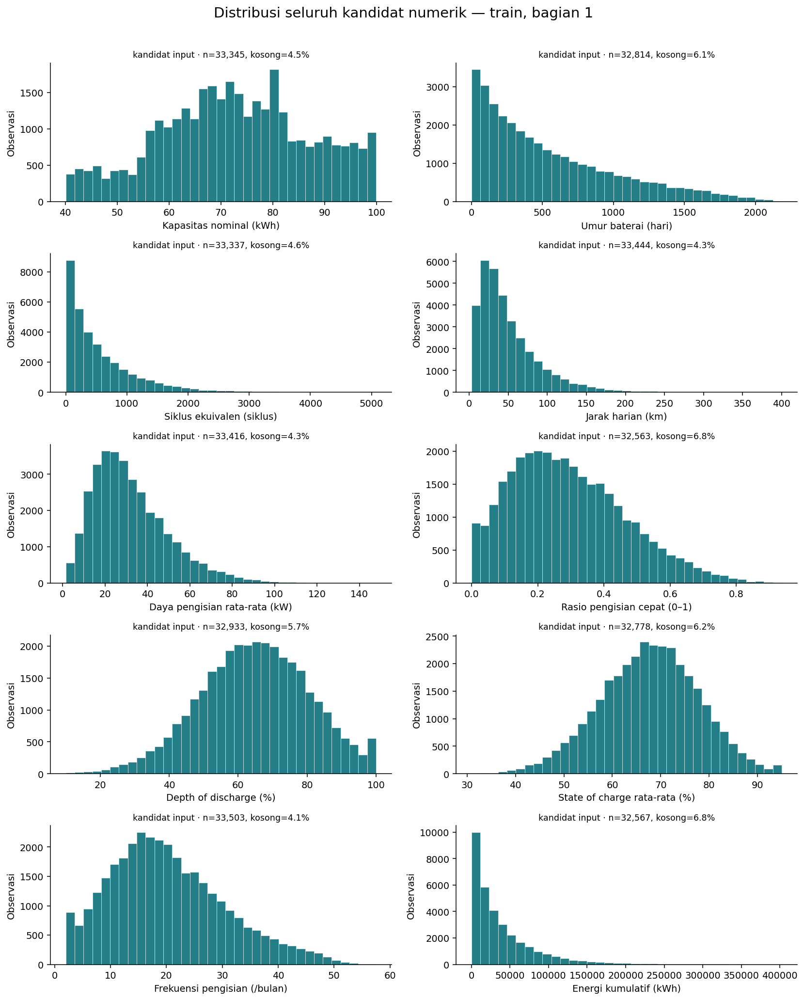

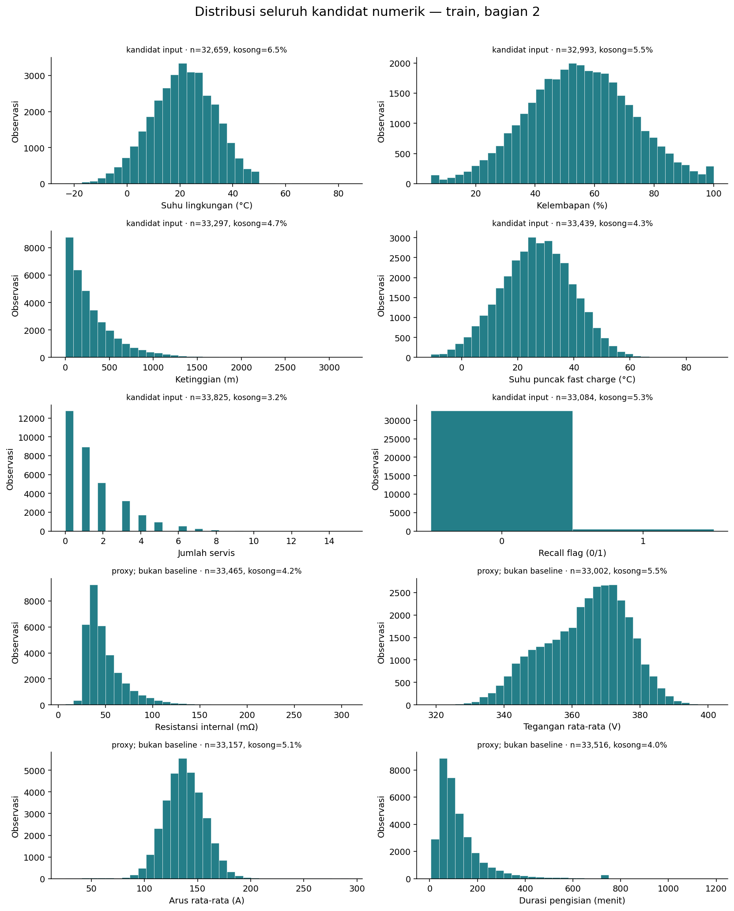

Seluruh 15 kandidat numerik, recall_flag, dan empat kandidat proxy sensor dicakup. Setiap panel mencantumkan jumlah terisi dan missing. Histogram tidak membuang outlier. Bentuk miring, diskret, atau rentang lebar dapat dilihat langsung; statistik minimum, p1, p5, kuartil, p95, p99, maksimum, dan skewness tersedia di `numeric_distributions.csv` dan `tails_and_iqr.csv`.

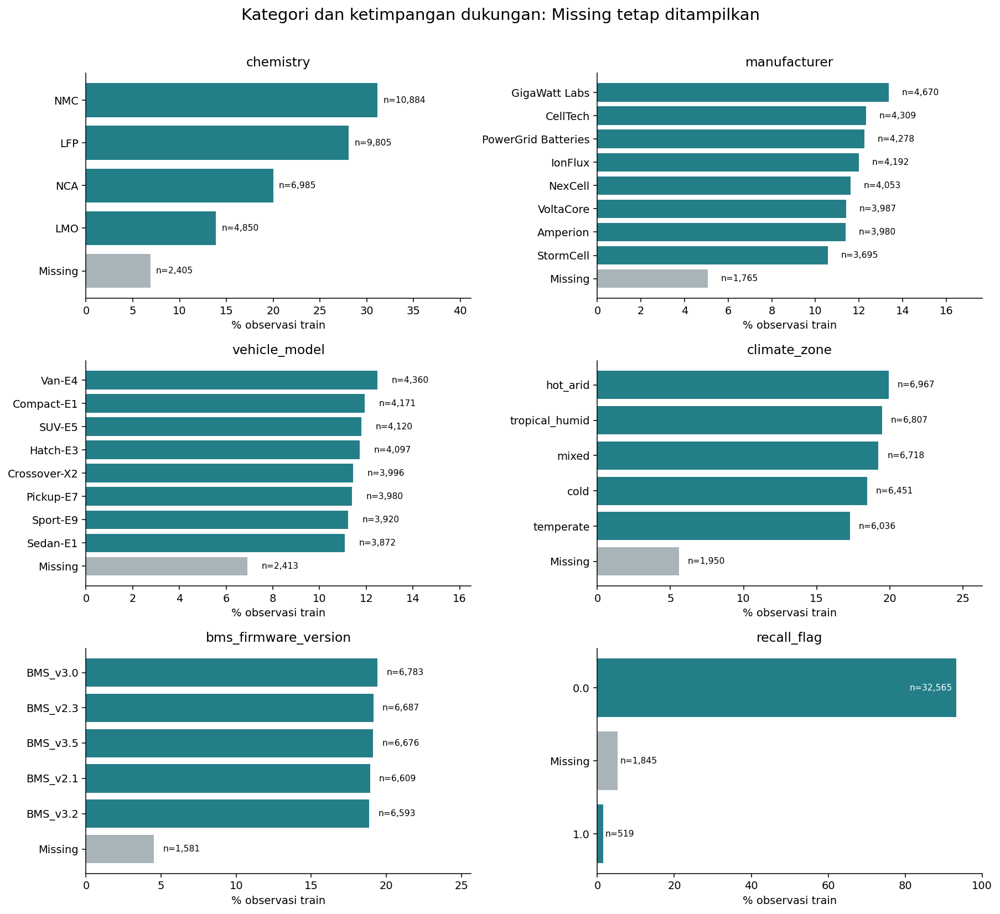

Kategori Missing bukan jenis baterai baru. Firmware dan recall dapat berubah antarobservasi; jangan dianggap atribut statis hanya karena bentuknya kategori. Jumlah baterai dalam kategori yang berubah dapat tumpang tindih dan tidak boleh dijumlahkan seolah-olah kategori saling eksklusif pada tingkat baterai. Recall=1 jarang; banyaknya baris per kategori tercantum agar pembaca tidak menyimpulkan dari kelompok kecil.

**Implikasi:** imputer numerik, encoding kategori tak dikenal, skala numerik, dan perlakuan biner perlu dirancang pada tahap preprocessing. Tidak otomatis menghapus fitur berkorelasi rendah atau kategori langka dari EDA saja.

## 4. Kimia dan umur: perbandingan yang lebih adil

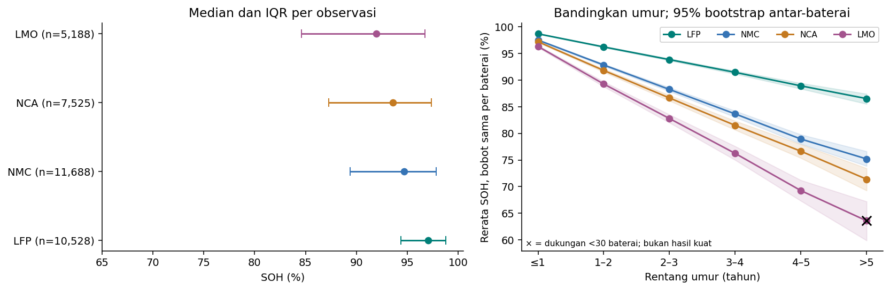

Panel kiri merangkum median/IQR observasi, bukan interval kepercayaan. Panel kanan mengelompokkan umur menjadi rentang tahunan tetap, merata-ratakan SOH per baterai dalam rentang itu, lalu memberi bobot sama pada setiap baterai.

Contoh rentang **1–2 tahun**:

| chemistry | rows | batteries | battery_balanced_mean_soh | ci95_low | ci95_high |
| --- | --- | --- | --- | --- | --- |
| LFP | 2439 | 469 | 96.237 | 96.119 | 96.348 |
| LMO | 1168 | 226 | 89.27 | 88.781 | 89.709 |
| NCA | 1665 | 344 | 91.817 | 91.513 | 92.115 |
| NMC | 2718 | 501 | 92.845 | 92.634 | 93.038 |

Pita pada panel kanan adalah interval persentil bootstrap 95% dari **1,000 resampling baterai dalam setiap sel kimia–umur**, seed 42. Ini interval pointwise untuk rerata sel, bukan untuk keseluruhan kurva atau perbedaan kimia, dan tidak mengatasi confounding. Tidak digunakan untuk uji signifikansi. Baterai yang sama dapat muncul di beberapa rentang umur, sehingga titik-titik sepanjang kurva tetap berkaitan.

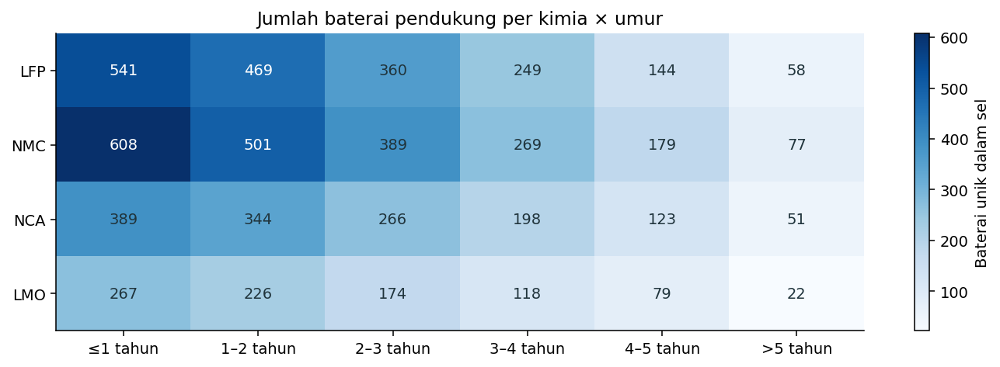

Sel dengan <30 baterai diberi tanda × pada kurva. Dukungan rendah:

| chemistry | age_band | rows | batteries |
| --- | --- | --- | --- |
| LMO | >5 tahun | 51 | 22 |

**Kesimpulan terbatas:** kimia dan umur layak dipertimbangkan bersama karena pola antarkimia tidak identik. Kurva ini adalah ringkasan lintas observasi/baterai pada rentang umur, bukan kurva degradasi terkontrol satu baterai atau bukti kimia tertentu selalu lebih baik.

## 5. Hubungan numerik, nonlinearitas, dan redundansi

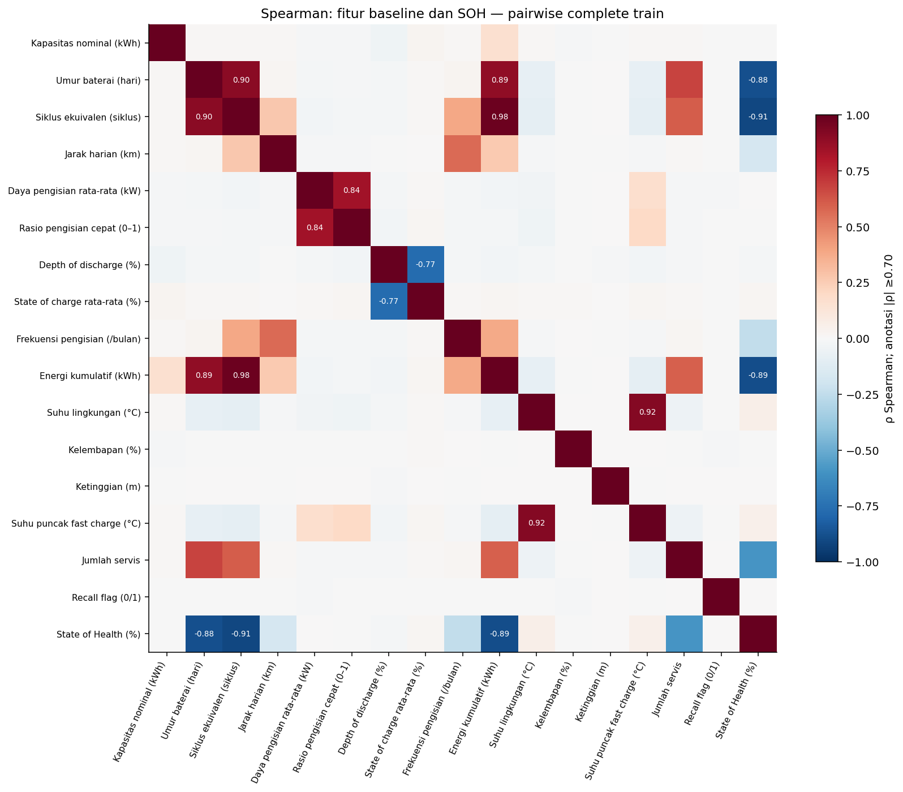

Spearman mengukur hubungan monoton berbasis ranking dan tidak mengharuskan garis lurus. Pearson melengkapi hubungan linear. Korelasi dihitung pairwise-complete, tanpa mengisi missing; jumlah pasangan antarvariabel berkisar **30,368–33,825** pada matriks yang disimpan. Matriks jumlah pasangan terpisah ada di `correlation_pair_counts.csv`.

Asosiasi target terbesar pada kandidat baseline/proxy:

| feature | role | pairwise_rows | batteries | pearson_pooled | spearman_pooled |
| --- | --- | --- | --- | --- | --- |
| cycle_count | primary | 33337 | 1820 | -0.873 | -0.907 |
| internal_resistance_mohm | proxy_not_baseline | 33465 | 1820 | -0.928 | -0.896 |
| total_energy_throughput_kwh | primary | 32567 | 1820 | -0.822 | -0.886 |
| battery_age_days | primary | 32814 | 1820 | -0.809 | -0.881 |
| service_count | primary | 33825 | 1820 | -0.564 | -0.593 |
| charge_cycles_per_month | primary | 33503 | 1820 | -0.275 | -0.244 |
| avg_daily_distance_km | primary | 33444 | 1820 | -0.177 | -0.169 |
| avg_ambient_temp_c | primary | 32659 | 1820 | 0.024 | 0.056 |
| peak_temp_during_fast_charge_c | primary | 33439 | 1820 | 0.022 | 0.053 |
| voltage_avg_v | proxy_not_baseline | 33002 | 1820 | 0.048 | 0.023 |

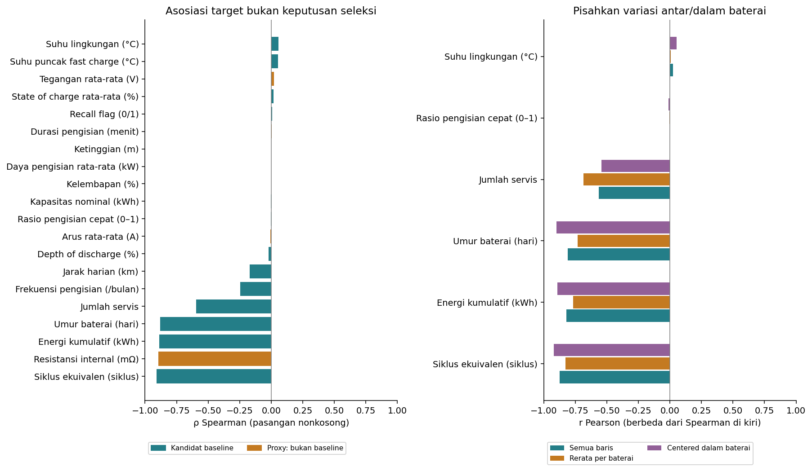

Panel kanan membandingkan **Pearson**, bukan nilai Spearman panel kiri: pooled pada seluruh pasangan terisi; antar-baterai pada rerata pasangan per baterai; dan dalam-baterai setelah mengurangi rerata masing-masing baterai. Centering bukan model kausal dan tidak mengontrol umur/kimia atau semua variabel lain. Fitur konstan dalam baterai tidak punya korelasi centered yang terdefinisi; nilai tersebut dibiarkan kosong dalam tabel.

Pasangan fitur utama dengan |Spearman| ≥0.70 (ambang eksplorasi, bukan aturan penghapusan):

| feature_a | feature_b | spearman | pairwise_rows |
| --- | --- | --- | --- |
| cycle_count | total_energy_throughput_kwh | 0.984 | 31064 |
| avg_ambient_temp_c | peak_temp_during_fast_charge_c | 0.92 | 31255 |
| battery_age_days | cycle_count | 0.903 | 31304 |
| battery_age_days | total_energy_throughput_kwh | 0.89 | 30582 |
| avg_charging_power_kw | fast_charge_ratio | 0.841 | 31147 |
| avg_depth_of_discharge_pct | avg_state_of_charge_pct | -0.767 | 30917 |

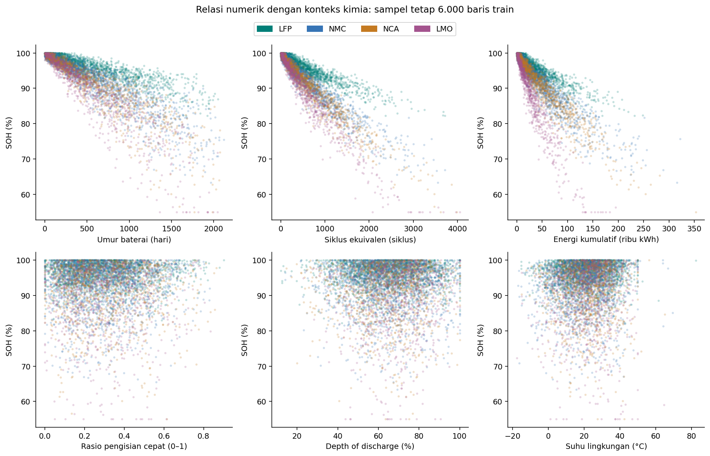

Scatter memakai sampel deterministik 6.000 baris train tanpa fitting garis/model. Warna menambah konteks kimia. Makin banyak siklus/umur umumnya berasosiasi dengan SOH lebih rendah, tetapi sebaran dan perbedaan kimia menunjukkan satu hubungan linear tunggal tidak cukup menggambarkan semua observasi. Ini alasan menguji MLP, bukan bukti MLP pasti memberi skor terbaik.

**Implikasi:** bandingkan fitur pemakaian yang saling tumpang tindih melalui eksperimen terkontrol nanti. Korelasi rendah fast charge/DOD/suhu secara pooled tidak membuktikan fitur tidak berguna atau faktor tersebut tidak memengaruhi baterai nyata. Secara khusus, Spearman fast charge–SOH pada train hanya sekitar −0.003; sumber menyebut penalti fast charge dalam simulator, tetapi generator tidak tersedia untuk memeriksa bagaimana fitur observasi dan parameter laten saling terkait.

## 6. Pola bersyarat: jangan tertipu korelasi pooled

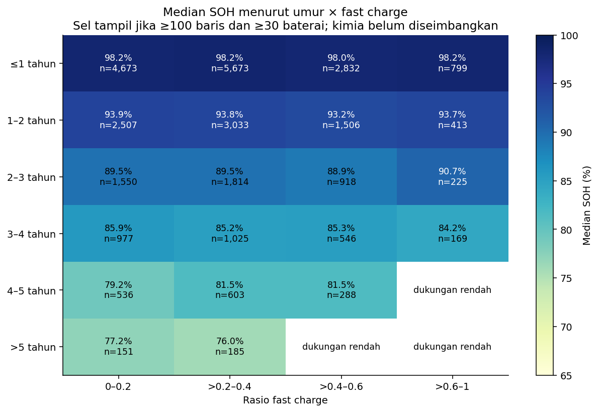

Grid memakai rentang umur/rasio tetap, menampilkan median SOH dan n observasi. Hanya sel dengan ≥100 baris dan ≥30 baterai ditampilkan. Kimia dan penggunaan lain belum diseimbangkan. Grid membantu membedakan variasi umur dari rasio fast charge; tidak mengidentifikasi efek kausal charging.

Tabel `stratified_associations.csv` menghitung Spearman fast charge, DOD, suhu, frekuensi pengisian, dan service_count di dalam sel kimia × umur dengan dukungan yang sama. Rentang umur masih lebar; confounding di dalam sel tetap mungkin. Tidak merangkum semua sel menjadi satu “efek” atau memilih hanya sel yang menarik.

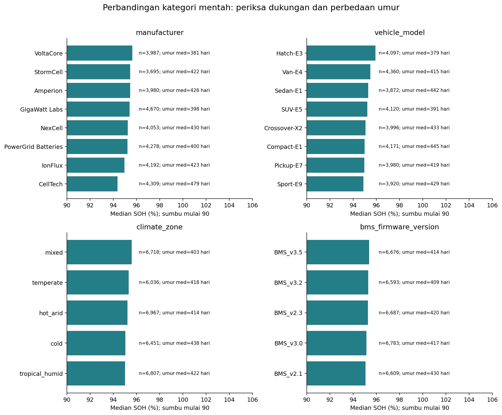

Kategori produsen/model/iklim/firmware dibandingkan bersama dukungan dan median umur. Sumbu SOH dimulai 90% agar variasi terlihat dan ditandai eksplisit. Selisih kecil tidak otomatis penting; perbedaan usia dapat menjelaskan sebagian perbedaan mentah. Jangan menyebut merek/model fiktif paling awet tanpa kontrol kondisi dan validasi lebih lanjut.

## 7. Missingness: apa yang hilang dan apakah terkait kondisi?

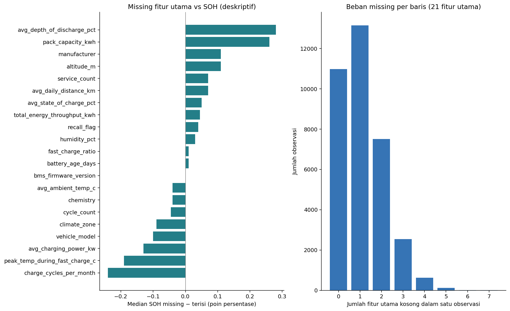

Perbedaan median missing–terisi hanya ringkasan deskriptif: missing dapat terkait kondisi, sumber injeksi, atau komposisi kelompok. Selisih kecil tidak membuktikan data Missing Completely At Random. Korelasi indikator missing (`missingness_phi.csv`) dan semua pasangan terurut (`missingness_pairs.csv`) disimpan tanpa mengubah data. Nilai maksimum |phi| sekitar 0.017 pada train, sehingga tidak tampak ko-missing linear besar pada pasangan indikator yang diperiksa; ketergantungan nonlinear atau bersyarat belum dikesampingkan.

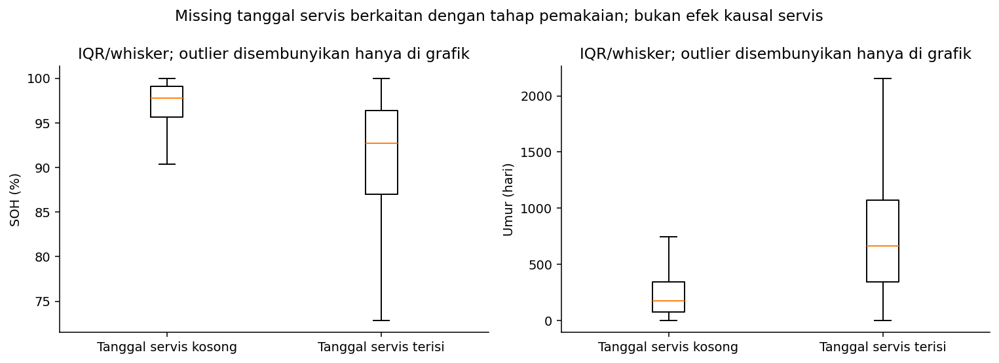

Median SOH untuk tanggal servis kosong adalah **97.79%**, dibanding **92.70%** ketika terisi; median umur masing-masing **174** dan **662** hari. Ini konsisten dengan tahap penggunaan berbeda, **bukan** bukti servis menurunkan kesehatan. Tidak melakukan pengisian tanggal dan tidak menambahkan indikator servis sebagai fitur melalui notebook ini.

## 8. Outlier dan sensitivitas kesimpulan

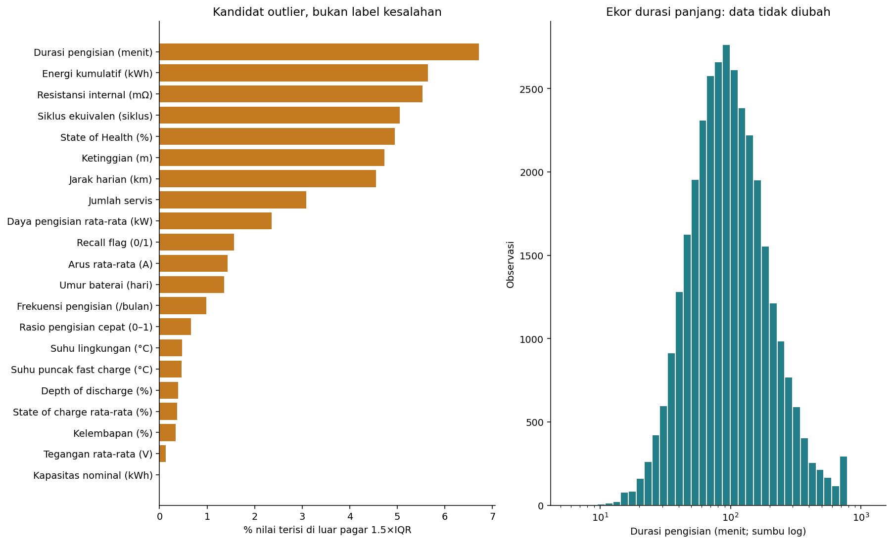

Pagar 1.5×IQR hanya menandai nilai ekstrem terhadap distribusi train. Nilai target rendah dan flag biner langka juga dapat ditandai IQR tanpa menjadi kesalahan. Jangan menerapkan satu aturan ini untuk menghapus seluruh outlier.

Histogram durasi menggunakan sumbu log agar ekor terlihat; nilai asli tidak dilog-transform untuk model. `outlier_association_sensitivity.csv` membandingkan Spearman semua pasangan dengan pasangan di dalam pagar IQR fitur tersebut. Ini analisis sensitivitas, bukan keputusan membuang baris; denominator perbandingan dicatat. Untuk recall_flag, pagar IQR menyisakan hanya 0 sehingga korelasi setelah penyaringan tidak terdefinisi dan dibiarkan kosong. Untuk siklus/umur/energi, hubungan negatif kuat tetap tampak pada subset di dalam pagar, tanpa membuktikan bahwa penghapusan outlier akan memperbaiki prediksi. Tidak ada mask resmi outlier injeksi untuk menilai apakah titik tertentu pasti salah.

## 9. Struktur temporal dan konsistensi simulator

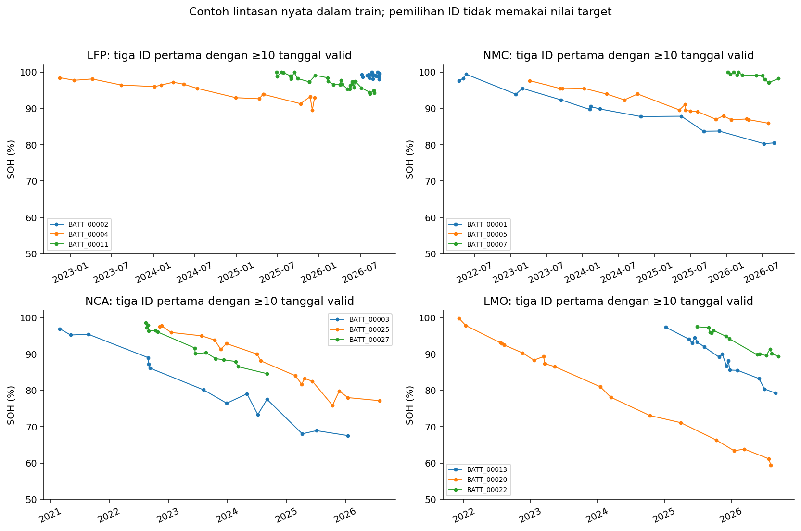

Contoh dipilih secara deterministik: tiga ID pertama secara alfabet dalam setiap kimia dengan ≥10 observasi bertanggal. Nilai SOH tidak dipakai untuk memilih contoh. Lintasan ini tidak merangkum seluruh populasi; tanggal yang kosong tidak dibuat-buat atau dihubungkan sebagai interval yang diketahui.

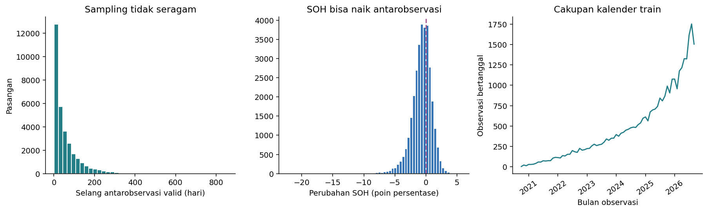

| label | rows | pct_pairs |
| --- | --- | --- |
| turun >0.01 pp | 20498 | 65.015 |
| stabil ±0.01 pp | 670 | 2.125 |
| naik >0.01 pp | 10360 | 32.86 |

Selisih dihitung antarobservasi bertanggal valid dari baterai sama, pada tanggal yang meningkat. Pasangan dapat melompati observasi yang tanggalnya kosong. Perubahan SOH dibulatkan ke presisi pencatatan 0.01 poin sebelum klasifikasi naik/stabil/turun, agar artefak floating-point tidak menggeser nilai tepat di batas. Karena selang waktu berbeda, histogram ΔSOH **bukan laju degradasi per hari**. SOH naik pada sebagian pasangan; sumber menyebut data sintetis/noisy, tetapi mekanisme tiap kenaikan tidak dapat dipastikan tanpa generator. Counter siklus/energi yang turun sudah teridentifikasi pada audit sebelumnya.

**Implikasi:** mempertahankan baseline tabular dan menunda timesteps tetap masuk akal. Jangan memaksa monoton atau menyortir berdasarkan target untuk merapikan lintasan. Group split menguji baterai baru, bukan periode kalender baru.

## 10. Target alternatif: dipahami, bukan dimasukkan ke input

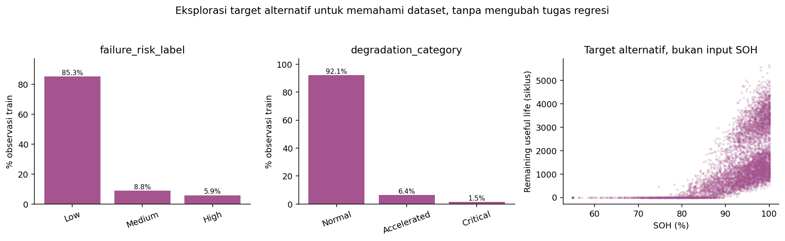

Label risiko/degradasi membantu membaca komposisi simulator dan ketimpangan kelas, tetapi tugas tetap regresi SOH. Pada train, risiko Low/Medium/High masing-masing sekitar 85.26%/8.84%/5.90%, konsisten dengan perkiraan komposisi yang disebut sumber. Degradasi Normal mencapai 92.13%. RUL/risiko/degradasi tidak dijadikan fitur atau tugas tambahan. Kolom capacity_fade_pct memiliki identitas langsung 100−SOH dan tetap dilarang; korelasi sempurna bukan prestasi prediktif.

## 11. Keputusan yang didukung EDA dan yang belum diputuskan

| Temuan | Implikasi tahap berikutnya | Batas kesimpulan |
| --- | --- | --- |
| Target condong ke SOH tinggi | Analisis error per rentang SOH dan per baterai | Tidak otomatis menyeimbangkan target kontinu |
| Umur/siklus/energi berkaitan kuat | Kandidat fitur penting; uji subset redundan nanti | Tidak menyatakan ketiganya penyebab independen |
| Kimia berbeda pada rentang umur sama | Pertahankan kimia sebagai kandidat; pertimbangkan interaksi nonlinear | Belum mengontrol seluruh kondisi penggunaan |
| Missing numerik/kategori dan servis struktural | Rancang imputasi train-only dan encoding kategori baru | Jangan menganggap semua missing setara/MCAR |
| Rentang fitur sangat berbeda | Standardisasi numerik sebagai baseline preprocessing | Statistik scaler belum dihitung/disimpan untuk model |
| Ekor sensor/nilai langka | Evaluasi penanganan outlier terarah dan sensitivitas | IQR bukan ground truth kesalahan |
| Pengamatan berulang dan kualitas waktu | Pertahankan group split, tunda timestep | Tidak mengklaim forecasting |
| Proxy dan target turunan | Tetap keluarkan kebocoran; sensor hanya ablation terpisah | Bukan larangan universal terhadap sensor terukur nyata |

Daftar fitur awal **tidak diubah**. Belum ada feature selection berbasis skor, model, imputer, encoder, scaler, balancing, atau tuning. Fokus pekerjaan ini hanya pemahaman data.

## 12. Reproduksi dan bahan penilaian EDA

- Notebook: `../../notebooks/01_eda_train.ipynb`, berisi pertanyaan, metode, tabel, gambar, interpretasi, dan pemeriksaan.
- Perintah dari root: `python -m src.eda` dan `python scripts/run_notebook.py notebooks/01_eda_train.ipynb`.
- Semua 35 kolom tercantum pada `column_coverage.csv`, termasuk ID/tanggal/target alternatif dengan peran yang jelas.
- Seluruh tabel merupakan hasil hitung aktual train; grafik tersimpan sebagai PNG resolusi 140 dpi dan SVG untuk ekspor laporan.
- Tidak menggunakan p-value naif antarbaris, tidak menyimpulkan sebab akibat, dan tidak mengintip holdout untuk menyempurnakan narasi.

Keterbatasan utama: data sintetis, generator tidak tersedia, interval fitur agregat tidak lengkap, missing/outlier tanpa mask asli, pengamatan berulang, sel kelompok dengan dukungan kecil, dan confounding yang belum seluruhnya dikontrol.
