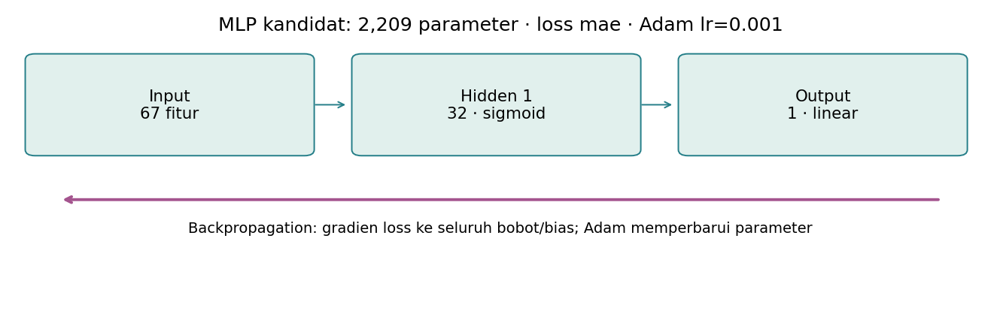
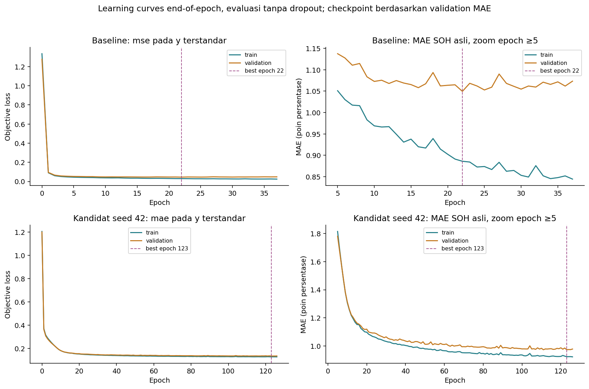
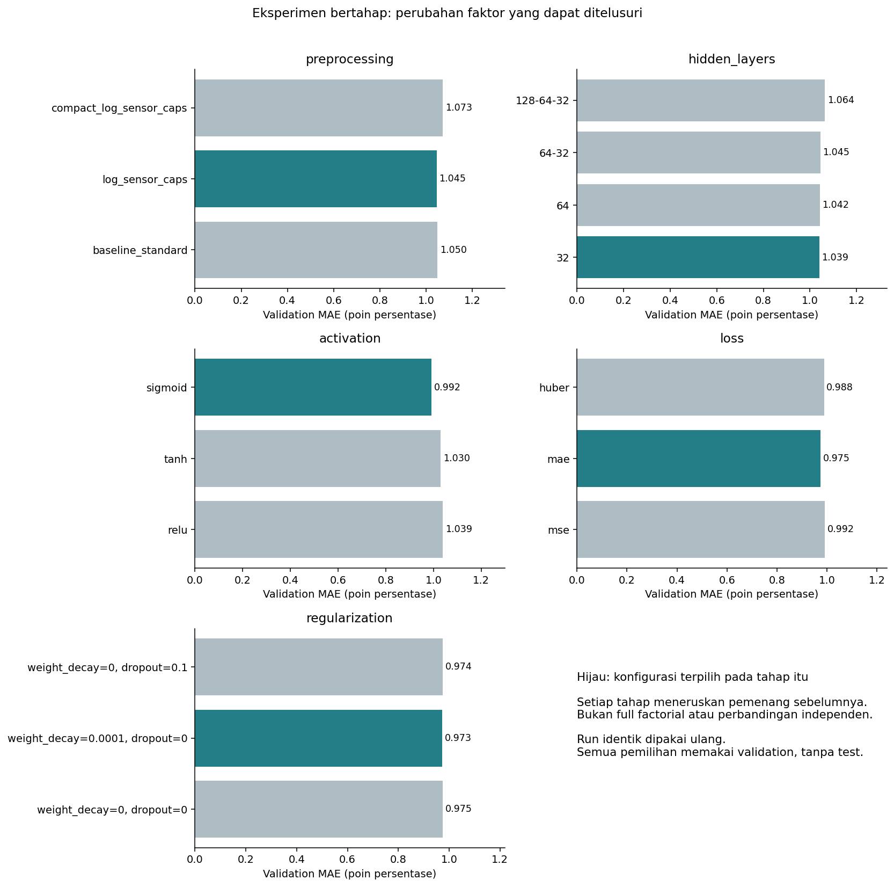
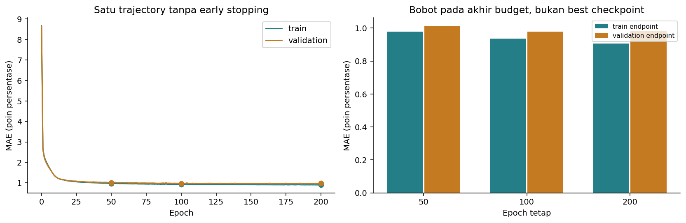
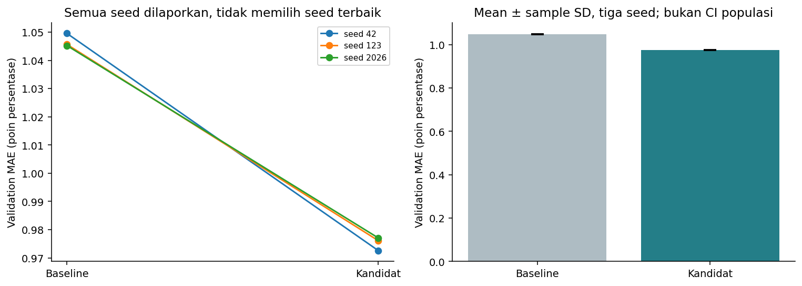
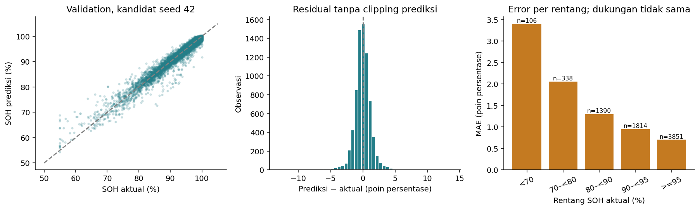

# Eksperimen MLP dengan Backpropagation

## Hasil utama dan status

- **17 run unik** selesai, termasuk konfirmasi tiga seed. Run identik digunakan ulang, bukan dihitung sebagai eksperimen baru.
- Baseline: validation MAE **1.0495** poin persentase SOH, train **0.8861**; best epoch 22 dari 37 epoch aktual.
- Kandidat seed 42: validation MAE **0.9726**, RMSE **1.4973**, R² **0.9545**. Ini hasil validation yang dipakai berulang selama pencarian, bukan performa test independen.
- Konfirmasi baseline: mean MAE **1.0468 ± 0.0024**; kandidat **0.9752 ± 0.0024**, tiga seed pada split tetap.
- Semua model prediksi adalah **MLP feedforward dengan backpropagation**. Test tidak dimuat/dievaluasi. Belum ada evaluasi akhir notebook 04 atau klaim generalisasi pada baterai nyata.

## 1. Data dan batas evaluasi

Train 34.929 baris, validation 7.499 baris, grup baterai tidak tumpang tindih. Input berasal dari tiga fitted preprocessing recipe, semuanya fit train-only. Target dilatih pada skala terstandar dan metrik dikembalikan ke SOH asli melalui target scaler yang cocok.

Runner hanya meminta split `train` dan `validation`; ada pengujian yang menolak jika loader meminta `test`. Tidak menjalankan ulang preprocessing, membentuk fitur domain baru, mengubah split, atau memakai label turunan target. Feature engineering domain masih merupakan eksperimen lanjutan setelah baseline ini.

## 2. Arsitektur, forward pass, dan backpropagation

Untuk layer l: `z[l] = W[l] a[l-1] + b[l]`, lalu `a[l] = activation(z[l])`. Output berupa satu neuron linear yang memprediksi SOH terstandar. Semua linear layer memakai Xavier uniform gain=1 dan bias nol sebagai kebijakan inisialisasi yang sama antaraktivasi.

Di setiap mini-batch:
1. Bersihkan gradien sebelumnya (`optimizer.zero_grad`).
2. Hitung prediksi dengan forward pass dan loss terhadap y_scaled.
3. `loss.backward()` menghitung gradien setiap bobot/bias dengan chain rule.
4. Adam memperbarui parameter (`optimizer.step`).

PyTorch 2.11.0 menyediakan autograd; ini backpropagation, bukan ELM atau algoritma JST lain. Implementasi manual dari nol tidak menjadi asumsi tugas. Test terpisah mencocokkan gradien satu jaringan kecil dengan contoh hitung manual di CONTEXT.md.

Semua kandidat memiliki minimal satu hidden layer nonlinear. Bias, jumlah parameter, output shape `(N,)` termasuk batch satu, dan hilangnya dropout saat evaluasi diperiksa. Tidak ada CNN/RNN/Transformer atau model non-MLP.

## 3. Konfigurasi acuan

Baseline: input 67, hidden [64,32], ReLU, loss MSE, output linear, Adam learning rate 0.001, batch **256**, maksimum 200 epoch, patience 15, min_delta 0.001 poin SOH, tanpa dropout/weight decay. Batch 256 menggantikan rekomendasi awal 32 demi pelatihan CPU yang praktis; nilai ini tetap pada seluruh pembanding dan tidak dituning dari validation. CPU dua thread, seed 42 untuk pencarian.

| model | recipe | hidden | activation | loss | input | parameters | best_epoch | epochs_actual | train_MAE_pp | validation_MAE_pp | validation_RMSE_pp | validation_R2 |
| --- | --- | --- | --- | --- | --- | --- | --- | --- | --- | --- | --- | --- |
| Baseline seed 42 | baseline_standard | [64, 32] | relu | mse | 67 | 6465 | 22 | 37 | 0.8861 | 1.0495 | 1.535 | 0.9522 |
| Kandidat seed 42 | log_sensor_caps | [32] | sigmoid | mae | 67 | 2209 | 123 | 126 | 0.9228 | 0.9726 | 1.4973 | 0.9545 |

Kurva objective train/validation dihitung pada bobot yang sama di akhir epoch, dalam mode eval sehingga dropout nonaktif. `batch_objective_scaled` di history adalah rata-rata mini-batch saat bobot berubah dan dropout aktif; jangan menyamakannya dengan full-train evaluation loss. Panel objective menampilkan sejak epoch 0; panel MAE diperbesar mulai epoch 5 untuk keterbacaan generalization gap. Epoch 0 adalah jaringan sebelum update dan hanya titik acuan, bukan checkpoint terpilih.

## 4. Early stopping dan checkpoint

Checkpoint `best.pt` selalu menyimpan **MAE validation minimum persis** pada epoch training 1..N, bukan hanya perbaikan yang melewati min_delta. Patience direset bila ada perbaikan signifikan >min_delta terhadap referensi patience. Dengan demikian perbaikan kecil tetap tersimpan meski tidak mereset patience.

`last.pt` menyimpan bobot pada epoch terakhir. File menyertakan state_dict, optimizer, konfigurasi, nama input, fingerprint data, epoch, serta RNG torch/shuffle. Checkpoint terbaik dimuat ulang dan MAE-nya direkonsiliasi dengan nilai minimum history. Cache hanya menggunakan run **selesai** dengan fingerprint dan file checkpoint yang cocok. Run terputus dapat diulang dari awal; runner belum menawarkan resume tengah-epoch.

Semua checkpoint di `models/mlp/<run_id>/` disimpan lokal dan diabaikan Git. Konfigurasi, history, ringkasan, dan daftar run tetap dibagikan. Rerun dari clone baru melatih ulang bila checkpoint lokal belum ada; tidak menyajikan bobot rekaan.

## 5. Matriks eksperimen bertahap

Tahap: preprocessing → hidden layer → aktivasi → loss → dua probe regularisasi. Pemenang MAE validation seed 42 diteruskan ke tahap berikutnya. Arsitektur [32], [64], [64,32], [128,64,32]; aktivasi ReLU/tanh/sigmoid; loss MSE/MAE/Huber. Huber delta=1 pada target terstandar, setara 7.1927 poin persentase SOH pada versi data ini.

File `stage_comparisons.csv` mencatat setiap kandidat dan pilihan. Ini pencarian berurutan, **bukan full factorial**: tidak mengisolasi seluruh interaksi faktor dan tidak membuktikan optimum global. Tidak membandingkan angka loss mentah lintas MSE/MAE/Huber; keputusan memakai MAE pada skala asli. Weight decay berlaku pada Adam; objective loss yang diplot tidak menambahkan penalti optimizer secara eksplisit.

Resep log/cap mengubah beberapa transformasi sekaligus; compact menguji pengurangan dua fitur. Kesimpulan manfaat tiap transformasi sendiri masih memerlukan ablation tersendiri. Probe dropout 0.1 dan weight decay 1e-4 menguji regularisasi, tanpa otomatis menyimpulkan keduanya pasti memperbaiki generalisasi.

## 6. Eksperimen epoch yang benar-benar berbeda

| epoch | train_mae | validation_mae | validation_rmse | validation_r2 |
| --- | --- | --- | --- | --- |
| 50 | 0.9784 | 1.0118 | 1.5653 | 0.9503 |
| 100 | 0.9355 | 0.9785 | 1.5084 | 0.9538 |
| 200 | 0.9076 | 0.9809 | 1.499 | 0.9544 |

Tabel memakai bobot **endpoint epoch 50, 100, 200** dari satu trajectory tanpa early stopping, dengan seed/urutan batch yang sama. Endpoint bukan checkpoint minimum sebelum epoch tersebut. Karena trajectory bersarang, ini eksperimen budget terkontrol, bukan tiga replikasi independen. Model fixed-epoch tidak dipakai memilih ulang kandidat; tabel ini menjelaskan efek melanjutkan training. Best checkpoint diagnostik trajectory 200 epoch ada di epoch 191 (MAE 0.9669), berbeda dari endpoint 200. Perbaikan yang muncul setelah early stopping menunjukkan patience hanyalah heuristik dan dapat melewatkan perbaikan terlambat. Run diagnostik ini sengaja tidak dipromosikan diam-diam menjadi kandidat dari protokol early stopping.

## 7. Konfirmasi seed dan batas ketidakpastian

| group | seed | run_id | validation_mae_pp | validation_rmse_pp | validation_r2 | train_mae_pp | best_epoch |
| --- | --- | --- | --- | --- | --- | --- | --- |
| baseline | 42 | run_83aa5197bac6 | 1.0495 | 1.535 | 0.9522 | 0.8861 | 22 |
| baseline | 123 | run_567cd20b04c3 | 1.0456 | 1.526 | 0.9527 | 0.8805 | 23 |
| baseline | 2026 | run_e8aecfd9751c | 1.0452 | 1.5337 | 0.9523 | 0.8693 | 22 |
| candidate | 42 | run_417429878fc7 | 0.9726 | 1.4973 | 0.9545 | 0.9228 | 123 |
| candidate | 123 | run_312fdc17ada1 | 0.9761 | 1.5 | 0.9543 | 0.9285 | 116 |
| candidate | 2026 | run_73d0ae8e6140 | 0.9771 | 1.508 | 0.9538 | 0.9323 | 100 |

SD menggunakan sample standard deviation (ddof=1) dari tiga seed inisialisasi/pengacakan training. Bukan confidence interval baterai/populasi atau ketidakpastian semua kemungkinan split. Konfigurasi kandidat dikunci dari pencarian seed 42 sebelum konfirmasi; tidak memilih seed terbaik untuk dilaporkan. Evaluasi akhir kelak harus mencakup seluruh seed final yang ditetapkan.

Jika keunggulan terhadap baseline kecil atau tidak konsisten antar-seed, jangan menyebut satu konfigurasi pasti lebih baik. Validation telah digunakan untuk banyak keputusan sehingga estimasi ini bisa optimistis; test independen tetap diperlukan.

## 8. Analisis error validation

| soh_band | rows | batteries | mae_pp |
| --- | --- | --- | --- |
| <70 | 106 | 28 | 3.4 |
| 70–<80 | 338 | 80 | 2.0567 |
| 80–<90 | 1390 | 218 | 1.298 |
| 90–<95 | 1814 | 305 | 0.9519 |
| >=95 | 3851 | 384 | 0.7029 |

Residual bertanda adalah prediksi−aktual. Tidak memotong prediksi ke 0..100 demi mempercantik metrik. Kandidat seed 42 menghasilkan 0.413% prediksi di luar batas tersebut. Selain MAE per observasi, rerata MAE per baterai kandidat adalah **0.9765** poin, sehingga baterai dengan banyak baris tidak selalu mendominasi ringkasan kedua.

Rentang SOH rendah lebih jarang menurut EDA. Baca error per rentang bersama n dan jumlah baterai; skor agregat bagus tidak menjamin semua kondisi sama baik. Analisis ini tetap validation; jangan mengubah kebijakan berdasarkan test nanti.

## 9. Pemeriksaan kewajaran terhadap konstanta train

| reference | constant_soh | mae | rmse | r2 | bias_pp | outside_0_100_pct | battery_mean_mae |
| --- | --- | --- | --- | --- | --- | --- | --- |
| train_median | 95.23 | 4.9432 | 7.3623 | -0.1 | 2.2199 | 0.0 | 4.9363 |
| train_mean | 92.9187 | 5.2697 | 7.0202 | -0.0002 | -0.0913 | 0.0 | 5.2737 |

Konstanta median/rerata train bukan algoritma ML pesaing dan tidak belajar dari validation; ini kontrol kewajaran agar MLP tidak dianggap berhasil hanya karena target dominan SOH tinggi. Model prediksi yang dilatih tetap hanya MLP/backpropagation.

## 10. Overfitting, underfitting, dan yang belum dapat diklaim

Pada checkpoint terpilih, gap validation−train MAE baseline **0.1634** poin dan kandidat **0.0498** poin. Gap perlu dibaca bersama seluruh kurva, bukan satu ambang universal. Bertambahnya epoch dapat memperbaiki train dan memperburuk validation; eksperimen budget dan early stopping memperlihatkan perilaku aktualnya.

Underfitting bukan sekadar “R² kurang dari angka tertentu”. Periksa apakah train loss tetap tinggi, apakah melebihi kontrol konstanta, dan apakah kapasitas/optimasi belum memadai. Kecilnya gap juga tidak membuktikan model pasti bebas masalah, terutama pada data sintetis dan split terbatas.

## 11. Artefak, reproduksi, dan pemeriksaan

- `configs/mlp_study.json`: konfigurasi/protokol yang dipakai.
- `results/experiments/run_summary.csv`: satu baris per training run unik.
- `runs/<run_id>/`: config, history, summary, dan status. Prediksi per-baris validation dibuat lokal dan diabaikan Git.
- `models/mlp/<run_id>/`: best/last serta endpoint checkpoint fixed-epoch; lokal, diabaikan Git.
- `study.json`: kandidat sementara, baseline, seed, fingerprint, versi, dan status test belum dimuat.

Perintah: `python -m src.mlp_experiments`; atau jalankan notebook 03. Cache memakai source/data/config fingerprint, sehingga notebook dapat menampilkan ulang run yang sudah selesai. Ubah source/config/data secara sengaja bila bereksperimen dan catat hasil baru; jangan mengedit skor CSV manual. Determinisme dikonfigurasi pada CPU ini, namun hasil numerik lintas versi/hardware tidak dijamin identik.

Pengujian mencakup gradien manual vs autograd, parameter count, batch satu, eval/dropout, metrik, loader tanpa test, checkpoint epoch minimum, reload prediksi, dan cache. Hasil data aktual juga diverifikasi melalui notebook.

## 12. Langkah setelah notebook ini

Kandidat masih **sementara berdasarkan validation**. Feature engineering domain dapat diuji sebagai tahap lanjutan dengan prosedur yang sama sebelum konfigurasi final dibekukan. Setelah seluruh keputusan disepakati, barulah notebook 04 mengevaluasi test satu tahap akhir pada baseline/kandidat serta semua seed final yang dikunci. Tidak membuat klaim performa dunia nyata dari dataset sintetis ini.

Referensi: [optimasi dan backward PyTorch](https://docs.pytorch.org/tutorials/beginner/basics/optimization_tutorial.html), [checkpoint state_dict](https://docs.pytorch.org/tutorials/beginner/saving_loading_models.html), [reproducibility](https://docs.pytorch.org/docs/stable/notes/randomness.html). Versi runtime dipin pada PyTorch 2.11.0; dokumentasi stable dapat menunjukkan versi lebih baru.
