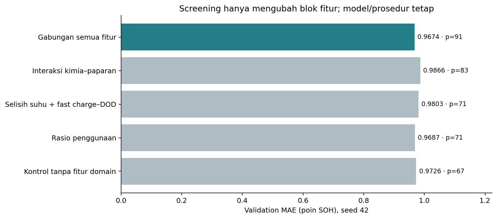
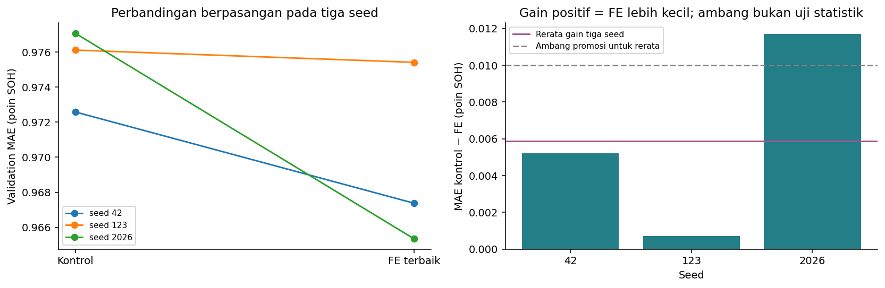
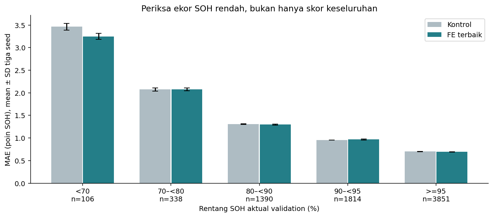
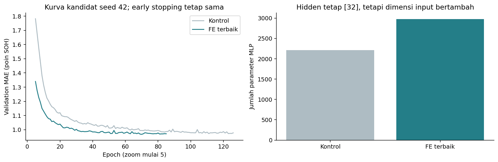

# Ablation Feature Engineering untuk MLP

## Hasil dan rekomendasi

**Rekomendasi: pertahankan kontrol tanpa fitur domain sebagai kandidat utama.** Fitur baru benar-benar diuji; peningkatan kecil tidak otomatis dijadikan alasan menambah kompleksitas.

- Kontrol adalah kandidat notebook 03, **bukan** baseline awal [64,32] ReLU.
- Mean validation MAE tiga seed: kontrol **0.97525 ± 0.00236**, FE terbaik **0.96938 ± 0.00532** poin SOH.
- Gain berpasangan rerata **0.00587 poin** (0.60% relatif terhadap MAE kontrol), menang pada **3/3** seed.
- Input kontrol 67, FE terbaik 91. Parameter 2,209 → 2,977 (**+34.8%**), hidden tetap [32].
- Ambang promosi yang ditetapkan sebelum training: gain rerata minimal **0.01 poin** dan menang minimal dua seed. Lolos: **False**. Ini heuristik praktis, bukan uji signifikansi atau ambang fisika baterai.
- Test tidak ditransform, tidak dimuat sebagai array, dan tidak dievaluasi. Data sintetis tetap membatasi generalisasi.

## 1. Pertanyaan dan protokol

Apakah fitur turunan menurunkan error MLP jika hidden, aktivasi, output, loss, learning rate, batch, seed, dan aturan checkpoint/early stopping sama? Kontrol dibekukan dari run `run_417429878fc7`: log_sensor_caps, hidden [32], sigmoid, output linear, MAE, Adam lr=0.001, batch 256, weight_decay=1e-4, dropout 0, max 200 epoch, patience 15.

Screening empat varian dilakukan pada seed 42, lalu hanya FE dengan MAE screening terkecil dikonfirmasi pada 42/123/2026. Tiga run kontrol yang sudah ada dipakai ulang dengan fingerprint yang sama. Ada **6 run training baru** dalam versi final ini; riwayat study notebook 03 tetap utuh.

Validation dipakai untuk screening dan konfirmasi, sehingga hasil ini belum evaluasi independen akhir. Tidak menjalankan pencarian tanpa batas sampai hasil terlihat bagus dan tidak memilih seed terbaik.

## 2. Definisi fitur

| block | feature | formula | unit |
| --- | --- | --- | --- |
| usage_rates | fe_cycles_per_day | cycle_count / battery_age_days | siklus/hari; rasio snapshot |
| usage_rates | fe_energy_per_cycle_kwh | total_energy_throughput_kwh / cycle_count | kWh/siklus |
| context | fe_charge_ambient_delta_c | peak_temp_during_fast_charge_c - avg_ambient_temp_c | °C |
| context | fe_fastcharge_dod_interaction | fast_charge_ratio * avg_depth_of_discharge_pct / 100 | interaksi rasio |
| chemistry | fe_chem_<kimia>_log_cycles | I(chemistry=kimia) * log1p(cycle_count) | interaksi; 4 kolom dari kimia train |
| chemistry | fe_chem_<kimia>_log_age_years | I(chemistry=kimia) * log1p(battery_age_days / 365.25) | interaksi; 4 kolom dari kimia train |

Chemistry dipelajari dari kategori nonmissing pada encoder train yang telah dibekukan. Untuk kimia diketahui, interaksi kategori yang tidak cocok bernilai nol; untuk kimia missing/baru atau exposure missing, fitur interaksi menjadi missing. Tidak menyamaratakan unknown menjadi salah satu kimia yang dikenal.

Rasio hanya dihitung jika denominator >0 dan kedua operand terisi setelah pemeriksaan domain. Tidak memakai epsilon/floor yang mengubah arti pembagian. Nilai yang tidak tersedia dipertahankan sebagai missing sebelum imputasi ekstra. Tidak memakai target, capacity_fade_pct, RUL, label risiko/degradasi, ID, data masa depan, atau group fill.

Rasio kumulatif adalah ringkasan snapshot, bukan estimasi laju degradasi atau bukti mekanisme fisik. Counter siklus/energi yang tidak selalu monoton tetap menjadi keterbatasan sumber; feature engineering tidak memperbaikinya secara otomatis.

## 3. Preprocessing ekstra dan fairness

Seluruh **67 output base pipeline tetap bit-for-bit sama** sebagai prefix input. Fitur baru diappend bersama indikator missing masing-masing. Median, batas cap 0.5%/99.5% untuk dua rasio dan delta suhu, serta scaler ekstra di-fit hanya train. Dua rasio memakai signed log1p setelah cap; interaksi kimia sudah dibentuk pada log exposure dan tidak dilog dua kali. Fast charge–DOD tidak dicap karena sudah berupa produk rasio yang valid.

Target scaler dipakai ulang tanpa refit. Tidak menghapus observasi atau SOH rendah. Tidak ada array test baru. CSV sumber dibaca secara chunk dengan kolom input+ID saja; baris test dibuang saat loading sebelum aritmetika/statistik. Label target tidak diambil dari pembacaan CSV ini.

Konfigurasi MLP sama kecuali jumlah input dan parameter yang mengikuti dimensi. Karena parameter bertambah, ablation ini mengukur paket representasi fitur+kapasitas input, bukan mengisolasi efek kausal fitur pada jumlah parameter identik. Seluruh jumlah parameter dicatat.

## 4. Screening

| variant | run_id | seed | input_neurons | parameters | train_mae_pp | validation_mae_pp | validation_rmse_pp | validation_r2 | best_epoch | epochs_actual |
| --- | --- | --- | --- | --- | --- | --- | --- | --- | --- | --- |
| control_no_domain_features | run_417429878fc7 | 42 | 67 | 2209 | 0.92277 | 0.97258 | 1.49731 | 0.9545 | 123 | 126 |
| fe_usage_rates | run_5b7a4eefc1a0 | 42 | 71 | 2337 | 0.91587 | 0.96871 | 1.48088 | 0.95549 | 82 | 97 |
| fe_context | run_0c7f8ab3b7d9 | 42 | 71 | 2337 | 0.93156 | 0.98029 | 1.5091 | 0.95378 | 82 | 97 |
| fe_chemistry | run_b5ff9581a95f | 42 | 83 | 2721 | 0.94149 | 0.98656 | 1.52395 | 0.95287 | 55 | 67 |
| fe_combined | run_e19f105ebb61 | 42 | 91 | 2977 | 0.91642 | 0.96738 | 1.47532 | 0.95583 | 70 | 85 |

Pemenang screening adalah `fe_combined`. Sebuah blok dapat memperburuk hasil; bukan semua fitur turunan harus dipakai. Tidak menghapus hasil varian yang kalah. Screening satu seed dapat sensitif terhadap optimasi, sehingga disertai konfirmasi tiga seed. Hanya pemenang screening yang dikonfirmasi; selisih sangat kecil dengan varian rasio tidak membuktikan peringkat tersebut stabil pada seed lain.

## 5. Konfirmasi berpasangan

| variant | n_seeds | mae_mean_pp | mae_sd_pp | rmse_mean_pp | r2_mean | parameters |
| --- | --- | --- | --- | --- | --- | --- |
| control_no_domain_features | 3 | 0.97525 | 0.00236 | 1.50177 | 0.95423 | 2209 |
| fe_combined | 3 | 0.96938 | 0.00532 | 1.48237 | 0.9554 | 2977 |

| seed | control_no_domain_features | fe_combined | mae_improvement_pp |
| --- | --- | --- | --- |
| 42 | 0.97258 | 0.96738 | 0.0052 |
| 123 | 0.9761 | 0.97541 | 0.0007 |
| 2026 | 0.97706 | 0.96535 | 0.01171 |

SD adalah sample SD tiga seed pada split tetap, bukan CI populasi atau bukti signifikansi. Ambang 0.01 poin berlaku pada **rerata gain**, bukan syarat tiap seed. Menang tiga seed dapat menunjukkan arah konsisten pada seed yang diuji, tetapi n=3 dan besarnya gain tetap perlu dipertimbangkan.

## 6. Ekor SOH rendah dan kompleksitas

| variant | band | n_rows | batteries | mae_mean_pp | mae_sd_pp |
| --- | --- | --- | --- | --- | --- |
| control_no_domain_features | <70 | 106 | 28 | 3.46259 | 0.07584 |
| control_no_domain_features | 70–<80 | 338 | 80 | 2.07372 | 0.03321 |
| control_no_domain_features | 80–<90 | 1390 | 218 | 1.30747 | 0.01038 |
| control_no_domain_features | 90–<95 | 1814 | 305 | 0.95365 | 0.00178 |
| control_no_domain_features | >=95 | 3851 | 384 | 0.70063 | 0.00618 |
| fe_combined | <70 | 106 | 28 | 3.24724 | 0.06555 |
| fe_combined | 70–<80 | 338 | 80 | 2.07532 | 0.02963 |
| fe_combined | 80–<90 | 1390 | 218 | 1.29632 | 0.01309 |
| fe_combined | 90–<95 | 1814 | 305 | 0.96717 | 0.01153 |
| fe_combined | >=95 | 3851 | 384 | 0.69264 | 0.00586 |

Baca mean error tiap band bersama jumlah observasi/baterai dan variasi seed. Jumlah baterai antarband dapat tumpang tindih. Tidak mempromosikan suatu fitur hanya karena satu kelompok validation kecil tampak lebih bagus.

Learning curves adalah validation seed 42, zoom epoch ≥5. Perbedaan epoch aktual mengikuti aturan early stopping yang sama. Penambahan fitur meningkatkan jumlah parameter; menambah fitur bukan jaminan menghilangkan overfitting/underfitting.

## 7. Diagnostik fitur train

`train_feature_diagnostics.csv` berisi missing, rentang raw, median, cap, scaler, dan korelasi target **train**. Kolom parameter per varian dan nama fitur output juga disimpan. Korelasi hanya membantu interpretasi; tidak dipakai untuk memilih subset tambahan setelah melihat hasil validation. Pada train, dua rasio kosong sekitar 10.38% dan 11.07%, sebab jika salah satu operand kosong hasil juga kosong. Fitur turunan tidak menambah pengukuran independen dan dapat meningkatkan redundansi/kompleksitas, sehingga peningkatan kecil masuk akal tanpa membuktikan penyebabnya. Fitur rasio yang kuat berkaitan dengan fitur asal dapat redundan, dan interaksi kimia bukan informasi fisik baru.

## 8. Artefak dan reproduksi

- Notebook `03b_feature_engineering_ablation.ipynb`, terpisah agar study 03 tidak ditulis ulang.
- Config: `configs/feature_engineering.json`.
- Kode: `src/feature_engineering.py`, memakai training loop MLP yang sama tanpa modifikasi.
- Array train/validation FE: `data/processed/<variant>/`, lokal dan diabaikan Git.
- Bundle inference: `models/feature_engineering/<variant>.joblib`; `bundle['preprocessor'].transform(new_rows[bundle['required_columns']])` menghitung base+fitur ekstra konsisten. Load hanya artefak tepercaya.
- Checkpoint MLP: `models/mlp/<run_id>/`, lokal. Config/history/summary/status ada di `results/experiments/runs/<run_id>/`.
- Ringkasan study: `results/feature_engineering/study.json`. Kontrol tetap tercatat di `results/experiments/study.json`; tidak diganti diam-diam.

Reproduksi: `python -m src.feature_engineering`, `python -m src.feature_reporting`, kemudian jalankan notebook 03b. Run dengan fingerprint source/data/config sama dipakai ulang. Untuk cross-validation, fit base serta ekstra pada tiap fold-train; jangan memakai fitted global-train untuk fold-validation.

## 9. Batas kesimpulan dan langkah berikutnya

Hasil saat ini mendukung **pertahankan kontrol tanpa fitur domain sebagai kandidat utama** menurut aturan praktis yang telah ditetapkan, sambil menyimpan FE sebagai hasil ablation yang sah. Tidak ada kebutuhan memaksakan FE agar selalu menang. Keputusan ini belum klaim statistik populasi, skor test, atau validitas pada baterai nyata.

Langkah berikutnya adalah meninjau rekomendasi, lalu mengunci konfigurasi/seed untuk evaluasi test di notebook 04. Jangan memakai test untuk memilih fitur baru atau menyesuaikan ambang keputusan.
