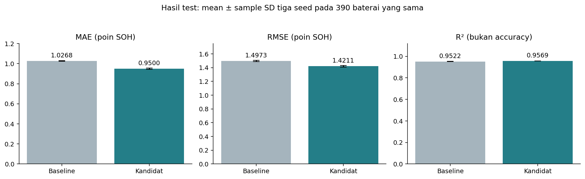
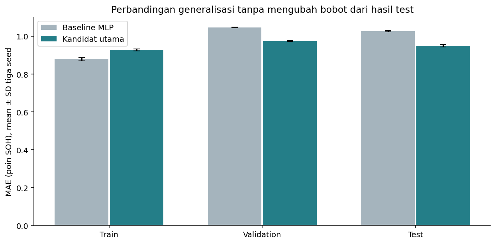
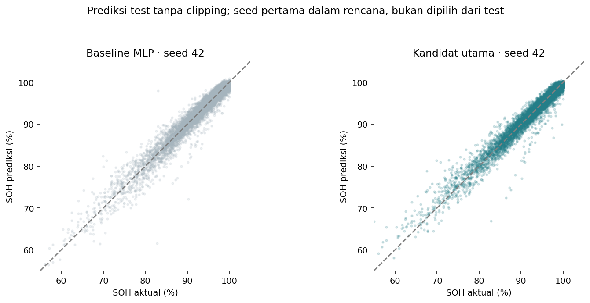
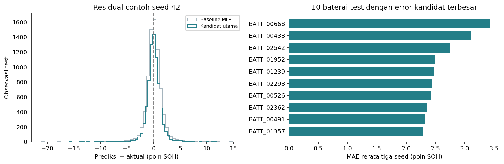
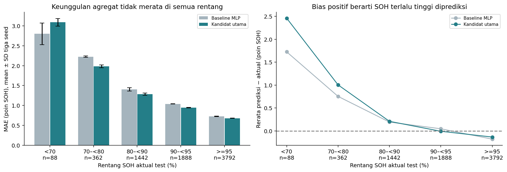
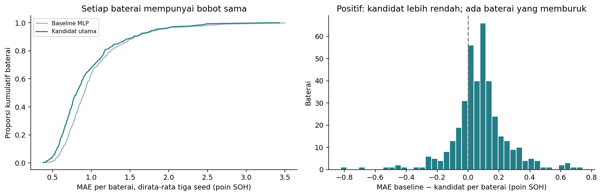

# Evaluasi Akhir MLP Backpropagation

## Hasil utama

Evaluasi final selesai pada **7.572 observasi dari 390 baterai test** yang tidak muncul dalam train/validation. Enam checkpoint dan preprocessing dikunci sebelum prediksi test dihitung. Tidak ada fit, retraining, pemilihan seed, penambahan FE, clipping prediksi, atau tuning setelah melihat test.

- Kandidat utama yang ditetapkan sebelum test: mean MAE **0.95005 ± 0.00619 poin SOH**, RMSE **1.42114 ± 0.01228**, R² **0.95694 ± 0.00074**.
- Baseline MLP: mean MAE **1.02684 ± 0.00311 poin**. Selisih **0.07679 poin**, sekitar **7.48%** relatif terhadap MAE baseline pada test ini.
- Parameter baseline 6,465, kandidat 2,209. Semua hasil memakai seed 42/123/2026, tidak memilih seed test terbaik dan tidak melakukan ensemble.
- Keterbatasan penting: pada **SOH <70%**, MAE kandidat **3.0905** lebih besar daripada baseline **2.8006**, dengan 88 observasi / 23 baterai. Keunggulan agregat tidak berarti kandidat unggul di semua kondisi.

## 1. Apa yang dikunci sebelum test?

Rencana `configs/final_evaluation.json` menetapkan baseline/kandidat dan tiga seed, best checkpoint berdasarkan validation, rentang SOH, serta kandidat sebagai keluarga model utama. Kandidat memakai log_sensor_caps, input 67 → hidden [32] sigmoid → output linear, loss MAE, Adam lr=0.001, weight_decay=1e-4. Baseline memakai input 67 → [64,32] ReLU → output linear, MSE, Adam dengan kebijakan batch/stopping yang sama. Epoch terbaik berasal dari validation, bukan test.

Feature engineering tetap hasil ablation validation. Rekomendasinya sebelum test mempertahankan kandidat 03 tanpa fitur domain tambahan. FE tidak diam-diam dimasukkan kembali ke pembandingan test.

`evaluation_lock.json` dibuat pada `2026-11-06T04:46:57.766275+00:00` sebelum inference test, fingerprint `bd989baf6c7a34b7c7a8cec0c73209b2d95f32deda3d8d4e193089592d74a430`. Lock mencatat SHA-256 enam checkpoint, dua fitted pipeline, array test, konfigurasi, manifest, bukti pemilihan validation/FE, dan source evaluator. Semua berkas yang dikunci diperiksa tetap sama sesudah inference.

## 2. Metrik akhir dan arti satuannya

| group | test_mae_mean_pp | test_mae_sd_pp | test_rmse_mean_pp | test_rmse_sd_pp | test_r2_mean | test_r2_sd | test_battery_mae_mean_pp | parameters |
| --- | --- | --- | --- | --- | --- | --- | --- | --- |
| baseline | 1.02684 | 0.00311 | 1.49732 | 0.00794 | 0.95221 | 0.00051 | 1.02975 | 6465 |
| candidate | 0.95005 | 0.00619 | 1.42114 | 0.01228 | 0.95694 | 0.00074 | 0.9525 | 2209 |

MAE/RMSE dihitung setelah inverse target scaling. MAE 0.95 berarti rata-rata selisih absolut sekitar 0.95 **poin persentase SOH**, bukan accuracy 99.05% dan bukan jaminan semua prediksi memiliki error sebesar itu. R² juga bukan accuracy klasifikasi.

SD adalah sample SD (ddof=1) tiga seed training pada baterai test yang sama; bukan confidence interval populasi, bukan ketidakpastian semua split, dan bukan tiga dataset test independen. Rerata R²/RMSE adalah rerata metrik per seed, bukan metrik ensemble prediksi.

## 3. Hasil setiap seed

| group | seed | run_id | best_epoch_from_validation | test_mae_pp | test_rmse_pp | test_r2 | test_battery_mean_mae_pp |
| --- | --- | --- | --- | --- | --- | --- | --- |
| baseline | 42 | run_83aa5197bac6 | 22 | 1.02867 | 1.50053 | 0.952 | 1.03153 |
| baseline | 123 | run_567cd20b04c3 | 23 | 1.02325 | 1.48827 | 0.95278 | 1.02677 |
| baseline | 2026 | run_e8aecfd9751c | 22 | 1.02859 | 1.50315 | 0.95183 | 1.03096 |
| candidate | 42 | run_417429878fc7 | 123 | 0.94299 | 1.40703 | 0.9578 | 0.94534 |
| candidate | 123 | run_312fdc17ada1 | 116 | 0.95455 | 1.42942 | 0.95644 | 0.95643 |
| candidate | 2026 | run_73d0ae8e6140 | 100 | 0.9526 | 1.42696 | 0.95659 | 0.95571 |

Semua seed tetap ditampilkan, termasuk yang error-nya lebih tinggi. Gambar scatter menggunakan seed 42, yaitu seed pertama dalam rencana yang sudah ada, bukan seed yang dipilih setelah melihat ranking test. Perbandingan utama tetap mean/SD ketiga seed.

## 4. Apakah pola validation bertahan?

| group | train_mae_mean_pp | validation_mae_mean_pp | test_mae_mean_pp | test_minus_validation_pp |
| --- | --- | --- | --- | --- |
| baseline | 0.87863 | 1.0468 | 1.02684 | -0.01996 |
| candidate | 0.92785 | 0.97525 | 0.95005 | -0.0252 |

Test MAE kandidat berada sekitar -0.02520 poin dari validation. Baseline juga memiliki skor test sedikit berbeda. Perbedaan tersebut dapat berasal dari komposisi baterai/sampel pada split; bukan alasan mengubah scaler atau bobot agar hasil cocok. Skor test lebih rendah daripada validation tidak membuktikan kebocoran maupun menjamin generalisasi pada distribusi lain.

Kandidat dipilih sebelum test. Hasil ini mendukung kegunaan kandidat pada test sintetis yang ditahan, tetapi tidak membuktikan bebas overfitting untuk semua data. Kurva train–validation dan proses seleksi tetap dibahas pada notebook 03; test tidak menjadi dataset tuning baru.

## 5. Aktual vs prediksi dan residual

Prediksi tidak dipotong ke 0..100. Rerata proporsi prediksi kandidat di luar rentang itu adalah **0.6207%**; nilai tersebut dilaporkan sebagai keterbatasan output linear. Residual positif berarti model memprediksi SOH lebih tinggi daripada aktual. Rerata bias kandidat pada seluruh test adalah +0.0483 poin, yang tidak boleh menutupi bias lebih besar pada subkelompok.

## 6. Rentang SOH rendah masih menjadi kelemahan

| group | soh_band | rows | batteries | mae_mean_pp | mae_sd_pp | rmse_mean_pp | bias_mean_pp |
| --- | --- | --- | --- | --- | --- | --- | --- |
| baseline | <70 | 88 | 23 | 2.80057 | 0.27262 | 3.72309 | 1.7247 |
| baseline | 70–<80 | 362 | 83 | 2.22403 | 0.01856 | 2.805 | 0.75378 |
| baseline | 80–<90 | 1442 | 226 | 1.40137 | 0.0426 | 1.93865 | 0.1938 |
| baseline | 90–<95 | 1888 | 324 | 1.03822 | 0.00472 | 1.47755 | 0.04718 |
| baseline | >=95 | 3792 | 385 | 0.72329 | 0.00682 | 0.94084 | -0.17853 |
| candidate | <70 | 88 | 23 | 3.09049 | 0.09566 | 4.06597 | 2.45854 |
| candidate | 70–<80 | 362 | 83 | 1.9813 | 0.03608 | 2.54887 | 1.00457 |
| candidate | 80–<90 | 1442 | 226 | 1.28293 | 0.02539 | 1.77545 | 0.21001 |
| candidate | 90–<95 | 1888 | 324 | 0.94414 | 0.0054 | 1.3917 | -0.00711 |
| candidate | >=95 | 3792 | 385 | 0.67828 | 0.00451 | 0.9303 | -0.1328 |

Pada SOH <70%, kandidat mempunyai MAE **3.0905 ± 0.0957**, baseline **2.8006 ± 0.2726**. Bias kandidat di rentang ini adalah **+2.4585 poin**: kesehatan baterai sintetis yang lebih buruk cenderung diperkirakan terlalu tinggi.

Subkelompok ini hanya 88 observasi dari 23 baterai; tidak menyimpulkan superioritas statistik dari mean/SD tiga seed. Namun temuan tersebut wajib dilaporkan, karena target train didominasi SOH tinggi menurut EDA. Tidak mengubah loss, fitur, weighting, atau threshold dari temuan test ini. Jika dikembangkan lagi, diperlukan validasi/evaluasi independen baru.

## 7. Evaluasi per baterai

MAE utama memberi bobot sama per observasi. `test_battery_mean_mae_pp` merata-ratakan MAE setiap baterai agar baterai dengan banyak observasi tidak mendominasi. Kandidat: **0.95250 ± 0.00621 poin**, baseline **1.02975 ± 0.00260**.

Setelah MAE setiap baterai dirata-rata tiga seed, kandidat memiliki error lebih rendah pada 292 dari 390 baterai. Ini analisis deskriptif, bukan 390 eksperimen training independen. Sepuluh baterai dengan error kandidat terbesar disajikan berikut; daftar ini dipilih eksplisit untuk diagnosis akhir, bukan untuk menyetel model terhadap test.

| group | battery_id | rows | mean_actual_soh | mae_mean_pp | mae_sd_pp | rmse_mean_pp | bias_mean_pp |
| --- | --- | --- | --- | --- | --- | --- | --- |
| candidate | BATT_00668 | 21 | 82.61143 | 3.43008 | 0.09172 | 4.52653 | 3.18535 |
| candidate | BATT_00438 | 20 | 79.008 | 3.10901 | 0.08717 | 3.84391 | 2.99187 |
| candidate | BATT_02542 | 18 | 82.20667 | 2.74536 | 0.00989 | 3.09099 | -1.70181 |
| candidate | BATT_01952 | 17 | 78.47765 | 2.48918 | 0.08065 | 2.75376 | 2.48918 |
| candidate | BATT_01239 | 26 | 76.49 | 2.4837 | 0.2129 | 2.83152 | 2.45816 |
| candidate | BATT_02298 | 22 | 73.88773 | 2.44405 | 0.16116 | 3.64356 | 1.69563 |
| candidate | BATT_00526 | 18 | 94.165 | 2.42714 | 0.03602 | 4.01537 | -1.81633 |
| candidate | BATT_02362 | 20 | 83.3135 | 2.36043 | 0.0996 | 2.82727 | 2.28602 |
| candidate | BATT_00491 | 16 | 92.03812 | 2.31602 | 0.10098 | 3.78906 | -1.99974 |
| candidate | BATT_01357 | 20 | 87.055 | 2.29901 | 0.06909 | 2.83352 | 2.18126 |

## 8. Kontrol konstanta dari train

| reference | constant_from_train | mae | rmse | r2 | bias_pp | outside_0_100_pct | battery_mean_mae |
| --- | --- | --- | --- | --- | --- | --- | --- |
| train_median | 95.23 | 4.93024 | 7.22279 | -0.11211 | 2.29327 | 0.0 | 4.93412 |
| train_mean | 92.91875 | 5.1975 | 6.84908 | -1e-05 | -0.01799 | 0.0 | 5.21201 |

Median/rerata dipelajari hanya dari y_train sebelum test dan dipakai sebagai pemeriksaan kewajaran. Ini bukan algoritma ML tambahan; model yang dilatih tetap MLP/backpropagation. Hasil akhir menunjukkan manfaat di atas menebak pusat distribusi target saja, tanpa menyamakan perbaikan tersebut dengan validasi fisik baterai.

## 9. Kesimpulan yang dapat dipertanggungjawabkan

Pada protokol group split dataset sintetis ini, kandidat MLP kecil yang dipilih dari validation menghasilkan MAE test agregat lebih rendah daripada baseline pada tiga seed yang sudah dikunci. Model memiliki lebih sedikit parameter, dan arah perbandingan validation bertahan pada test.

Klaim ini dibatasi pada estimasi SOH saat observasi untuk baterai baru dalam simulator yang sama. Tidak menguji forecasting, sisa umur, data kendaraan nyata, atau distribution shift. Kelemahan pada SOH rendah dan prediksi di luar rentang fisik tetap terbuka. Tidak menyatakan “akurasi 95%”, bebas overfitting secara universal, atau siap digunakan pada baterai nyata.

Keluarga kandidat tetap model utama karena sudah dipilih **sebelum** test; test hanya evaluasi akhir. Feature engineering tetap dilaporkan sebagai ablation validation yang memberi gain kecil dengan kompleksitas lebih besar.

## 10. Artefak dan reproduksi

- `notebooks/04_final_evaluation.ipynb`: protokol, metrik, visual, analisis error, dan pemeriksaan.
- `configs/final_evaluation.json`: model/seed yang dikunci.
- `evaluation_lock.json`: identitas berkas dan waktu lock sebelum test inference.
- `metrics_by_seed.csv`, `metrics_summary.csv`: seluruh hasil seed dan ringkasan.
- `test_band_summary.csv`, `test_battery_summary.csv`: hasil per rentang dan baterai; tabel seed rinci juga tersedia.
- `predictions/`: prediksi per observasi test tersimpan lokal, diabaikan Git.
- Bobot dan fitted preprocessing tetap di folder models lokal.

Perintah: `python -m src.final_evaluation`, `python -m src.final_reporting`, kemudian jalankan notebook 04. Evaluator memakai ulang hasil yang lengkap dengan lock yang sama; tidak melatih ulang atau mengganti checkpoint. Pemeriksaan deterministik ulang terhadap hasil yang sama bukan evaluasi independen baru.

Untuk clone/lingkungan baru, laporan dapat dibaca tanpa bobot. Jika perlu mereproduksi setelah checkpoint/preprocessing dibuat ulang dan hash biner berbeda, gunakan `python -m src.final_evaluation --reproduce`; output berada di `data/processed/final_evaluation_reproduction`, terpisah dari hasil rilis. Perbandingan protokol tetap sama, bukan izin tuning dari test. Jangan menghapus lock rilis untuk mengganti hasil akhir.

Langkah proyek berikutnya adalah menyusun laporan/presentasi dari hasil yang sudah ada, dengan angka, satuan, prosedur seleksi, dan keterbatasan yang konsisten.
