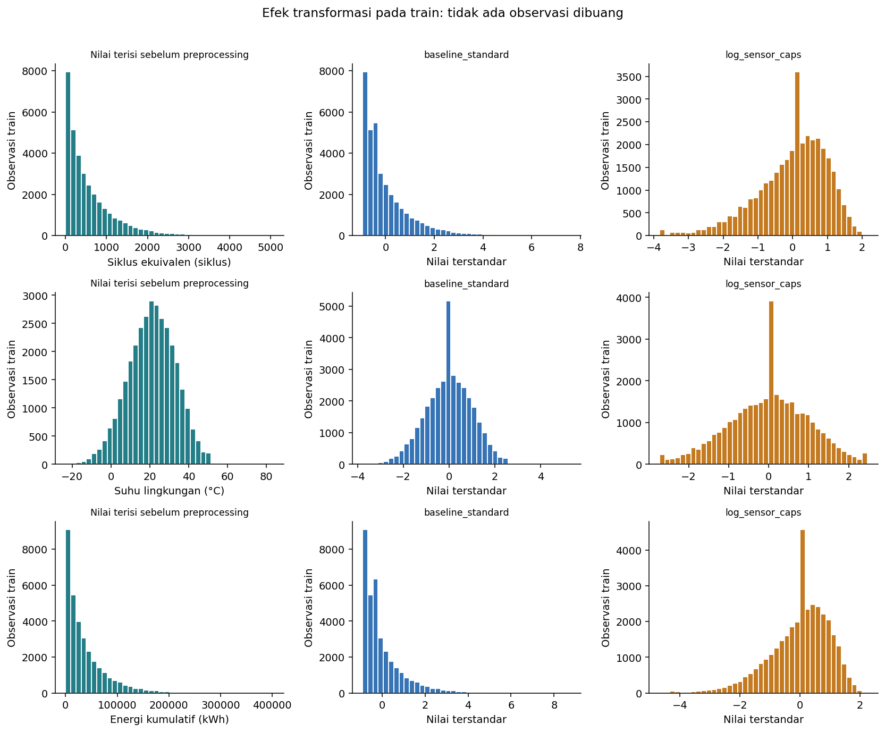
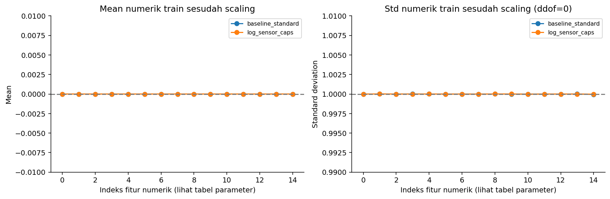
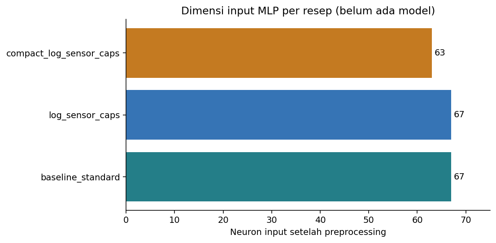

# Preprocessing untuk MLP Backpropagation

## Status dan tujuan

Pipeline sudah di-fit **hanya pada 34.929 observasi / 1.820 baterai train**. Validation (7.499 baris) dan test (7.572 baris) hanya ditransform memakai parameter yang telah dibekukan. Tidak ada MLP yang dilatih, tuning, pemilihan berdasarkan test, atau klaim bahwa overfitting/underfitting sudah teratasi.

Preprocessing membantu skala optimasi, menangani ketiadaan informasi, dan menyediakan ablation redundansi. Generalisasi tetap harus dinilai dari train–validation learning curves, kapasitas MLP, regularisasi, early stopping, dan variasi seed. Daftar kandidat fitur awal dan manifest split tidak diubah.

## Tiga resep yang dapat dibandingkan nanti

| recipe | raw_features | input_neurons | capped_train_feature_cells | log_features |
| --- | --- | --- | --- | --- |
| baseline_standard | 21 | 67 | 0 | Tidak ada |
| log_sensor_caps | 21 | 67 | 720 | cycle_count, total_energy_throughput_kwh, avg_daily_distance_km, altitude_m, service_count |
| compact_log_sensor_caps | 19 | 63 | 389 | cycle_count, avg_daily_distance_km, altitude_m, service_count |

Default awal: **baseline_standard**, karena mempertahankan seluruh 21 fitur sah sebagai acuan. Resep lain adalah alternatif yang telah ditetapkan sebelum training, bukan pemenang eksperimen. Full vs log_sensor_caps menguji gabungan log/cap; efek log dan cap belum diisolasi satu per satu. Compact vs log_sensor_caps menguji pengurangan dua fitur. Jika ingin atribusi efek log vs cap secara terpisah, tambahkan eksperimen terkontrol ketika training.

## 1. Urutan pemrosesan

1. Validasi skema bernama: ID, target, label turunan, tanggal, dan proxy sensor tidak boleh ikut masuk pipeline utama. Urutan kolom boleh berbeda; kolom wajib hilang/kolom tambahan ditolak.
2. Konversi numerik dan pemeriksaan nilai finite. Nilai yang melanggar batas definisi (rasio, persentase, biner, nonnegatif tertentu) dijadikan missing dengan catatan; nilai ekstrem yang masih sah tidak otomatis dibuang. Altitude negatif tetap sah. Tidak melakukan perbaikan monoton, forward/backward fill, atau pengisian metadata lintas waktu/baterai.
3. Numerik: imputasi median train. Indikator missing tetap dibuat untuk setiap fitur numerik, termasuk bila lengkap saat fit, agar missing baru pada inferensi dapat ditangani.
4. Pada resep alternatif: cap hanya sensor yang ditetapkan menggunakan quantile 0.5% dan 99.5% **nilai train terisi sebelum imputasi**. Tidak menyaring seluruh baris, tidak menghapus baterai tua atau SOH rendah. Cap adalah hipotesis ketahanan terhadap ekor, bukan identifikasi pasti kesalahan sensor.
5. Signed log1p untuk fitur berekor kanan terpilih. Untuk nilai nonnegatif sama dengan log1p; untuk altitude negatif memakai sign(x)×log1p(abs(x)). Bukan log target.
6. StandardScaler fit pada numerik train **setelah** imputasi/cap/log. Mean mendekati 0 dan std populasi mendekati 1 pada train yang bervariasi. Validation/test tidak dipaksa mean=0/std=1 dan tidak diskalakan ulang.
7. Recall flag diimputasi modus train dan tetap 0/1, dengan indikator missing. Flag langka tidak terkena aturan outlier IQR.
8. Kategori: whitespace pinggir dibersihkan; kosong memakai kategori eksplisit `__MISSING__`; one-hot tanpa urutan ordinal buatan. Kategori baru memakai blok all-zero; tidak menjadi kategori missing dan tidak memperluas dimensi. Token missing dialokasikan sejak fit, termasuk bila suatu fitur lengkap pada train. Unknown count tersedia lewat diagnostic.
9. Gabungkan blok numerik, indikator numerik, biner, indikator biner, lalu one-hot ke array dense **float32**. Urutan/nama output disimpan. Target disimpan terpisah.

Kategori tidak diisi dari pengamatan masa depan atau nilai grup baterai seperti label pengelompokan EDA. Pipeline inferensi hanya memerlukan satu baris fitur yang tersedia saat prediksi.

## 2. Feature selection yang dapat dipertanggungjawabkan

- capacity_fade_pct (100−SOH), RUL, label risiko/degradasi, dan ID tetap dikeluarkan untuk menghindari kebocoran/hafalan. Empat proxy sensor tetap terpisah dari lingkup utama.
- Resep compact mengeluarkan total_energy_throughput_kwh karena korelasi Spearman train dengan cycle_count 0.984, serta peak_temp_during_fast_charge_c karena korelasi dengan suhu lingkungan 0.920.
- Umur dan siklus tetap dipertahankan meski berkorelasi, karena mewakili calendar aging dan penggunaan berbeda. Fitur dengan korelasi target kecil tidak otomatis dihapus: MLP dapat memanfaatkan interaksi.
- Pengurangan redundansi dapat mengurangi input/parameter jaringan, tetapi juga bisa membuang informasi. Karena itu compact **bukan feature selection final**; pilih resep melalui validation kelak.

## 3. Target dan balancing

SOH asli dipertahankan, tanpa clipping target, binning menjadi kelas, oversampling, SMOTE, atau penghapusan SOH rendah. Balancing kelas tidak relevan untuk target kontinu. Distribusi evaluasi mengikuti split semula.

Target scaler fit hanya pada y_train: mean **92.918747**, scale **7.192673** poin persentase. Target terstandar memudahkan MLP output linear memulai di sekitar nol. Ini tidak memperbaiki distribusi ekor secara otomatis dan tidak menjamin peningkatan skor.

Output array: `y_scaled` untuk optimasi dan `y_original` untuk evaluasi. Kembalikan prediksi melalui `bundle['target_scaler'].inverse_transform(...)`. MAE/RMSE wajib dilaporkan dalam poin persentase SOH asli. Bila membandingkan Huber, nilai delta harus dijelaskan pada skala target yang dipakai; perubahan skala juga mengubah besar loss/gradien.

## 4. Bukti teknis kesiapan input

| recipe | rows | raw_features | input_neurons | numeric_missing_after | finite |
| --- | --- | --- | --- | --- | --- |
| baseline_standard | 34929 | 21 | 67 | 0 | True |
| log_sensor_caps | 34929 | 21 | 67 | 0 | True |
| compact_log_sensor_caps | 34929 | 19 | 63 | 0 | True |

Seluruh split dipertahankan dengan pasangan ID/X/y yang sama; ringkasan holdout terbatas pada shape dan validitas input, tanpa distribusi target atau penilaian model. Semua array finite, nama output unik dan konsisten, serta target round-trip diperiksa. Detail semua split di `split_readiness.csv`.



Grafik hanya train. Spike pada nilai median sebagian merupakan konsekuensi imputasi; indikator missing mempertahankan informasi ketiadaan, bukan berpura-pura median adalah pengukuran asli. Log/cap dapat meredam ekor dan sekaligus menghilangkan detail—bandingkan resep pada validation nanti.



Grafik mean/std mengacu pada blok numerik saja; one-hot, biner, dan indikator tidak dipaksa unit variance. Standardisasi per fitur tidak menghilangkan korelasi antarf fitur atau membuat matriks input sepenuhnya bebas redundansi.



Jumlah neuron input dihitung **setelah preprocessing**, termasuk indikator dan one-hot. Nama, indeks, dan parameter masing-masing resep tersedia pada tabel CSV. Untuk jaringan hidden [64,32] output satu, parameter dihitung sebagai `(p×64+64)+(64×32+32)+(32×1+1)`; ini ilustrasi kapasitas, bukan model yang sudah dilatih.

## 5. Pemeriksaan dan kegagalan yang ditangani

| recipe | check | result |
| --- | --- | --- |
| baseline_standard | transform_state_unchanged | PASS |
| baseline_standard | all_split_float32_finite_and_same_width | PASS |
| baseline_standard | target_inverse_max_error_pp | 0.000001712 |
| baseline_standard | serialization_exact_first_16_rows | PASS |
| log_sensor_caps | transform_state_unchanged | PASS |
| log_sensor_caps | all_split_float32_finite_and_same_width | PASS |
| log_sensor_caps | target_inverse_max_error_pp | 0.000001712 |
| log_sensor_caps | serialization_exact_first_16_rows | PASS |
| compact_log_sensor_caps | transform_state_unchanged | PASS |
| compact_log_sensor_caps | all_split_float32_finite_and_same_width | PASS |
| compact_log_sensor_caps | target_inverse_max_error_pp | 0.000001712 |
| compact_log_sensor_caps | serialization_exact_first_16_rows | PASS |

Pengujian otomatis tambahan pada `tests/test_preprocessing.py` mencakup parameter yang benar-benar berasal dari train, kategori/missing baru, nilai tidak valid, urutan kolom, skema bocor, serialisasi, serta memastikan transform holdout tidak mengubah state fit. Kasus synthetic kecil dipakai untuk pemeriksaan perilaku; bukan sampel pengganti dataset atau hasil eksperimen model.

## 6. Artefak dan pemakaian

- `data/processed/<recipe>/train.npz`, `validation.npz`, `test.npz`: X float32, y_scaled, y_original, observation_id, battery_id, dan feature_names; disimpan lokal, diabaikan Git.
- `models/preprocessing/<recipe>.joblib`: bundle berisi preprocessor, target_scaler, resep, identitas sumber/split, nama fitur, dan versi paket; lokal, diabaikan Git. Hanya muat joblib dari artefak tepercaya. load_prepared_split memeriksa identitas resep/split, urutan fitur, dan hash state agar array tidak tercampur dengan pipeline lain.
- `results/preprocessing/`: laporan, pemeriksaan, tiga gambar train, parameter train, kategori, nama output, dan provenance; dapat dibagikan lewat Git.
- `configs/preprocessing.json`: definisi resep yang dapat direview. Kontrak fitur awal tidak ditimpa.

```python
from src.preprocessing import load_prepared_split
data, bundle = load_prepared_split('baseline_standard', 'train')
X_train, y_train = data['X'], data['y_scaled']
# Untuk data baru gunakan kolom mentah persis yang diperlukan:
# X_new = bundle['preprocessor'].transform(new_rows[bundle['required_columns']])
# y_pred_soh = bundle['target_scaler'].inverse_transform(pred_scaled.reshape(-1, 1)).ravel()
```

Precomputed arrays khusus split tetap saat ini. Jika memakai cross-validation di dalam train, **clone/buat ulang dan fit preprocessor serta target scaler pada setiap fold train**; jangan memakai array yang sudah di-fit pada seluruh train untuk fold-validation. Library scikit-learn di sini hanya menyediakan transformasi; tidak ada model prediksi di luar MLP.

Reproduksi: `python -m src.preprocessing`, lalu `python scripts/run_notebook.py notebooks/02_preprocessing.ipynb`. Pilih lingkungan dengan requirements.txt. Tidak mengubah CSV asli, manifest split, atau konfigurasi fitur awal.

## 7. Yang masih perlu dibuktikan saat eksperimen

1. Mulai dari baseline_standard untuk acuan, lalu bandingkan alternatif menggunakan arsitektur/seed/kebijakan training yang sama.
2. Train loss tinggi dan validation tinggi dapat menunjukkan underfitting atau masalah optimasi; periksa kapasitas, learning rate, epoch, dan fitur.
3. Train membaik tetapi validation memburuk dapat menunjukkan overfitting; periksa regularisasi L2/dropout, ukuran hidden, early stopping, dan stabilitas seed.
4. Jangan menambah/hapus fitur atau memilih cap berdasarkan test. Test hanya untuk evaluasi final model terkunci.

## Referensi implementasi

- [scikit-learn: common pitfalls dan data leakage](https://scikit-learn.org/stable/common_pitfalls.html).
- [StandardScaler: parameter train dan sensitivitas terhadap outlier](https://scikit-learn.org/stable/modules/generated/sklearn.preprocessing.StandardScaler.html).
- [OneHotEncoder: kategori tak dikenal dan handle_unknown](https://scikit-learn.org/stable/modules/generated/sklearn.preprocessing.OneHotEncoder.html).

Versi yang dijalankan tetap scikit-learn 1.7.2 dan tercatat dalam provenance, bukan otomatis mengikuti versi dokumentasi stable terbaru. Temuan dataset merujuk laporan EDA train sebelumnya.
