# Laporan EDA: EV-Battery-Health

**Mata Kuliah:** Jaringan Saraf Tiruan (Kelas A)  
**Program Studi:** Teknik Informatika, Fakultas Ilmu Komputer (FILKOM), Universitas Brawijaya (2026)  
**Dosen Pengampu:** Dr.Eng. Budi Darma Setiawan, S.Kom., M.Cs.

| Nama Anggota Tim | NIM |
| --- | --- |
| Hubert Cendana | 245150207111049 |
| Oktavianus Samuel Minarto | 245150200111043 |
| Muhammd Hafizh Faiqunnabil | 245150201111031 |
| Alberd Juniawan Pasunda | 245150200111039 |

---

## Ringkasan

Laporan Exploratory Data Analysis (EDA) ini bertujuan untuk memeriksa kualitas skema dan integritas data, mendeskripsikan distribusi target State of Health (SOH) beserta struktur pengamatan berulang per baterai, membandingkan hubungan fitur penggunaan, lingkungan, dan kimia baterai terhadap SOH, serta merumuskan implikasi metodologis bagi perancangan prapemrosesan dan arsitektur Multilayer Perceptron (MLP) berbasis backpropagation yang dibangun dari awal menggunakan NumPy. Analisis pola dilakukan secara eksklusif pada himpunan data latih (train) yang mencakup 34.929 baris observasi dari 1.820 unit baterai unik hasil pembagian grup berbasis battery_id (70% train, 15% validation, dan 15% test dari total 50.000 observasi dan 2.600 baterai pada dataset sintetis Kaggle EV Battery Health & Degradation). Tiga temuan utama diperoleh dari hasil eksplorasi ini. Pertama, distribusi target state_of_health_pct sangat miring ke kiri (skewness -1,808) dengan median 95,230% dan rerata 92,919%, di mana 51,622% pengamatan berada pada kondisi sehat (>= 95%) dan hanya 6,361% berada di bawah ambang batas akhir masa pakai (< 80%, termasuk 1,503% pada rentang kritis < 70%). Kedua, degradasi SOH berasosiasi monoton negatif paling kuat dengan tiga variabel penggunaan kumulatif yang saling berkorelasi tinggi (r_s >= 0,900), yaitu cycle_count (Spearman r_s = -0,907), battery_age_days (r_s = -0,842), dan total_energy_throughput_kwh (r_s = -0,841), diikuti oleh laju penggunaan bulanan charge_cycles_per_month (r_s = -0,317) serta perbedaan profil degradasi antarkimia baterai (LFP memiliki rata-rata SOH tertinggi diikuti NMC, NCA, dan LMO pada kelompok usia yang sama). Ketiga, audit kualitas dan struktur longitudinal menemukan nilai hilang sebesar 3,161% hingga 6,908% pada 21 fitur utama, nilai hilang struktural sebesar 37,785% pada last_service_date yang berkaitan dengan tahap pemakaian awal, ketiadaan tanggal pengamatan pada 2.216 baris global, penurunan nilai penghitung kumulatif siklus (18,179% pasangan) serta energi (21,272% pasangan), dan kenaikan SOH lebih dari 0,01 poin persentase pada 32,860% pasangan pengamatan berurutan. Seluruh temuan tersebut menetapkan bahwa estimasi SOH harus diformulasikan sebagai regresi tabular satu baris per observasi tanpa timesteps, mewajibkan eksklusi variabel bocor capacity_fade_pct (100 - SOH) dan empat kandidat proksi sensor dari model baseline, menuntut imputasi median beserta indikator biner nilai hilang yang di-fit hanya pada data train (menghasilkan 67 neuron input standar dan 63 neuron pada resep kompak), serta mewajibkan evaluasi galat model secara terpisah pada setiap rentang SOH dan per unit baterai.

## Daftar Isi

- Ringkasan (hlm. 2)
- Daftar Isi (hlm. 2)
- Daftar Gambar dan Tabel (hlm. 5)
- 1. Pendahuluan (hlm. 8)
  - 1.1. Latar Belakang (hlm. 8)
  - 1.2. Rumusan Masalah (hlm. 8)
  - 1.3. Tujuan Analisis (hlm. 9)
  - 1.4. Ruang Lingkup dan Batasan (hlm. 9)
- 2. Dataset dan Metode EDA (hlm. 10)
  - 2.1. Sumber dan Karakteristik Dataset (hlm. 10)
  - 2.2. Unit Observasi, Identitas Baterai, dan Definisi SOH (hlm. 10)
  - 2.3. Kelompok Variabel dan Satuan Pengukuran (hlm. 11)
  - 2.4. Pembagian Data Berdasarkan ID Baterai (hlm. 13)
  - 2.5. Statistik Deskriptif, Visualisasi, dan Pembobotan per Baterai (hlm. 14)
    - 2.5.1. Ringkasan Distribusi dan Hubungan Antarvariabel (hlm. 14)
    - 2.5.2. Pembobotan dan Kecukupan Sampel (hlm. 14)
- 3. Audit Kualitas Data (hlm. 15)
  - 3.1. Kelengkapan Data dan Pola Nilai Hilang (hlm. 15)
  - 3.2. Nilai Hilang pada Riwayat Servis (hlm. 17)
  - 3.3. Duplikasi dan Validitas Nilai (hlm. 18)
  - 3.4. Nilai Ekstrem dan Sensitivitas terhadap Batas IQR (hlm. 19)
  - 3.5. Keteraturan Tanggal dan Konsistensi Pengukuran Kumulatif (hlm. 22)
- 4. Hasil Eksplorasi Data (hlm. 23)
  - 4.1. Distribusi SOH dan Keterwakilan Rentang SOH Rendah (hlm. 23)
  - 4.2. Jumlah Observasi per Baterai dan Pengaruh Pembobotan (hlm. 24)
  - 4.3. Distribusi Fitur Numerik, Kategorikal, dan Biner (hlm. 25)
    - 4.3.1. Profil Fitur Numerik (hlm. 25)
    - 4.3.2. Profil Fitur Kategorikal dan Biner (hlm. 28)
  - 4.4. Hubungan SOH dengan Usia, Siklus, dan Energi Kumulatif (hlm. 29)
  - 4.5. Korelasi dan Redundansi Antarfitur (hlm. 30)
  - 4.6. Perbandingan Kimia Baterai pada Kelompok Usia yang Sama (hlm. 32)
    - 4.6.1. Perbandingan SOH Mentah dan dalam Rentang Usia yang Sama (hlm. 32)
    - 4.6.2. Dukungan Data dan Ketidakpastian (hlm. 33)
    - 4.6.3. Pertanyaan Pemandu (hlm. 35)
  - 4.7. Pola SOH Menurut Penggunaan, Pengisian Cepat, dan Kondisi Operasi (hlm. 36)
  - 4.8. Pola SOH Menurut Kategori Baterai dan Lingkungan (hlm. 37)
  - 4.9. Lintasan SOH dan Perubahan Antarobservasi (hlm. 38)
    - 4.9.1. Lintasan SOH per Baterai (hlm. 38)
    - 4.9.2. Perubahan SOH antarobservasi Bertanggal (hlm. 39)
  - 4.10. Target Turunan, Pembacaan Sensor, dan Risiko Kebocoran Target (hlm. 41)
    - 4.10.1. Target Alternatif dan Variabel Turunan (hlm. 41)
    - 4.10.2. Pembacaan Sensor sebagai Proksi SOH (hlm. 41)
- 5. Pembahasan (hlm. 42)
  - 5.1. Sintesis Temuan terhadap Rumusan Masalah (hlm. 42)
  - 5.2. Implikasi terhadap Preprocessing dan Seleksi Fitur (hlm. 43)
  - 5.3. Implikasi terhadap Input Tabular dan Evaluasi per Rentang SOH (hlm. 44)
  - 5.4. Keterbatasan Data Sintetis dan Interpretasi Hubungan (hlm. 45)
- 6. Penutup (hlm. 46)
  - 6.1. Kesimpulan (hlm. 46)
  - 6.2. Saran untuk Tahap Berikutnya (hlm. 47)
- 7. Daftar Pustaka (hlm. 47)
- 8. Lampiran (hlm. 48)
  - 8.1. Kamus Data dan Pemetaan Kolom (hlm. 48)
  - 8.2. Tabel Statistik dan Gambar Pendukung (hlm. 53)
  - 8.3. Notebook dan Petunjuk Reproduksi EDA (hlm. 59)

## Daftar Gambar dan Tabel

### Daftar Gambar

- Gambar 3.1 Selisih median SOH antara nilai hilang dan teramati per fitur utama (kiri) serta distribusi jumlah fitur utama yang hilang per baris observasi pada data train (kanan). (hlm. 16)
- Gambar 3.2 Perbandingan distribusi kuartil SOH (kiri) dan usia baterai dalam hari (kanan) antara observasi dengan tanggal servis kosong dan tanggal servis terisi pada data train. (hlm. 17)
- Gambar 3.3 Persentase nilai teramati yang berada di luar pagar 1,5 x IQR pada setiap fitur (kiri) dan histogram berekor panjang pada durasi pengisian daya dalam sumbu logaritmik (kanan). (hlm. 20)
- Gambar 4.1 Histogram distribusi target SOH pada data train dengan perbandingan bobot observasi vs bobot baterai (kiri) serta kurva ECDF dengan garis referensi EOL 80% (kanan). (hlm. 23)
- Gambar 4.2 Histogram jumlah observasi per baterai pada data train (kiri) dan diagram pencar antara jumlah observasi per baterai terhadap rata-rata SOH baterai (kanan). (hlm. 24)
- Gambar 4.3 Histogram distribusi fitur numerik pada data train bagian pertama (mencakup kapasitas paket, umur, jumlah siklus, jarak harian, daya pengisian, rasio fast charge, DoD, SoC, siklus bulanan, dan energi kumulatif). (hlm. 26)
- Gambar 4.4 Histogram distribusi fitur numerik pada data train bagian kedua (mencakup suhu lingkungan, kelembapan, ketinggian, suhu puncak fast charge, jumlah servis, recall flag, dan empat variabel sensor). (hlm. 27)
- Gambar 4.5 Frekuensi baris observasi dan jumlah baterai unik untuk setiap kategori pada lima fitur kategorikal utama serta fitur biner recall_flag pada data train. (hlm. 28)
- Gambar 4.6 Perbandingan korelasi Spearman terhadap SOH pada tingkat observasi gabungan, antar-baterai (between-battery), dan intra-baterai (within-battery) pada data train. (hlm. 29)
- Gambar 4.7 Diagram pencar hubungan antara fitur numerik utama terhadap SOH yang dikelompokkan menurut kimia baterai (LFP, NMC, NCA, dan LMO) pada sampel deterministik data train. (hlm. 30)
- Gambar 4.8 Matriks korelasi peringkat Spearman antarfitur kandidat baseline beserta variabel target state_of_health_pct pada data train. (hlm. 31)
- Gambar 4.9 Perbandingan distribusi kuartil SOH mentah per kimia baterai (kiri) dan kurva rata-rata SOH berbobot sama per baterai lintas kelompok usia beserta interval bootstrap 95% (kanan). (hlm. 33)
- Gambar 4.10 Peta panas (heatmap) jumlah baterai unik pendukung pada setiap sel kombinasi kimia baterai dan kelompok usia di dalam himpunan data train. (hlm. 33)
- Gambar 4.11 Peta panas median SOH (kiri) dan jumlah dukungan baris/baterai (kanan) menurut matriks kelompok usia baterai dan pita rasio pengisian cepat (fast_charge_ratio) pada data train. (hlm. 36)
- Gambar 4.12 Perbandingan median SOH disertai jumlah baris observasi dan median umur baterai (hari) untuk setiap kategori pada kelima fitur kategorikal utama di data train. (hlm. 38)
- Gambar 4.13 Contoh deterministik lintasan SOH terhadap tanggal observasi untuk tiga baterai pertama per jenis kimia yang memiliki minimal 10 pengamatan bertanggal pada data train. (hlm. 39)
- Gambar 4.14 Distribusi selang waktu hari antarobservasi berurutan (kiri), histogram perubahan SOH dalam poin persentase (tengah), dan proporsi arah perubahan SOH pada 31.528 pasangan bertanggal di data train (kanan). (hlm. 40)
- Gambar 4.15 Proporsi kelas pada target alternatif failure_risk_label (kiri), degradation_category (tengah), dan diagram pencar hubungan SOH terhadap remaining_useful_life_cycles pada data train (kanan). (hlm. 41)
- Gambar 8.1 Profil persentase nilai hilang pada setiap kolom di himpunan data train hasil tahap audit awal (00_data_audit.ipynb). (hlm. 58)
- Gambar 8.2 Profil awal distribusi target SOH dan proporsi pengamatan per jenis kimia baterai pada data train hasil tahap audit awal. (hlm. 58)
- Gambar 8.3 Hubungan awal antara fitur utama serta kandidat proksi sensor (internal_resistance_mohm) terhadap SOH pada sampel deterministik 5.000 baris data train. (hlm. 59)
- Gambar 8.4 Diagram kotak-garis (boxplot) pemeriksaan rentang nilai dan kandidat pencilan 1,5 x IQR pada variabel sensor di data train. (hlm. 59)

### Daftar Tabel

- Tabel 2.1 Kelompok variabel, jumlah kolom, contoh variabel, satuan pengukuran, dan peran pemodelan (hlm. 11)
- Tabel 2.2 Ringkasan pembagian dataset berdasarkan grup battery_id (rasio 70/15/15, seed 42) (hlm. 13)
- Tabel 3.1 Profil nilai hilang pada kolom utama dan perbandingan median SOH serta usia pada data train (hlm. 15)
- Tabel 3.2 Ringkasan hasil pemeriksaan duplikasi, validitas rentang fisik, dan konsistensi atribut dari AUDIT_REPORT.md (hlm. 18)
- Tabel 3.3 Analisis sensitivitas korelasi Spearman terhadap SOH pada seluruh pasangan valid dibandingkan pasangan di dalam pagar 1,5 x IQR (hlm. 20)
- Tabel 3.4 Pemeriksaan monotonisitas penghitung kumulatif pada pasangan observasi berurutan bertanggal valid (hlm. 22)
- Tabel 4.1 Proporsi pengamatan data train menurut rentang nilai State of Health (SOH band) (hlm. 23)
- Tabel 4.2 Pasangan fitur utama dengan tingkat kolinearitas / redundansi tertinggi (|Spearman| >= 0,80) pada data train (hlm. 31)
- Tabel 4.3 Dukungan jumlah observasi, jumlah baterai, rata-rata SOH berbobot baterai, dan interval bootstrap 95% per kombinasi kimia dan usia (hlm. 34)
- Tabel 4.4 Median SOH (%) dan dukungan jumlah baterai unik (dalam tanda kurung) menurut kelompok usia dan pita rasio pengisian cepat (hlm. 36)
- Tabel 4.5 Klasifikasi arah perubahan SOH antarobservasi bertanggal berurutan pada data train (31.528 pasangan) (hlm. 40)
- Tabel 5.1 Pemetaan temuan EDA, bukti kuantitatif, dan implikasinya terhadap prapemrosesan serta seleksi fitur MLP (hlm. 43)
- Tabel 8.1 Kamus data lengkap, cakupan nilai hilang, peran kontrak fitur, dan catatan risiko kebocoran untuk seluruh 35 kolom (hlm. 48)
- Tabel 8.2 Profil statistik deskriptif lengkap dan kandidat pencilan 1,5 x IQR untuk seluruh variabel numerik pada data train (hlm. 53)
- Tabel 8.3 Profil dukungan baris, baterai unik, median/rerata SOH, median usia, dan median siklus per kategori pada data train (hlm. 55)

---

## 1. Pendahuluan

### 1.1. Latar Belakang

Baterai traksi lithium-ion merupakan komponen penyimpan energi paling vital sekaligus paling menentukan keandalan operasional, jarak tempuh, dan keselamatan kendaraan listrik (electric vehicle / EV). Seiring bertambahnya umur kalender baterai, akumulasi siklus pengisian-pengosongan daya, serta paparan terhadap suhu lingkungan dan arus pengisian cepat (fast charging), sel elektrokimia di dalam paket baterai mengalami penurunan kapasitas penyimpanan muatan serta peningkatan hambatan dalam secara bertahap. Dalam sistem manajemen baterai (Battery Management System / BMS), derajat penurunan kesehatan baterai tersebut dikuantifikasi melalui indikator utama bernama State of Health (SOH), yang dinyatakan dalam persentase kapasitas efektif saat ini terhadap kapasitas nominal awal baterai saat diproduksi.

Kemampuan mengestimasi nilai SOH secara akurat pada saat observasi berlangsung sangat krusial bagi sistem kendaraan listrik. Estimasi SOH yang presisi memungkinkan BMS memperkirakan sisa jarak tempuh secara realistis, menyesuaikan batas daya pengisian agar sel tidak mengalami pelapisan litium (lithium plating) atau panas berlebih, serta memberikan peringatan dini ketika kesehatan baterai mendekati ambang batas akhir masa pakai (end-of-life / EOL) yang secara industri umumnya ditetapkan pada nilai SOH 80%. Mengingat hubungan antara riwayat penggunaan, kondisi termal, dan kimia baterai terhadap penurunan SOH bersifat non-linear dan melibatkan interaksi multivariat, jaringan saraf tiruan Multilayer Perceptron (MLP) yang dilatih menggunakan algoritma backpropagation menjadi pendekatan pemodelan yang relevan untuk dipelajari.

Meskipun demikian, perancangan arsitektur MLP dan alur prapemrosesan data tidak boleh dilakukan secara buta tanpa memahami karakteristik dasar dataset terlebih dahulu. Data telemetri dan riwayat siklus hidup baterai sering kali mengandung pengamatan berulang dari unit baterai yang sama, ketimpangan distribusi antara baterai sehat dan baterai terdegradasi berat, nilai hilang (missing values), nilai ekstrem berekor panjang, hingga potensi kebocoran target (target leakage) akibat hadirnya variabel turunan langsung dari SOH. Apabila pola-pola tersebut tidak dipetakan melalui audit kualitas data dan Exploratory Data Analysis (EDA) yang ketat sebelum pemodelan, jaringan saraf tiruan berisiko mengalami kebocoran informasi antar-split, menghafal identitas aljabar yang tidak valid di dunia nyata, atau tampak unggul pada metrik rata-rata global namun gagal memprediksi baterai pada rentang SOH kritis.

### 1.2. Rumusan Masalah

Berdasarkan latar belakang tersebut, rumusan masalah dalam laporan Exploratory Data Analysis (EDA) ini disusun ke dalam empat pertanyaan analitis utama:

1. Bagaimana tingkat kualitas skema, kelengkapan data (pola nilai hilang), validitas rentang fisik, sensitivitas terhadap nilai ekstrem (batas 1,5 x IQR), serta konsistensi urutan waktu dan pengukuran kumulatif pada dataset kesehatan baterai kendaraan listrik?
2. Bagaimana karakteristik distribusi variabel target state_of_health_pct pada himpunan data latih (train), seberapa besar ketimpangan keterwakilan pengamatan pada rentang SOH rendah (< 80% dan < 70%), serta bagaimana pengaruh variasi jumlah observasi per baterai terhadap ringkasan distribusi target?
3. Bagaimana arah, kekuatan, dan bentuk hubungan antara fitur-fitur penggunaan (usia baterai, jumlah siklus, energi kumulatif, rasio fast charging), kondisi lingkungan, serta kategori kimia dan profil kendaraan terhadap SOH, baik secara gabungan (pooled) maupun setelah dikondisikan menurut kelompok usia dan unit baterai?
4. Apa implikasi langsung dari temuan audit kualitas data, struktur korelasi antarfitur, dan risiko kebocoran target terhadap pemilihan fitur input tabular, strategi prapemrosesan (imputasi, encoding, scaling), penentuan jumlah neuron input MLP, serta protokol evaluasi model?

### 1.3. Tujuan Analisis

Berpasangan secara langsung dengan keempat rumusan masalah pada Subbab 1.2, tujuan analisis dalam laporan ini adalah sebagai berikut:

1. Memeriksa kelengkapan data, pola nilai hilang pada fitur utama dan riwayat servis, ketiadaan duplikasi dan pelanggaran rentang nilai, ketahanan korelasi terhadap batas antarkuartil (1,5 x IQR), serta konsistensi kronologis tanggal dan penghitung kumulatif.
2. Mendeskripsikan distribusi variabel target state_of_health_pct beserta proporsi sampel pada setiap rentang SOH, serta membandingkan statistik target berbobot sama per observasi dengan statistik berbobot sama per unit baterai.
3. Membandingkan kekuatan asosiasi monoton (Spearman) dan linear (Pearson) antara fitur kandidat dengan SOH, mengidentifikasi redundansi antarfitur penggunaan, serta mengevaluasi perbedaan profil SOH antarkelompok kimia baterai, rasio pengisian cepat, kategori kendaraan, dan lintasan antarobservasi bertanggal.
4. Merumuskan implikasi teknis hasil EDA terhadap aturan pencegahan kebocoran target, skema prapemrosesan yang di-fit khusus pada data train, penetapan representasi input tabular bagi jaringan MLP berbasis NumPy, serta penyusunan metrik evaluasi per rentang SOH dan per baterai.

### 1.4. Ruang Lingkup dan Batasan

Ruang lingkup laporan ini dibatasi secara tegas pada tahapan audit data (00_data_audit.ipynb) dan eksplorasi data (01_eda.ipynb) untuk tugas estimasi SOH pada saat pengamatan berlangsung (current-state regression terhadap target kontinu state_of_health_pct dalam satuan persen). Laporan ini tidak mencakup peralaman deret waktu masa depan (multi-step forecasting), klasifikasi kategori risiko kegagalan, maupun estimasi sisa umur siklus (Remaining Useful Life / RUL). Seluruh pemeriksaan distribusi, korelasi, perbandingan kelompok, nilai hilang, dan sensitivitas pencilan pada tahap EDA dijalankan secara eksklusif menggunakan subset data latih (train) yang berjumlah 34.929 baris dari 1.820 baterai unik, sedangkan subset validation (7.499 baris, 390 baterai) dan test (7.572 baris, 390 baterai) dikunci sepenuhnya agar tidak memengaruhi pemilihan fitur maupun rancangan transformasi.

Sebagai batasan interpretasi yang wajib diperhatikan di sepanjang laporan, dataset yang dianalisis merupakan data yang sepenuhnya sintetis (fully synthetic) hasil pembangkitan simulator komputer dengan penyuntikan nilai hilang dan pencilan buatan yang masker aslinya tidak dipublikasikan. Oleh sebab itu, seluruh korelasi dan perbedaan antarkelompok yang ditemukan bersifat deskriptif terhadap perilaku simulator dan tidak boleh ditafsirkan sebagai bukti kausalitas fisik pada armada kendaraan listrik nyata. Selain itu, pada tahap EDA ini belum dilakukan proses fitting imputer, encoder, scaler, maupun pelatihan bobot model MLP; seluruh berkas data mentah dan manifest pembagian grup dijaga tetap utuh tanpa modifikasi.

## 2. Dataset dan Metode EDA

### 2.1. Sumber dan Karakteristik Dataset

Dataset yang digunakan dalam studi kasus ini berasal dari repositori publik Kaggle berjudul EV Battery Health & Degradation Dataset (dipublikasikan oleh vinay24baghira di alamat https://www.kaggle.com/datasets/vinay24baghira/ev-battery-health-and-degradation-dataset) dengan lisensi Creative Commons Zero (CC0: Public Domain). Berdasarkan dokumentasi sumber pada arsip data/raw/README.md, kamus data asli data/raw/data_dictionary .csv (spasi sebelum ekstensi .csv merupakan nama asli berkas), serta kartu dataset proyek pada docs/DATASET_CARD.md, seluruh isi dataset bersifat sepenuhnya sintetis (fully synthetic) dan merepresentasikan simulasi pembacaan siklus hidup baterai kendaraan listrik lintas waktu.

Secara fisik, berkas utama data/raw/ev_battery_health.csv berukuran 12.142.334 byte (sekitar 12,14 MB) dan memiliki sidik jari kriptografis SHA-256 cacdf6afcf50db86583be3754207a89acbfd60b04dfff8f69b71e29cfd78218d yang diverifikasi secara otomatis sebelum analisis dijalankan. Tabel data terdiri atas tepat 50.000 baris pengamatan dan 35 kolom yang mencakup 2.600 unit baterai unik (battery_id mulai dari BAT_000001 hingga BAT_002600). Dokumentasi sumber menyatakan bahwa simulator sengaja menyuntikkan nilai hilang (sekitar 3% hingga 5% pada mayoritas fitur operasional dan sekitar 38% pada tanggal servis terakhir) serta nilai pencilan (sekitar 1% hingga 2% pada pembacaan sensor), namun kode program simulator maupun daftar indeks baris yang disuntik tidak disertakan di dalam arsip publik.

### 2.2. Unit Observasi, Identitas Baterai, dan Definisi SOH

Di dalam struktur tabel dataset, satu baris merepresentasikan satu pengamatan atau pembacaan kondisi baterai pada satu titik waktu tertentu yang diidentifikasi secara unik oleh kolom observation_id (OBS_0000001 hingga OBS_0050000). Karena setiap paket baterai dipantau secara berulang sepanjang masa pakainya, satu identitas baterai (battery_id) memiliki banyak baris pengamatan. Hasil audit pada keseluruhan 2.600 baterai menunjukkan bahwa jumlah baris per baterai berkisar antara minimum 7 hingga maksimum 37 observasi, dengan median 19,000 observasi (kuartil bawah 16,000, kuartil atas 22,000) dan rerata 19,231 observasi (simpangan baku 4,367). Struktur hierarkis ini berarti bahwa baris-baris yang berbagi battery_id yang sama tidak saling bebas (non-independent), melainkan merefleksikan lintasan degradasi dari unit fisik yang sama.

Variabel target yang diestimasi adalah state_of_health_pct, yaitu ukuran kesehatan kapasitas baterai pada saat observasi dilakukan yang dinyatakan dalam satuan persen (%). Pada dataset ini, state_of_health_pct bertipe numerik kontinu (floating-point) tanpa satu pun nilai yang kosong (0% missing pada 50.000 baris), dengan rentang nilai teramati mulai dari 55,000% hingga 100,000%. Nilai 100% merepresentasikan kapasitas efektif baterai yang masih setara dengan kondisi barunya, sedangkan penurunan nilai SOH menunjukkan persentase kapasitas yang telah menyusut akibat penuaan kalender maupun pemakaian siklus. Acuan umum batas akhir masa pakai (end-of-life) baterai kendaraan listrik yang dicantumkan dalam dokumentasi dataset adalah SOH sebesar 80%.

### 2.3. Kelompok Variabel dan Satuan Pengukuran

Ke-35 kolom di dalam dataset dikelompokkan ke dalam enam kategori fungsional berdasarkan tipe data, satuan pengukuran, dan perannya di dalam kontrak fitur proyek (configs/feature_contract.json). Sebanyak 21 kolom ditetapkan sebagai fitur input utama (primary features) yang terdiri atas 15 fitur numerik, 5 fitur kategorikal, dan 1 fitur biner. Satu kolom menjadi target regresi utama, sedangkan 13 kolom lainnya dikeluarkan dari model baseline karena berperan sebagai penanda identitas, tanggal mentah, target alternatif, kebocoran target langsung, atau kandidat proksi sensor. Ringkasan kelompok variabel disajikan pada Tabel 2.1, sementara kamus data lengkap untuk seluruh 35 kolom beserta tingkat nilai hilangnya dicantumkan pada Lampiran 8.1 (Tabel 8.1).

**Tabel 2.1 Kelompok variabel, jumlah kolom, contoh variabel, satuan pengukuran, dan peran pemodelan**

| Kelompok Variabel | Jumlah Kolom | Contoh Kolom dan Satuan Pengukuran | Peran dalam Kontrak Fitur |
| --- | --- | --- | --- |
| Identitas (ID) | 2 | battery_id (-), observation_id (-) | Dieksklusi dari input; battery_id menjadi kunci pembagian grup (group split). |
| Waktu / Tanggal Mentah | 3 | manufacture_date, observation_date, last_service_date (YYYY-MM-DD) | Dieksklusi dari input; informasi umur telah diwakili oleh battery_age_days (hari). |
| Fitur Numerik Utama | 15 | pack_capacity_kwh (kWh), battery_age_days (hari), cycle_count (siklus), avg_daily_distance_km (km/hari), avg_charging_power_kw (kW), fast_charge_ratio (rasio 0-1), avg_depth_of_discharge_pct (%), avg_state_of_charge_pct (%), charge_cycles_per_month (siklus/bulan), total_energy_throughput_kwh (kWh), avg_ambient_temp_c (derajat C), humidity_pct (%), altitude_m (m), peak_temp_during_fast_charge_c (derajat C), service_count (kali) | Digunakan sebagai kandidat fitur input utama (primary_feature) pada model baseline. |
| Fitur Kategorikal Utama | 5 | chemistry (4 kategori), manufacturer (8 kategori), vehicle_model (8 kategori), climate_zone (5 kategori), bms_firmware_version (5 kategori) | Digunakan sebagai kandidat fitur input utama (primary_feature) dengan one-hot encoding. |
| Fitur Biner Utama | 1 | recall_flag (indikator 0 atau 1) | Digunakan sebagai kandidat fitur input utama (primary_feature) beserta indikator missing. |
| Target Regresi Utama | 1 | state_of_health_pct (%) | Variabel target kontinu yang diprediksi oleh jaringan saraf tiruan MLP. |
| Target Turunan & Proksi Sensor | 8 | capacity_fade_pct (%), remaining_useful_life_cycles (siklus), failure_risk_label (-), degradation_category (-), internal_resistance_mohm (mOhm), voltage_avg_v (V), current_avg_a (A), charge_time_avg_min (menit) | Dieksklusi dari baseline untuk mencegah kebocoran target (target leakage) dan ketergantungan proksi generator. |

### 2.4. Pembagian Data Berdasarkan ID Baterai

Karena setiap baterai memiliki antara 7 hingga 37 pengamatan berulang yang berkorelasi kuat satu sama lain, pembagian data secara acak pada tingkat baris (random row split) akan menyebabkan unit baterai yang sama muncul di himpunan train sekaligus validation dan test. Kondisi tersebut akan membocorkan karakteristik spesifik baterai dan membuat evaluasi model menjadi terlalu optimis dibandingkan performa sesungguhnya pada baterai kendaraan yang belum pernah dilihat. Oleh sebab itu, seluruh 2.600 baterai dibagi pada tingkat grup battery_id dengan proporsi 70% train, 15% validation, dan 15% test menggunakan pengacakan deterministik numpy.random.default_rng(42) tanpa melibatkan nilai target. Hasil pembagian dari berkas results/audit/split_summary.csv disajikan pada Tabel 2.2.

**Tabel 2.2 Ringkasan pembagian dataset berdasarkan grup battery_id (rasio 70/15/15, seed 42)**

| Subset (Split) | Jumlah Baterai Unik | Jumlah Baris Observasi | Proporsi Baris (%) |
| --- | --- | --- | --- |
| Train | 1.820 | 34.929 | 69,858% |
| Validation | 390 | 7.499 | 14,998% |
| Test | 390 | 7.572 | 15,144% |
| Total | 2.600 | 50.000 | 100,000% |

Pemeriksaan himpunan memastikan bahwa irisan battery_id antarketiga subset adalah kosong (nol baterai yang tumpang tindih). Seluruh analisis pola, korelasi, dan profil distribusi pada Bab 3 dan Bab 4 dijalankan hanya pada 34.929 baris data train agar setiap keputusan pemilihan fitur, penentuan ambang batas, maupun perancangan transformasi prapemrosesan bebas dari kebocoran informasi (data snooping) terhadap data validation dan test.

### 2.5. Statistik Deskriptif, Visualisasi, dan Pembobotan per Baterai

#### 2.5.1. Ringkasan Distribusi dan Hubungan Antarvariabel

Untuk merangkum distribusi variabel yang miring (skewed) atau memiliki ekor panjang tanpa terdistorsi oleh nilai ekstrem, laporan ini mengutamakan ukuran pemusatan berbasis kuantil, yaitu median (persentil ke-50 / P50) dan rentang antarkuartil (Interquartile Range / IQR = P75 - P25), di samping rerata aritmetika (mean) dan simpangan baku (standard deviation). Secara visual, bentuk sebaran dievaluasi menggunakan histogram (yang menampilkan frekuensi pengamatan pada setiap interval nilai tanpa membuang pencilan) serta kurva Empirical Cumulative Distribution Function (ECDF) yang menunjukkan proporsi kumulatif pengamatan yang berada pada atau di bawah suatu nilai ambang (seperti ambang SOH 80%).

Untuk mengukur arah dan kekuatan hubungan antarvariabel numerik, digunakan koefisien korelasi peringkat Spearman (r_s) sebagai metrik utama yang mendampingi korelasi linear Pearson (r). Korelasi Spearman bekerja pada peringkat data sehingga mampu menangkap hubungan monoton yang melengkung (non-linear) dan jauh lebih tangguh terhadap nilai ekstrem pada fitur berekor panjang seperti durasi pengisian daya atau jumlah siklus. Tanda positif atau negatif menunjukkan arah hubungan monoton (searah atau berlawanan arah), sedangkan nilai absolut |r_s| yang mendekati 1 menandakan keterkaitan peringkat yang sangat kuat. Mengingat ke-34.929 baris train tidak saling bebas, nilai p (p-value) sengaja tidak dihitung agar ketergantungan intrabaterai tidak menghasilkan klaim signifikansi statistik yang semu.

#### 2.5.2. Pembobotan dan Kecukupan Sampel

Analisis ini membedakan secara tegas dua unit ringkasan statistik, yaitu ringkasan tingkat observasi (observation-level) dan ringkasan berbobot sama per baterai (battery-level / equal weight per battery). Pada ringkasan tingkat observasi, setiap baris memiliki bobot yang sama sehingga baterai yang tercatat hingga 37 kali memberikan kontribusi lima kali lebih besar dibandingkan baterai yang hanya tercatat 7 kali. Sebaliknya, pada ringkasan berbobot sama per baterai, setiap baris diberi bobot proporsional 1 / n_i (dengan n_i adalah jumlah baris milik baterai ke-i pada kelompok tersebut), atau dihitung terlebih dahulu rata-rata SOH per baterai di dalam satu sel kelompok sebelum dirata-ratakan lintas baterai. Pendekatan kedua ini menjamin bahwa kurva perbandingan kimia dan kelompok usia tidak didominasi oleh baterai yang kebetulan memiliki frekuensi pencatatan lebih padat.

Untuk menjaga keandalan interpretasi pada perbandingan antarkelompok dan analisis berlapis (stratified analysis), ditetapkan aturan kecukupan sampel minimum di dalam kode analisis (src/ev_battery/eda.py). Suatu sel kombinasi kelompok kimia dan rentang usia hanya ditandai memiliki dukungan data yang memadai apabila mencakup sedikitnya 30 unit baterai unik (MIN_BATTERIES = 30), disertai estimasi ketidakpastian berupa interval kepercayaan persentil bootstrap 95% sebanyak 1.000 replikasi pada tingkat rata-rata baterai (seed = 42). Sementara itu, untuk perhitungan korelasi Spearman berlapis di dalam sel kimia dan usia, disyaratkan ketersediaan minimal 100 baris pengamatan valid sekaligus minimal 30 unit baterai unik.

## 3. Audit Kualitas Data

### 3.1. Kelengkapan Data dan Pola Nilai Hilang

Pemeriksaan kelengkapan data pada himpunan train (34.929 baris) menunjukkan bahwa variabel target state_of_health_pct dan ketiga target alternatif (remaining_useful_life_cycles, failure_risk_label, dan degradation_category) serta kedua kolom identitas terisi penuh 100% tanpa nilai hilang. Sebaliknya, seluruh 21 fitur utama mengalami kehilangan nilai dengan proporsi yang seragam pada kisaran 3,161% (service_count, hilang 1.104 baris) hingga 6,908% (vehicle_model, hilang 2.413 baris). Empat fitur utama dengan persentase nilai hilang tertinggi adalah vehicle_model (6,908%), chemistry (6,885% atau 2.405 baris), fast_charge_ratio (6,774% atau 2.366 baris), dan total_energy_throughput_kwh (6,762% atau 2.362 baris). Ringkasan nilai hilang dan perbandingan median SOH antara baris dengan nilai hilang terhadap baris teramati disajikan pada Tabel 3.1 serta divisualisasikan pada Gambar 3.1.

**Tabel 3.1 Profil nilai hilang pada kolom utama dan perbandingan median SOH serta usia pada data train**

| Nama Kolom | Baris Hilang | Persen Hilang (%) | Median SOH Hilang (%) | Median SOH Terisi (%) | Selisih Median SOH (pp) | Median Usia Hilang / Terisi (hari) |
| --- | --- | --- | --- | --- | --- | --- |
| vehicle_model | 2.413 | 6,908% | 95,140% | 95,240% | -0,100 | 421,0 / 418,0 |
| chemistry | 2.405 | 6,885% | 95,200% | 95,240% | -0,040 | 429,5 / 417,0 |
| fast_charge_ratio | 2.366 | 6,774% | 95,240% | 95,230% | +0,010 | 419,5 / 418,0 |
| total_energy_throughput_kwh | 2.362 | 6,762% | 95,275% | 95,230% | +0,045 | 419,5 / 418,0 |
| avg_ambient_temp_c | 2.270 | 6,499% | 95,200% | 95,240% | -0,040 | 421,0 / 418,0 |
| avg_state_of_charge_pct | 2.151 | 6,158% | 95,280% | 95,230% | +0,050 | 400,0 / 420,0 |
| battery_age_days | 2.115 | 6,055% | 95,240% | 95,230% | +0,010 | - / 418,0 |
| avg_depth_of_discharge_pct | 1.996 | 5,714% | 95,500% | 95,220% | +0,280 | 406,0 / 419,0 |
| climate_zone | 1.950 | 5,583% | 95,150% | 95,240% | -0,090 | 412,0 / 419,0 |
| humidity_pct | 1.936 | 5,543% | 95,260% | 95,230% | +0,030 | 419,0 / 418,0 |
| recall_flag | 1.845 | 5,282% | 95,270% | 95,230% | +0,040 | 414,0 / 419,0 |
| manufacturer | 1.765 | 5,053% | 95,340% | 95,230% | +0,110 | 420,0 / 418,0 |
| altitude_m | 1.632 | 4,672% | 95,340% | 95,230% | +0,110 | 419,0 / 418,0 |
| cycle_count | 1.592 | 4,558% | 95,195% | 95,240% | -0,045 | 422,0 / 418,0 |
| pack_capacity_kwh | 1.584 | 4,535% | 95,480% | 95,220% | +0,260 | 401,0 / 419,0 |
| bms_firmware_version | 1.581 | 4,526% | 95,230% | 95,230% | 0,000 | 424,0 / 418,0 |
| avg_charging_power_kw | 1.513 | 4,332% | 95,110% | 95,240% | -0,130 | 407,0 / 419,0 |
| peak_temp_during_fast_charge_c | 1.490 | 4,266% | 95,050% | 95,240% | -0,190 | 423,5 / 418,0 |
| avg_daily_distance_km | 1.485 | 4,251% | 95,300% | 95,230% | +0,070 | 413,0 / 419,0 |
| charge_cycles_per_month | 1.426 | 4,083% | 95,000% | 95,240% | -0,240 | 446,5 / 417,0 |
| service_count | 1.104 | 3,161% | 95,300% | 95,230% | +0,070 | 422,0 / 418,0 |
| last_service_date (tanggal) | 13.198 | 37,785% | 97,790% | 92,700% | +5,090 | 174,0 / 662,0 |

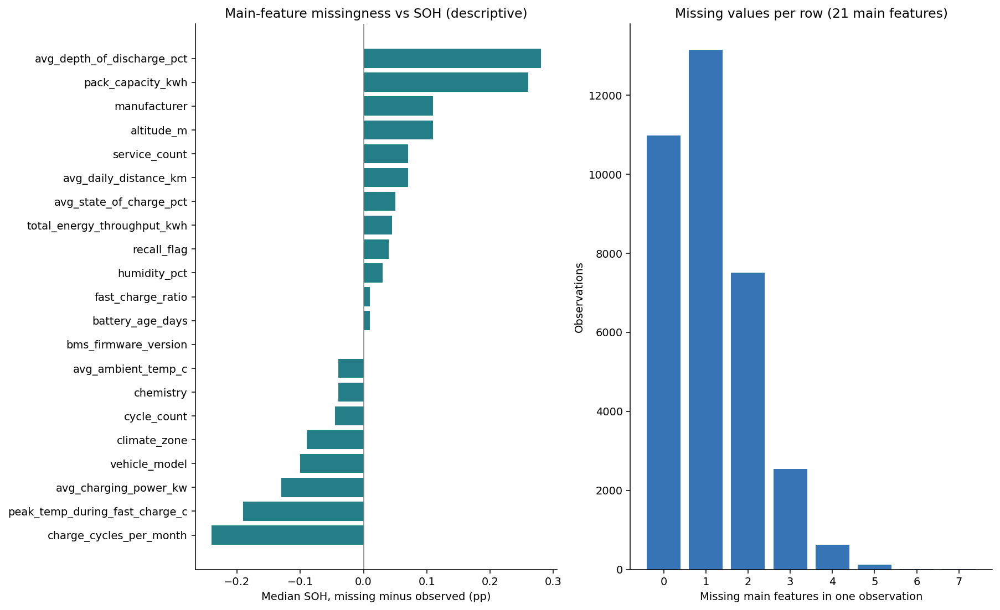
*Gambar 3.1 Selisih median SOH antara nilai hilang dan teramati per fitur utama (kiri) serta distribusi jumlah fitur utama yang hilang per baris observasi pada data train (kanan).*

Sebagaimana ditunjukkan pada panel kiri Gambar 3.1, selisih median SOH antara baris yang kehilangan nilai dan baris yang terisi pada ke-21 fitur utama sangat sempit, yaitu hanya berkisar antara -0,240 poin persentase (charge_cycles_per_month) hingga +0,280 poin persentase (avg_depth_of_discharge_pct). Pengujian kemunculan nilai hilang secara bersamaan antarfitur (co-missingness) menggunakan matriks koefisien phi pada berkas results/eda/missingness_pairs.csv juga menunjukkan nilai korelasi absolut maksimum |phi| sebesar 0,017 (antara avg_depth_of_discharge_pct dan last_service_date). Panel kanan Gambar 3.1 memperlihatkan bahwa sebagian besar baris observasi memiliki 0, 1, atau 2 fitur yang kosong secara independen. Walaupun pola ini konsisten dengan penyuntikan nilai hilang acak oleh simulator, kecilnya selisih univariat tersebut tidak secara otomatis membuktikan asumsi Missing Completely at Random (MCAR) secara multivariat, sehingga penambahan indikator biner nilai hilang tetap dianjurkan pada tahap prapemrosesan.

### 3.2. Nilai Hilang pada Riwayat Servis

Berbeda tajam dari ke-21 fitur utama di atas, kolom tanggal servis terakhir (last_service_date) memiliki 13.198 baris kosong (37,785% dari data train) dan 21.731 baris terisi (62,215%). Pada baris-baris yang tanggal servis terakhirnya kosong, median SOH mencapai 97,790% dengan median umur baterai (battery_age_days) hanya 174,0 hari. Sebaliknya, pada baris-baris yang memiliki catatan tanggal servis terakhir, median SOH turun menjadi 92,700% (selisih +5,090 poin persentase) dengan median umur baterai mencapai 662,0 hari. Sementara itu, fitur jumlah servis kumulatif (service_count) terisi pada 33.825 baris (96,839%) dengan median 1,000 kali servis (kuartil bawah 0,000, kuartil atas 3,000, dan maksimum 14,000 kali) serta memiliki korelasi negatif terhadap SOH (Spearman r_s = -0,432). Perbandingan distribusi kuartil SOH dan umur baterai menurut ketersediaan tanggal servis divisualisasikan pada Gambar 3.2.

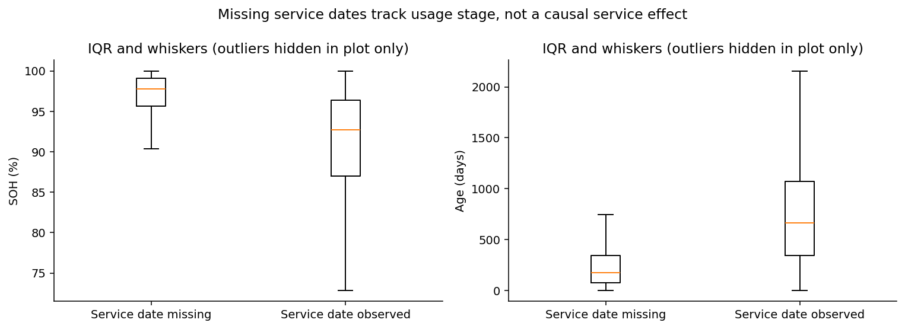
*Gambar 3.2 Perbandingan distribusi kuartil SOH (kiri) dan usia baterai dalam hari (kanan) antara observasi dengan tanggal servis kosong dan tanggal servis terisi pada data train.*

Kontras mencolok pada Gambar 3.2 membuktikan bahwa ketiadaan nilai pada last_service_date bukanlah kegagalan pencatatan sensor yang acak, melainkan nilai hilang struktural yang berkaitan erat dengan tahap penggunaan kendaraan. Baterai yang masih berusia muda (median 174 hari, kurang dari enam bulan sejak produksi) umumnya belum pernah menjalani kunjungan perawatan berkala (service_count = 0), sehingga kolom tanggal servis terakhirnya secara alami bernilai kosong dan kondisi kesehatannya masih sangat prima (median SOH 97,790%). Sebaliknya, baterai yang telah memiliki riwayat tanggal servis adalah baterai yang telah beroperasi jauh lebih lama (median 662 hari). Temuan ini menegaskan dua hal penting: perbedaan SOH sebesar 5,090 poin persentase tersebut tidak boleh disalahartikan sebagai bukti bahwa tindakan servis merusak kesehatan baterai, dan kolom tanggal mentah last_service_date tidak boleh diimputasi dengan nilai tanggal sembarang.

### 3.3. Duplikasi dan Validitas Nilai

Berdasarkan laporan audit pada results/audit/AUDIT_REPORT.md dan results/audit/quality_summary.json, pemeriksaan integritas struktural pada seluruh 50.000 baris dataset menghasilkan nol pelanggaran format. Tidak ditemukan duplikasi baris penuh (duplicate_rows = 0), tidak ada duplikasi identitas pengamatan (duplicate_observation_ids = 0), dan tidak ada duplikasi pasangan (battery_id, observation_date) pada baris-baris yang tanggal pengamatannya terisi (duplicate_dated_battery_observations = 0). Selain itu, seluruh kolom numerik bebas dari nilai tak hingga (infinite_numeric_values = 0) dan kolom target bebas dari nilai kosong (missing_targets = 0).

**Tabel 3.2 Ringkasan hasil pemeriksaan duplikasi, validitas rentang fisik, dan konsistensi atribut dari AUDIT_REPORT.md**

| Kategori Pemeriksaan Audit | Indikator / Aturan Validasi | Jumlah Pelanggaran | Status Validitas |
| --- | --- | --- | --- |
| Duplikasi Data | Baris identik penuh & duplikasi observation_id | 0 | Valid (100% unik) |
| Duplikasi Pasangan Waktu | Pasangan (battery_id, observation_date) bertanggal sama | 0 | Valid (0 duplikasi) |
| Kelengkapan Target & Nilai Numerik | Target kosong (missing_targets) & nilai numerik +-Inf | 0 | Valid (terisi penuh) |
| Validitas Format Tanggal | Kegagalan urai (parse failure) pada 3 kolom tanggal | 0 | Valid (format ISO YYYY-MM-DD) |
| Konsistensi Urutan Tanggal | Observasi < produksi, servis > observasi, servis < produksi | 0 / 0 / 0 | Valid (kronologis konsisten) |
| Identitas Umur Kalender | Selisih (observation_date - manufacture_date) != battery_age_days | 0 (dari 43.199 baris) | Valid (100% eksak) |
| Batas Rentang Fisik Dasar | SOH, capacity_fade, DoD, SoC, humidity di luar [0, 100]; fast_charge_ratio di luar [0, 1]; recall_flag bukan {0, 1} | 0 | Valid (dalam batas domain) |
| Konsistensi Atribut Statis Baterai | Konflik nilai chemistry, manufacturer, vehicle_model, pack_capacity_kwh, manufacture_date, atau climate_zone dalam 1 battery_id | 0 | Valid (100% konsisten per baterai) |

Sebagaimana dirangkum pada Tabel 3.2, pemeriksaan konsistensi kronologis memastikan tidak ada tanggal observasi yang mendahului tanggal produksi (2020-09-29 s.d. 2026-07-29), tidak ada tanggal servis yang melampaui tanggal observasi (2020-10-07 s.d. 2026-09-27), dan pada 43.199 baris yang memiliki ketiga kolom lengkap, selisih hari antara observation_date dan manufacture_date selalu sama persis dengan nilai battery_age_days (0 ketidakcocokan). Enam atribut statis baterai (chemistry, manufacturer, vehicle_model, pack_capacity_kwh, manufacture_date, dan climate_zone) juga terbukti tidak pernah berubah nilai di antara pengamatan milik baterai yang sama sepanjang datanya tidak kosong.

### 3.4. Nilai Ekstrem dan Sensitivitas terhadap Batas IQR

Untuk mendeteksi keberadaan nilai ekstrem tanpa berasumsi bahwa distribusi fitur berbentuk lonceng Gaussian, diterapkan aturan pagar antarkuartil 1,5 x IQR pada data train, dengan batas bawah Q1 - 1,5 x IQR dan batas atas Q3 + 1,5 x IQR. Nilai pengamatan yang berada di luar pagar tersebut ditandai sebagai kandidat pencilan (outlier candidates) untuk diinspeksi, bukan langsung dihapus sebagai kesalahan ukur. Proporsi kandidat pencilan per fitur dan bentuk ekor panjang pada durasi pengisian daya rata-rata (charge_time_avg_min) ditampilkan pada Gambar 3.3.

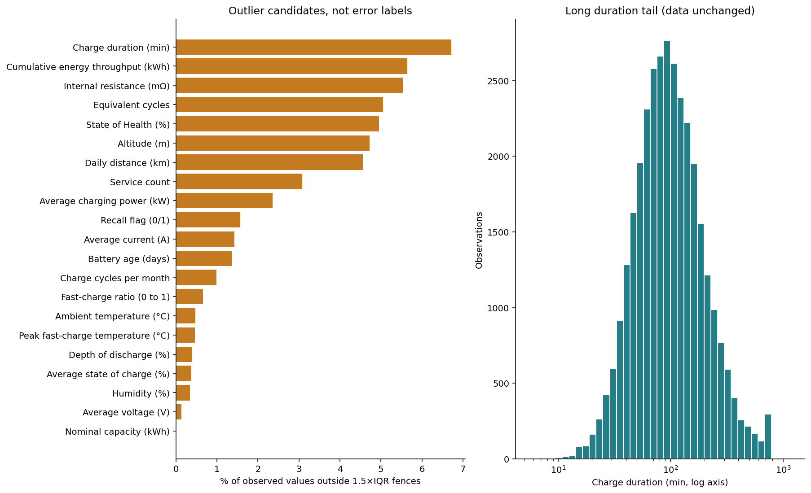
*Gambar 3.3 Persentase nilai teramati yang berada di luar pagar 1,5 x IQR pada setiap fitur (kiri) dan histogram berekor panjang pada durasi pengisian daya dalam sumbu logaritmik (kanan).*

Gambar 3.3 menunjukkan bahwa fitur dengan proporsi kandidat pencilan tertinggi adalah charge_time_avg_min (5,952% atau 1.995 dari 33.516 baris, dengan nilai maksimum mencapai 997,000 menit dibandingkan median 45,500 menit dan skewness 4,769), diikuti oleh avg_daily_distance_km (4,524% atau 1.513 baris, skewness 1,825), cycle_count (4,461% atau 1.487 baris, skewness 1,918), dan total_energy_throughput_kwh (4,029% atau 1.312 baris, skewness 1,680). Aturan 1,5 x IQR juga menandai 3,667% (1.281 baris) pada target state_of_health_pct (seluruhnya di bawah pagar bawah 78,125%) dan 1,569% (519 baris) pada recall_flag (seluruhnya bernilai 1,0 karena pagar Q1 dan Q3 bernilai 0). Fakta bahwa kondisi baterai terdegradasi berat dan kejadian recall ikut tertandai membuktikan bahwa pemangkasan otomatis berdasarkan IQR akan membuang sinyal langka yang justru paling berharga.

Guna menguji apakah keberadaan nilai ekstrem tersebut mendistorsi hubungan monoton antara fitur dan SOH, dilakukan analisis sensitivitas dengan membandingkan korelasi Spearman pada seluruh pasangan observasi valid terhadap korelasi Spearman yang dihitung hanya pada pasangan di dalam pagar 1,5 x IQR (results/eda/outlier_association_sensitivity.csv), sebagaimana dirangkum pada Tabel 3.3.

**Tabel 3.3 Analisis sensitivitas korelasi Spearman terhadap SOH pada seluruh pasangan valid dibandingkan pasangan di dalam pagar 1,5 x IQR**

| Nama Fitur | Peran Fitur | Pasangan Valid (Semua) | Pasangan dalam 1,5 x IQR | Spearman (Semua) | Spearman (Dalam IQR) | Selisih (Dalam IQR - Semua) |
| --- | --- | --- | --- | --- | --- | --- |
| cycle_count | primary_feature | 33.337 | 31.850 | -0,907 | -0,891 | +0,016 |
| battery_age_days | primary_feature | 32.814 | 32.454 | -0,842 | -0,836 | +0,006 |
| total_energy_throughput_kwh | primary_feature | 32.567 | 31.255 | -0,841 | -0,823 | +0,018 |
| service_count | primary_feature | 33.825 | 32.874 | -0,432 | -0,407 | +0,025 |
| charge_cycles_per_month | primary_feature | 33.503 | 32.866 | -0,317 | -0,308 | +0,009 |
| avg_daily_distance_km | primary_feature | 33.444 | 31.931 | -0,234 | -0,213 | +0,021 |
| avg_ambient_temp_c | primary_feature | 32.659 | 32.404 | -0,061 | -0,059 | +0,002 |
| fast_charge_ratio | primary_feature | 32.563 | 32.393 | -0,058 | -0,057 | +0,001 |
| peak_temp_during_fast_charge_c | primary_feature | 33.439 | 33.249 | -0,055 | -0,051 | +0,004 |
| avg_depth_of_discharge_pct | primary_feature | 32.933 | 32.789 | -0,049 | -0,049 | 0,000 |
| avg_charging_power_kw | primary_feature | 33.416 | 32.681 | -0,009 | -0,008 | +0,001 |
| pack_capacity_kwh | primary_feature | 33.345 | 33.345 | -0,008 | -0,008 | 0,000 |
| altitude_m | primary_feature | 33.297 | 32.865 | +0,003 | +0,002 | -0,001 |
| avg_state_of_charge_pct | primary_feature | 32.778 | 32.671 | -0,003 | -0,002 | +0,001 |
| humidity_pct | primary_feature | 32.993 | 32.993 | -0,001 | -0,001 | 0,000 |
| recall_flag | primary_feature | 33.084 | 32.565 | +0,005 | Tidak terdefinisi (konstan 0) | - |
| internal_resistance_mohm | sensor_proxy | 33.465 | 33.038 | -0,730 | -0,719 | +0,011 |
| voltage_avg_v | sensor_proxy | 33.002 | 32.905 | +0,164 | +0,162 | -0,002 |
| charge_time_avg_min | sensor_proxy | 33.516 | 31.521 | +0,009 | +0,010 | +0,001 |
| current_avg_a | sensor_proxy | 33.157 | 32.393 | +0,008 | +0,009 | +0,001 |

Tabel 3.3 membuktikan bahwa pola utama asosiasi fitur terhadap SOH bertahan sangat stabil meskipun nilai-nilai di luar pagar 1,5 x IQR dikeluarkan. Pada ketiga fitur terkuat, yaitu cycle_count (33.337 pasangan semua vs 31.850 pasangan dalam IQR), battery_age_days (32.814 vs 32.454 pasangan), dan total_energy_throughput_kwh (32.567 vs 31.255 pasangan), perubahan korelasi Spearman hanya berkisar antara +0,006 hingga +0,018. Urutan peringkat kepentingan fitur tidak mengalami perubahan sama sekali, sehingga penghapusan baris berbasis IQR tidak diperlukan.

### 3.5. Keteraturan Tanggal dan Konsistensi Pengukuran Kumulatif

Audit terhadap keteraturan tanggal pengamatan dan perilaku variabel kumulatif mengungkap keterbatasan mendasar apabila dataset ini diperlakukan sebagai deret waktu murni. Pertama, kolom observation_date kosong pada 2.216 baris di seluruh dataset (4,432%) dan kosong pada 1.581 baris di dalam himpunan train (4,526%), sehingga posisi kronologis baris-baris tersebut di dalam riwayat baterai tidak dapat ditentukan tanpa melakukan tebakan atau penghapusan data. Kedua, pada baris-baris yang memiliki tanggal pengamatan valid, jarak hari antarobservasi berurutan di dalam satu baterai sangat bervariasi dan tidak memiliki periode pencuplikan yang tetap (irregular sampling intervals).

**Tabel 3.4 Pemeriksaan monotonisitas penghitung kumulatif pada pasangan observasi berurutan bertanggal valid**

| Variabel Penghitung Kumulatif | Pasangan Berurutan Valid (Eligible Pairs) | Pasangan dengan Nilai Menurun (Decreasing Pairs) | Persentase Penurunan Nilai (%) |
| --- | --- | --- | --- |
| cycle_count (jumlah siklus kumulatif) | 43.017 | 7.820 | 18,179% |
| battery_age_days (umur kalender baterai) | 42.320 | 0 | 0,000% |
| total_energy_throughput_kwh (energi kumulatif) | 41.948 | 8.923 | 21,272% |

Ketiga, sebagaimana ditunjukkan pada Tabel 3.4, pengujian terhadap pasangan pengamatan berurutan dari baterai yang sama dengan tanggal yang meningkat menunjukkan bahwa dua variabel yang secara definisi fisik tidak mungkin berkurang justru sering menurun di dalam simulator. Nilai cycle_count mengalami penurunan pada 7.820 dari 43.017 pasangan valid (18,179%), sedangkan total_energy_throughput_kwh menurun pada 8.923 dari 41.948 pasangan valid (21,272%), padahal battery_age_days selalu naik secara konsisten (0% penurunan dari 42.320 pasangan). Ketidakkonsistenan penghitung kumulatif ini berpadu langsung dengan fenomena kenaikan nilai SOH antarobservasi yang dibahas lebih mendalam pada Subbab 4.9, sekaligus menjadi dasar metodologis mengapa fitur direpresentasikan secara tabular per pengamatan tanpa pembentukan jendela waktu (timesteps).

## 4. Hasil Eksplorasi Data

### 4.1. Distribusi SOH dan Keterwakilan Rentang SOH Rendah

Pada himpunan data train (34.929 observasi dari 1.820 baterai), variabel target state_of_health_pct terbentang dari nilai minimum 55,000% hingga maksimum 100,000%, dengan median 95,230% (kuartil bawah P25 = 90,080%, kuartil atas P75 = 98,050%, IQR = 7,970 poin persentase) serta rerata aritmetika 92,919% (simpangan baku 7,193%). Persentil bawah menunjukkan bahwa P1 berada pada 67,256% dan P5 berada pada 78,220%, sementara P95 dan P99 masing-masing mencapai 99,980% dan 100,000%. Nilai kemencengan (skewness) sebesar -1,808 menegaskan bahwa distribusi target sangat menceng ke kiri (left-skewed), disertai penumpukan nilai tepat pada batas atas 100,000% sebanyak 1.603 baris dan pada batas bawah 55,000% sebanyak 80 baris akibat pemotongan (clipping) di dalam simulator. Distribusi histogram dan fungsi distribusi kumulatif empiris (ECDF) ditampilkan pada Gambar 4.1, sedangkan proporsi pengamatan per rentang SOH dirangkum pada Tabel 4.1.

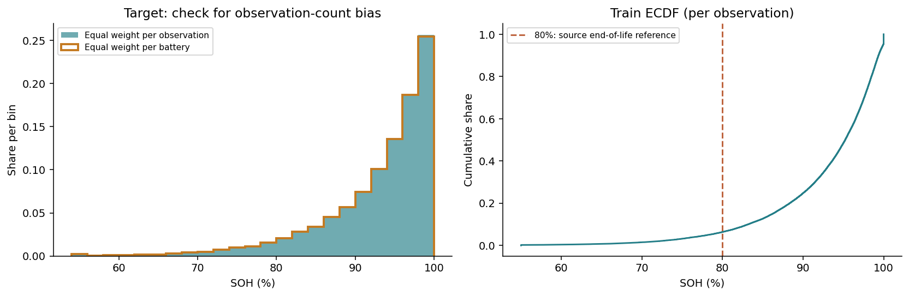
*Gambar 4.1 Histogram distribusi target SOH pada data train dengan perbandingan bobot observasi vs bobot baterai (kiri) serta kurva ECDF dengan garis referensi EOL 80% (kanan).*

**Tabel 4.1 Proporsi pengamatan data train menurut rentang nilai State of Health (SOH band)**

| Rentang SOH (soh_band_pct) | Jumlah Observasi Train | Proporsi Observasi Train (%) | Interpretasi Kondisi Kesehatan Baterai |
| --- | --- | --- | --- |
| < 70% | 525 | 1,503% | Degradasi kritis / jauh di bawah batas EOL |
| 70% - < 80% | 1.697 | 4,858% | Degradasi lanjut / di bawah ambang EOL 80% |
| 80% - < 90% | 6.412 | 18,357% | Degradasi menengah / kapasitas mulai menurun |
| 90% - < 95% | 8.264 | 23,659% | Degradasi ringan / tahap operasional normal |
| >= 95% | 18.031 | 51,622% | Kondisi sangat sehat / mendekati kapasitas baru |
| Total Train | 34.929 | 100,000% | Seluruh pengamatan pada 1.820 baterai train |

Sebagaimana terlihat pada Tabel 4.1 dan kurva ECDF Gambar 4.1, lebih dari separuh pengamatan (51,622% atau 18.031 baris) terkonsentrasi pada rentang SOH >= 95%, dan 75,281% pengamatan berada pada SOH >= 90%. Sebaliknya, pengamatan yang berada di bawah ambang batas akhir masa pakai (SOH < 80%) hanya mencakup 6,361% (2.222 baris), dengan rentang paling kritis (< 70%) hanya diwakili oleh 1,503% (525 baris). Dominasi baterai sehat ini menyebabkan metrik evaluasi rata-rata global seperti MAE atau RMSE keseluruhan akan sangat ditentukan oleh galat pada rentang SOH >= 90%. Apabila dukungan data dan galat prediksi pada rentang SOH rendah (< 80% dan < 70%) tidak dilaporkan secara terpisah, kegagalan model dalam mendeteksi baterai yang sudah kritis akan tertutup oleh tingginya akurasi pada baterai sehat.

### 4.2. Jumlah Observasi per Baterai dan Pengaruh Pembobotan

Pada himpunan data train (1.820 baterai), jumlah pengamatan per baterai bervariasi dari minimum 7 hingga maksimum 37 baris, dengan median 19,000 baris (P25 = 16,000, P75 = 22,000) dan rerata 19,231 baris (simpangan baku 4,367). Untuk menguji apakah perbedaan jumlah baris per baterai menggeser ringkasan distribusi target, dilakukan perbandingan antara statistik tingkat observasi (bobot sama untuk setiap baris) dan statistik berbobot sama per baterai (setiap baris diberi bobot 1 / n_i sehingga total bobot tiap baterai bernilai 1). Sebaran jumlah observasi per baterai dan hubungannya dengan rata-rata SOH baterai divisualisasikan pada Gambar 4.2.

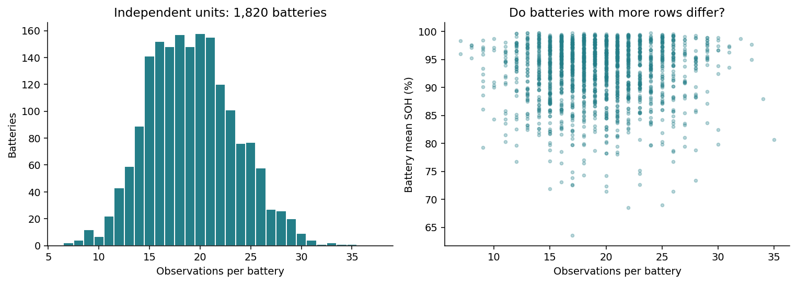
*Gambar 4.2 Histogram jumlah observasi per baterai pada data train (kiri) dan diagram pencar antara jumlah observasi per baterai terhadap rata-rata SOH baterai (kanan).*

Hasil perhitungan menunjukkan bahwa rata-rata SOH per observasi adalah 92,919% sedangkan rata-rata SOH berbobot sama per baterai adalah 92,913% (selisih hanya 0,006 poin persentase). Demikian pula, median SOH per observasi sebesar 95,230% hampir identik dengan median SOH berbobot sama per baterai sebesar 95,210% (selisih 0,020 poin persentase), sebagaimana tampak dari berimpitnya kurva oranye dan histogram biru pada panel kiri Gambar 4.1. Panel kanan Gambar 4.2 memperkuat temuan ini melalui koefisien korelasi Spearman antara jumlah observasi dan rata-rata SOH baterai yang bernilai r_s = 0,014 (mendekati nol). Artinya, frekuensi pencatatan di dalam simulator tidak bergantung pada tingkat kesehatan baterai, meskipun pengamatan berulang di dalam satu baterai tetap saling berkorelasi sehingga ukuran sampel efektif tetaplah 1.820 unit baterai, bukan 34.929 baris bebas.

### 4.3. Distribusi Fitur Numerik, Kategorikal, dan Biner

#### 4.3.1. Profil Fitur Numerik

Pemeriksaan terhadap ke-15 fitur numerik utama dan 4 kandidat proksi sensor pada data train memperlihatkan variasi rentang skala dan bentuk sebaran yang tajam, sebagaimana ditunjukkan pada Gambar 4.3 dan Gambar 4.4 (statistik deskriptif lengkap untuk seluruh 20 variabel numerik disajikan pada Lampiran 8.2, Tabel 8.2). Dari sisi skala pengukuran, fitur fast_charge_ratio berada pada interval sempit [0,000; 0,937] (median 0,272, IQR 0,244), sedangkan total_energy_throughput_kwh mencapai rentang [0,100; 441.533,700] kWh (median 25.004,600 kWh, IQR 45.774,600 kWh) dan cycle_count membentang pada [1,000; 5.073,000] siklus (median 372,000 siklus, IQR 664,000 siklus).

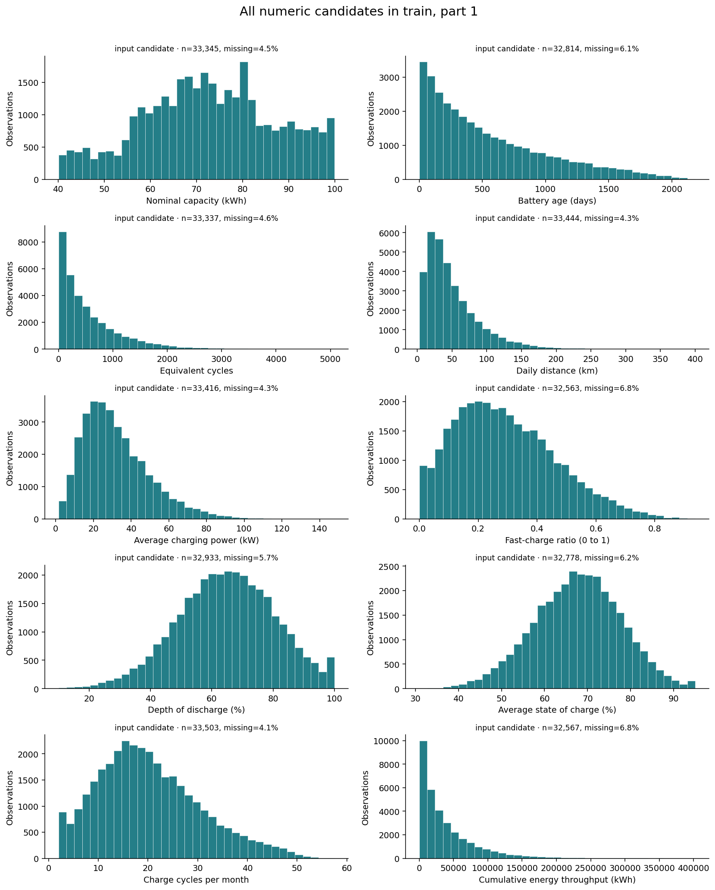
*Gambar 4.3 Histogram distribusi fitur numerik pada data train bagian pertama (mencakup kapasitas paket, umur, jumlah siklus, jarak harian, daya pengisian, rasio fast charge, DoD, SoC, siklus bulanan, dan energi kumulatif).*

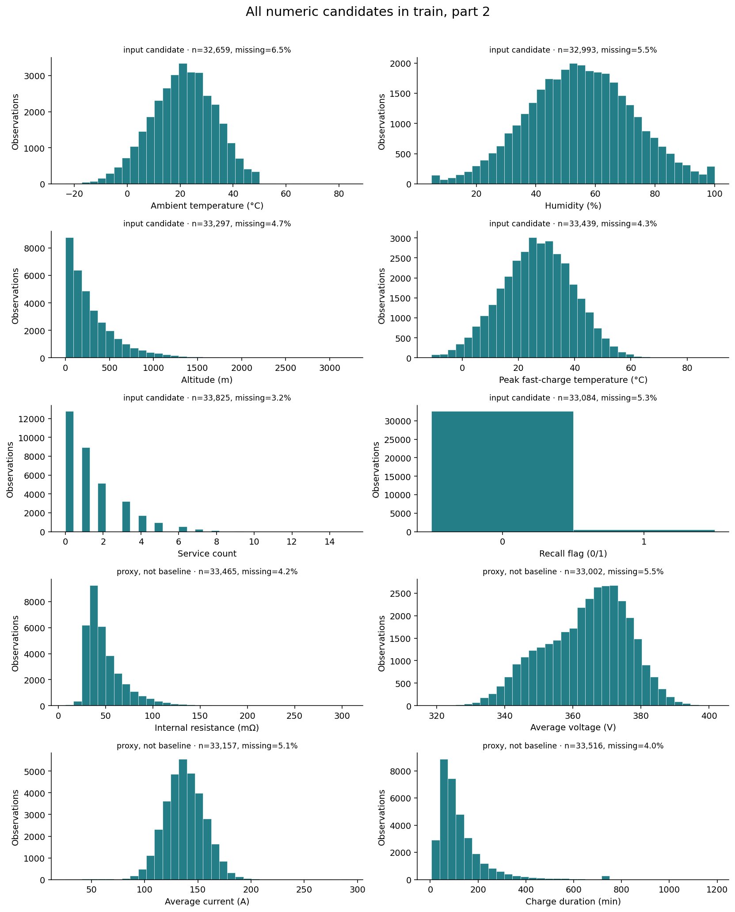
*Gambar 4.4 Histogram distribusi fitur numerik pada data train bagian kedua (mencakup suhu lingkungan, kelembapan, ketinggian, suhu puncak fast charge, jumlah servis, recall flag, dan empat variabel sensor).*

Dari sisi bentuk distribusi pada Gambar 4.3 dan Gambar 4.4, fitur-fitur kumulatif dan intensitas pemakaian memiliki kemencengan positif (right-skewed) dan ekor kanan yang panjang, terutama charge_time_avg_min (skewness 4,769), cycle_count (1,918), avg_daily_distance_km (1,825), total_energy_throughput_kwh (1,680), service_count (1,387), avg_charging_power_kw (0,997), dan battery_age_days (0,992). Sebaliknya, variabel kapasitas dan kondisi operasi seperti pack_capacity_kwh (skewness -0,098, median 72,500 kWh), avg_depth_of_discharge_pct (-0,146, median 65,000%), avg_state_of_charge_pct (-0,116, median 67,900%), avg_ambient_temp_c (-0,084, median 21,800 derajat C), dan humidity_pct (0,001, median 58,200%) memiliki sebaran yang mendekati simetris. Ketimpangan skala hingga lima orde besaran ini menuntut normalisasi (standard scaling atau min-max scaling) sebelum fitur diumpankan ke lapisan linear pertama MLP.

#### 4.3.2. Profil Fitur Kategorikal dan Biner

Kelima fitur kategorikal utama (chemistry, manufacturer, vehicle_model, climate_zone, dan bms_firmware_version) serta satu fitur biner (recall_flag) dirangkum menggunakan dua satuan analisis sekaligus, yaitu jumlah baris observasi (rows) dan jumlah baterai unik (batteries) pada Gambar 4.5 (angka lengkap per kategori dicantumkan pada Lampiran 8.2, Tabel 8.3). Pada atribut statis chemistry, kategori NMC mendominasi dengan 10.884 baris (31,160%, 613 baterai) dan LFP sebanyak 9.805 baris (28,071%, 546 baterai), diikuti NCA sebanyak 6.985 baris (19,998%, 393 baterai), LMO sebanyak 4.850 baris (13,885%, 268 baterai), serta kategori Missing sebanyak 2.405 baris (6,885% yang tersebar di 1.345 baterai).

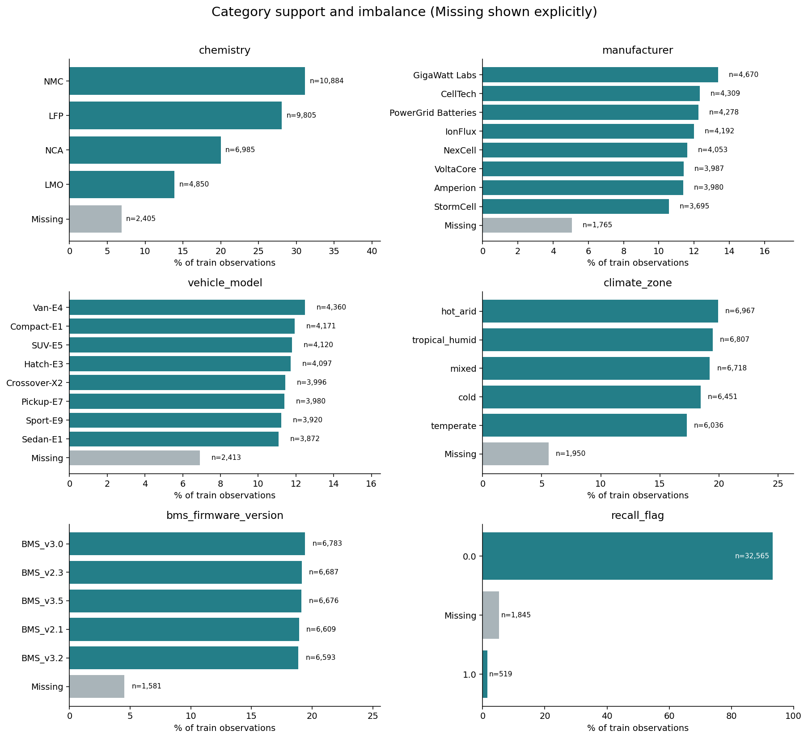
*Gambar 4.5 Frekuensi baris observasi dan jumlah baterai unik untuk setiap kategori pada lima fitur kategorikal utama serta fitur biner recall_flag pada data train.*

Pada fitur manufacturer (8 produsen) dan vehicle_model (8 model kendaraan), distribusi dukungan sampel terbagi merata di kisaran 10,579% hingga 13,370% per kategori (200 hingga 260 baterai per produsen) dan 11,085% hingga 12,482% per model kendaraan (216 hingga 238 baterai). Demikian pula, climate_zone terbagi relatif seimbang di antara lima zona iklim (17,281% pada temperate hingga 19,946% pada hot_arid, masing-masing didukung 342 hingga 379 baterai). Hal penting yang perlu dicermati adalah sifat dinamis pada bms_firmware_version dan recall_flag: masing-masing dari kelima versi firmware (BMS_v2.1 hingga BMS_v3.5) muncul pada sekitar 1.757 hingga 1.785 baterai unik dari total 1.820 baterai train karena versi firmware dapat berubah antarobservasi di dalam baterai yang sama. Selain itu, kejadian recall_flag = 1,0 merupakan kategori langka yang hanya mencakup 519 baris (1,486% dari data train, tersebar pada 460 baterai), dibandingkan recall_flag = 0,0 sebanyak 32.565 baris (93,232%) dan Missing sebanyak 1.845 baris (5,282%).

### 4.4. Hubungan SOH dengan Usia, Siklus, dan Energi Kumulatif

Analisis asosiasi bivariat terhadap target state_of_health_pct menempatkan tiga variabel riwayat penggunaan kumulatif sebagai prediktor dengan hubungan monoton negatif terkuat di antara seluruh 21 fitur utama. Sebagaimana ditampilkan pada Gambar 4.6 dan Tabel 4.2, jumlah siklus kumulatif (cycle_count) memiliki korelasi Spearman gabungan (pooled) sebesar r_s = -0,907 (Pearson r = -0,860 pada 33.337 pasangan observasi), diikuti oleh usia kalender baterai (battery_age_days) dengan r_s = -0,842 (r = -0,813 pada 32.814 pasangan), serta total energi kumulatif yang disalurkan (total_energy_throughput_kwh) dengan r_s = -0,841 (r = -0,814 pada 32.567 pasangan). Di bawah ketiga variabel tersebut, jumlah servis (service_count, r_s = -0,432), laju siklus bulanan (charge_cycles_per_month, r_s = -0,317), dan jarak tempuh harian rata-rata (avg_daily_distance_km, r_s = -0,234) menunjukkan hubungan negatif tingkat menengah.

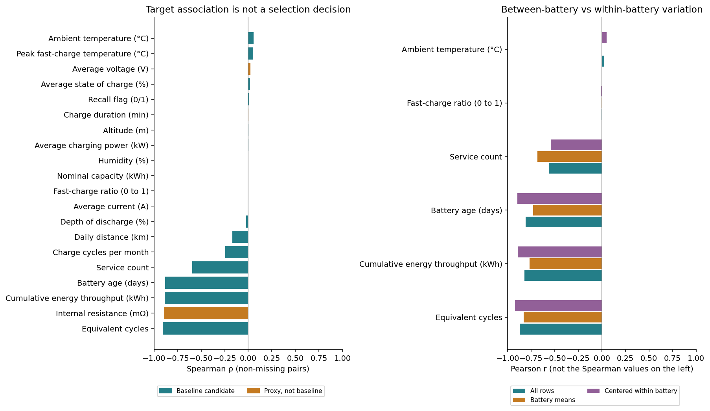
*Gambar 4.6 Perbandingan korelasi Spearman terhadap SOH pada tingkat observasi gabungan, antar-baterai (between-battery), dan intra-baterai (within-battery) pada data train.*

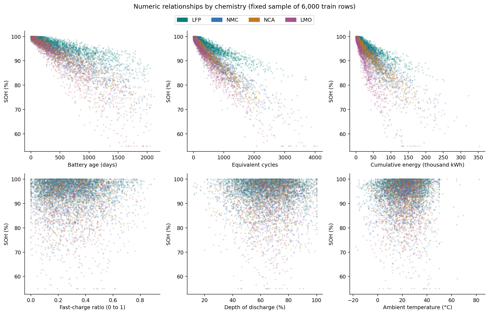
*Gambar 4.7 Diagram pencar hubungan antara fitur numerik utama terhadap SOH yang dikelompokkan menurut kimia baterai (LFP, NMC, NCA, dan LMO) pada sampel deterministik data train.*

Dekomposisi korelasi pada Gambar 4.6 memperlihatkan bahwa hubungan negatif yang kuat pada ketiga fitur utama tersebut berlaku secara konsisten baik ketika membandingkan rata-rata antar-unit baterai (between-battery Spearman: -0,765 untuk cycle_count, -0,683 untuk battery_age_days, dan -0,682 untuk total_energy_throughput_kwh pada 1.820 baterai) maupun ketika melacak penyimpangan di dalam baterai yang sama dari waktu ke waktu (within-battery Spearman: -0,884 untuk cycle_count, -0,868 untuk battery_age_days, dan -0,858 untuk total_energy_throughput_kwh). Lebih lanjut, diagram pencar pada Gambar 4.7 mengungkap bahwa hubungan antara cycle_count, battery_age_days, dan total_energy_throughput_kwh terhadap SOH tidak membentuk satu garis tunggal yang sempit, melainkan terpecah menjadi pita-pita kemiringan (fan-shaped bands) yang berbeda menurut jenis kimia baterai. Pada jumlah siklus atau usia yang sama, titik-titik pengamatan baterai LFP berada pada pita SOH paling atas dengan kemiringan penurunan paling landai, diikuti berturut-turut oleh NMC, NCA, dan LMO yang menurun paling curam.

### 4.5. Korelasi dan Redundansi Antarfitur

Pemeriksaan matriks korelasi Spearman antarfitur kandidat baseline pada Gambar 4.8 (beserta jumlah pasangan observasi valid pada berkas results/eda/correlation_pair_counts.csv dan results/eda/redundant_pairs.csv) mengidentifikasi empat pasangan fitur yang memiliki korelasi peringkat absolut sangat tinggi (|r_s| >= 0,80), sebagaimana disajikan pada Tabel 4.2.

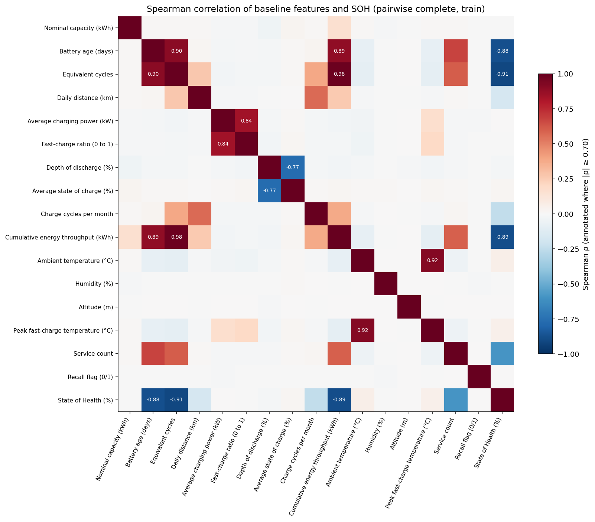
*Gambar 4.8 Matriks korelasi peringkat Spearman antarfitur kandidat baseline beserta variabel target state_of_health_pct pada data train.*

**Tabel 4.2 Pasangan fitur utama dengan tingkat kolinearitas / redundansi tertinggi (|Spearman| >= 0,80) pada data train**

| Fitur Pertama | Fitur Kedua | Pasangan Valid (Pairwise Rows) | Korelasi Spearman (r_s) | Korelasi Pearson (r) | Mekanisme Keterkaitan Domain |
| --- | --- | --- | --- | --- | --- |
| cycle_count | total_energy_throughput_kwh | 31.064 | +0,948 | +0,922 | Energi kumulatif merupakan hasil kali jumlah siklus dengan kapasitas dan kedalaman pengosongan. |
| battery_age_days | cycle_count | 31.304 | +0,928 | +0,854 | Akumulasi siklus bertambah seiring berjalannya umur kalender pemakaian kendaraan. |
| battery_age_days | total_energy_throughput_kwh | 30.582 | +0,900 | +0,835 | Total energi yang disalurkan terakumulasi sepanjang umur kalender operasional baterai. |
| avg_daily_distance_km | charge_cycles_per_month | 32.081 | +0,860 | +0,782 | Jarak tempuh harian yang tinggi secara langsung menuntut frekuensi pengisian bulanan yang lebih sering. |

Kuatnya korelasi antarfitur pada Tabel 4.2 membuktikan bahwa cycle_count, battery_age_days, dan total_energy_throughput_kwh (30.582 hingga 31.304 pasangan valid, r_s antara +0,900 hingga +0,948) membawa informasi penuaan kumulatif yang sangat tumpang tindih, bukan tiga bukti independen yang terpisah. Hal serupa terjadi antara avg_daily_distance_km dan charge_cycles_per_month (32.081 pasangan valid, r_s = +0,860) yang sama-sama mengukur intensitas pemakaian harian/bulanan. Temuan redundansi ini menjadi landasan langsung bagi perancangan eksperimen seleksi fitur pada tahap prapemrosesan: selain resep standar yang mempertahankan seluruh 21 fitur utama (67 neuron input), disusun pula resep kompak (compact_standard, 63 neuron input) yang meminimalkan redundansi dengan menguji penghapusan total_energy_throughput_kwh dan avg_daily_distance_km pada data validasi.

### 4.6. Perbandingan Kimia Baterai pada Kelompok Usia yang Sama

#### 4.6.1. Perbandingan SOH Mentah dan dalam Rentang Usia yang Sama

Pada data train mentah tingkat observasi, keempat jenis kimia baterai menunjukkan perbedaan SOH yang jelas: baterai LFP (Lithium Iron Phosphate) memiliki median SOH tertinggi sebesar 97,050% (rerata 96,130%), diikuti oleh NMC (Nickel Manganese Cobalt) dengan median 94,730% (rerata 92,706%), NCA (Nickel Cobalt Aluminum) dengan median 93,580% (rerata 91,295%), serta LMO (Lithium Manganese Oxide) dengan median terendah sebesar 91,965% (rerata 89,272%). Namun, perbandingan mentah tingkat baris berpotensi bias apabila satu jenis kimia kebetulan diamati lebih sering atau pada usia yang berbeda. Oleh sebab itu, Gambar 4.9 membandingkan distribusi SOH mentah (kiri) dengan kurva SOH dalam enam kelompok usia kalender yang sama (<= 1 tahun, 1-2 tahun, 2-3 tahun, 3-4 tahun, 4-5 tahun, dan > 5 tahun) di mana setiap unit baterai diberi bobot yang sama (kanan).

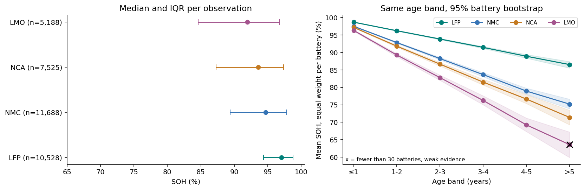
*Gambar 4.9 Perbandingan distribusi kuartil SOH mentah per kimia baterai (kiri) dan kurva rata-rata SOH berbobot sama per baterai lintas kelompok usia beserta interval bootstrap 95% (kanan).*

Sebagaimana terlihat pada panel kanan Gambar 4.9, urutan ketahanan SOH antarkimia baterai (LFP > NMC > NCA > LMO) tetap bertahan secara konsisten di setiap kelompok usia yang sama. Pada kelompok usia <= 1 tahun, rata-rata SOH berbobot baterai adalah 98,698% untuk LFP, 97,522% untuk NMC, 97,209% untuk NCA, dan 96,329% untuk LMO. Seiring bertambahnya usia baterai, jarak pemisahan kurva antarkimia semakin melebar: pada kelompok usia 3-4 tahun, rata-rata SOH berbobot baterai untuk LFP masih berada pada 91,459%, sedangkan NMC turun ke 83,654%, NCA ke 81,500%, dan LMO telah jatuh di bawah ambang akhir masa pakai pada 76,237%.

#### 4.6.2. Dukungan Data dan Ketidakpastian

Untuk menilai ketelitian estimasi pada setiap titik kurva usia dan kimia di atas, jumlah baterai unik, jumlah baris observasi, dan rentang interval kepercayaan bootstrap persentil 95% (1.000 replikasi pada tingkat baterai) dipetakan pada Gambar 4.10 serta dirangkum secara lengkap pada Tabel 4.3 (berdasarkan berkas results/eda/chemistry_age_profiles.csv).

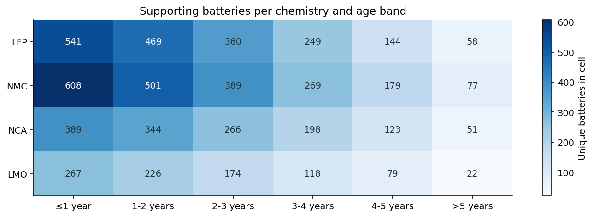
*Gambar 4.10 Peta panas (heatmap) jumlah baterai unik pendukung pada setiap sel kombinasi kimia baterai dan kelompok usia di dalam himpunan data train.*

**Tabel 4.3 Dukungan jumlah observasi, jumlah baterai, rata-rata SOH berbobot baterai, dan interval bootstrap 95% per kombinasi kimia dan usia**

| Kimia | Kelompok Usia | Baris Observasi | Baterai Unik | Rerata SOH Berbobot Baterai (%) | CI 95% Bawah (%) | CI 95% Atas (%) | Dukungan >= 30 Baterai |
| --- | --- | --- | --- | --- | --- | --- | --- |
| LFP | <= 1 tahun | 4.497 | 541 | 98,698% | 98,645% | 98,746% | Ya (True) |
| LFP | 1-2 tahun | 2.439 | 469 | 96,237% | 96,119% | 96,348% | Ya (True) |
| LFP | 2-3 tahun | 1.490 | 360 | 93,856% | 93,680% | 94,037% | Ya (True) |
| LFP | 3-4 tahun | 887 | 249 | 91,459% | 91,165% | 91,738% | Ya (True) |
| LFP | 4-5 tahun | 441 | 144 | 88,925% | 88,371% | 89,427% | Ya (True) |
| LFP | > 5 tahun | 138 | 58 | 86,533% | 85,535% | 87,412% | Ya (True) |
| NMC | <= 1 tahun | 5.089 | 608 | 97,522% | 97,420% | 97,612% | Ya (True) |
| NMC | 1-2 tahun | 2.718 | 501 | 92,845% | 92,634% | 93,038% | Ya (True) |
| NMC | 2-3 tahun | 1.519 | 389 | 88,249% | 87,905% | 88,600% | Ya (True) |
| NMC | 3-4 tahun | 917 | 269 | 83,654% | 83,046% | 84,219% | Ya (True) |
| NMC | 4-5 tahun | 587 | 179 | 78,937% | 78,037% | 79,771% | Ya (True) |
| NMC | > 5 tahun | 172 | 77 | 75,196% | 73,870% | 76,624% | Ya (True) |
| NCA | <= 1 tahun | 3.129 | 389 | 97,209% | 97,092% | 97,325% | Ya (True) |
| NCA | 1-2 tahun | 1.665 | 344 | 91,817% | 91,513% | 92,115% | Ya (True) |
| NCA | 2-3 tahun | 1.104 | 266 | 86,654% | 86,124% | 87,148% | Ya (True) |
| NCA | 3-4 tahun | 711 | 198 | 81,500% | 80,662% | 82,333% | Ya (True) |
| NCA | 4-5 tahun | 342 | 123 | 76,647% | 75,367% | 77,924% | Ya (True) |
| NCA | > 5 tahun | 112 | 51 | 71,389% | 69,263% | 73,431% | Ya (True) |
| LMO | <= 1 tahun | 2.261 | 267 | 96,329% | 96,141% | 96,514% | Ya (True) |
| LMO | 1-2 tahun | 1.168 | 226 | 89,270% | 88,781% | 89,709% | Ya (True) |
| LMO | 2-3 tahun | 725 | 174 | 82,786% | 82,011% | 83,517% | Ya (True) |
| LMO | 3-4 tahun | 414 | 118 | 76,237% | 74,999% | 77,572% | Ya (True) |
| LMO | 4-5 tahun | 238 | 79 | 69,248% | 67,324% | 71,203% | Ya (True) |
| LMO | > 5 tahun | 51 | 22 | 63,576% | 59,880% | 67,203% | Tidak (False) |

Gambar 4.10 dan Tabel 4.3 memperlihatkan bahwa jumlah baterai pendukung berkurang secara bertahap seiring bertambahnya kelompok usia pada seluruh jenis kimia. Sebanyak 23 dari 24 sel kombinasi memenuhi ambang batas kecukupan minimal 30 baterai unik, dengan interval kepercayaan 95% yang sangat rapat pada usia <= 1 tahun (lebar interval < 0,40 poin persentase). Sebaliknya, pada sel LMO berusia > 5 tahun, dukungan data menyusut hingga hanya tersisa 22 baterai unik dan 51 baris observasi (ditandai dengan simbol x pada kurva Gambar 4.9), sehingga lebar interval kepercayaan 95%-nya membengkak menjadi 7,323 poin persentase (59,880% hingga 67,203%).

#### 4.6.3. Pertanyaan Pemandu

Berdasarkan bukti kuantitatif pada Subbab 4.6.1 dan 4.6.2, ketiga pertanyaan pemandu analisis dapat dijawab secara tegas sebagai berikut:

1. Apakah pola perbedaan SOH antar kimia masih terlihat ketika rentang usianya sama? Ya, pola perbedaan SOH antarkimia tetap terlihat sangat jelas dan konsisten di dalam setiap rentang usia yang sama bahkan setelah setiap baterai diberi bobot yang setara. Sebagai contoh, pada rentang usia 1-2 tahun, rata-rata SOH berbobot baterai adalah 96,237% (CI 95%: 96,119%-96,348%) untuk LFP, 92,845% (92,634%-93,038%) untuk NMC, 91,817% (91,513%-92,115%) untuk NCA, dan 89,270% (88,781%-89,709%) untuk LMO, di mana keempat interval kepercayaan bootstrap 95% tersebut sama sekali tidak saling tumpang tindih.
2. Kelompok mana yang memiliki jumlah baterai paling sedikit, dan bagaimana hal itu memengaruhi interpretasi? Kelompok dengan dukungan paling sedikit adalah kombinasi kimia LMO pada rentang usia > 5 tahun yang hanya didukung oleh 22 baterai unik (51 baris observasi), berada di bawah ambang batas minimum 30 baterai. Kecilnya ukuran sampel ini meningkatkan variansi estimasi rata-rata kelompok secara tajam (interval bootstrap 95% melebar dari 59,880% hingga 67,203%), sehingga titik ujung kurva LMO pada usia > 5 tahun memiliki ketidakpastian yang tinggi dan tidak boleh diinterpretasikan secara berlebihan sebagai nilai populasi yang presisi.
3. Faktor penggunaan apa yang mungkin ikut menjelaskan perbedaan SOH antarkelompok? Karena pengelompokan pada Gambar 4.9 baru mengontrol usia kalender (battery_age_days), perbedaan SOH antarkelompok masih dapat dipengaruhi oleh faktor penggunaan lain yang belum dikontrol secara simultan, terutama laju siklus bulanan (charge_cycles_per_month, yang di dalam sel kimia dan usia yang sama masih memiliki korelasi Spearman hingga -0,796 terhadap SOH), akumulasi cycle_count, rasio pengisian cepat (fast_charge_ratio), kedalaman pengosongan rata-rata (avg_depth_of_discharge_pct), serta suhu operasi (avg_ambient_temp_c). Oleh karena itu, perbedaan kurva tersebut merepresentasikan pola gabungan di dalam simulator dan menuntut pemodelan multivariat bersama fitur penggunaan lainnya.

### 4.7. Pola SOH Menurut Penggunaan, Pengisian Cepat, dan Kondisi Operasi

Secara univariat pada seluruh data train gabungan, rasio pengisian cepat (fast_charge_ratio) tampak hanya memiliki korelasi negatif yang sangat lemah terhadap SOH (Spearman r_s = -0,058, Pearson r = -0,057), begitu pula suhu lingkungan rata-rata (avg_ambient_temp_c, r_s = -0,061), suhu puncak saat fast charging (peak_temp_during_fast_charge_c, r_s = -0,055), dan kedalaman pengosongan rata-rata (avg_depth_of_discharge_pct, r_s = -0,049). Untuk memeriksa apakah hubungan fast_charge_ratio berubah ketika dikelompokkan menurut usia baterai, Gambar 4.11 dan Tabel 4.4 menyajikan matriks median SOH lintas enam kelompok usia dan empat pita rasio pengisian cepat (0-0,2; >0,2-0,4; >0,4-0,6; dan >0,6-1,0) berdasarkan berkas results/eda/age_fastcharge_grid.csv.

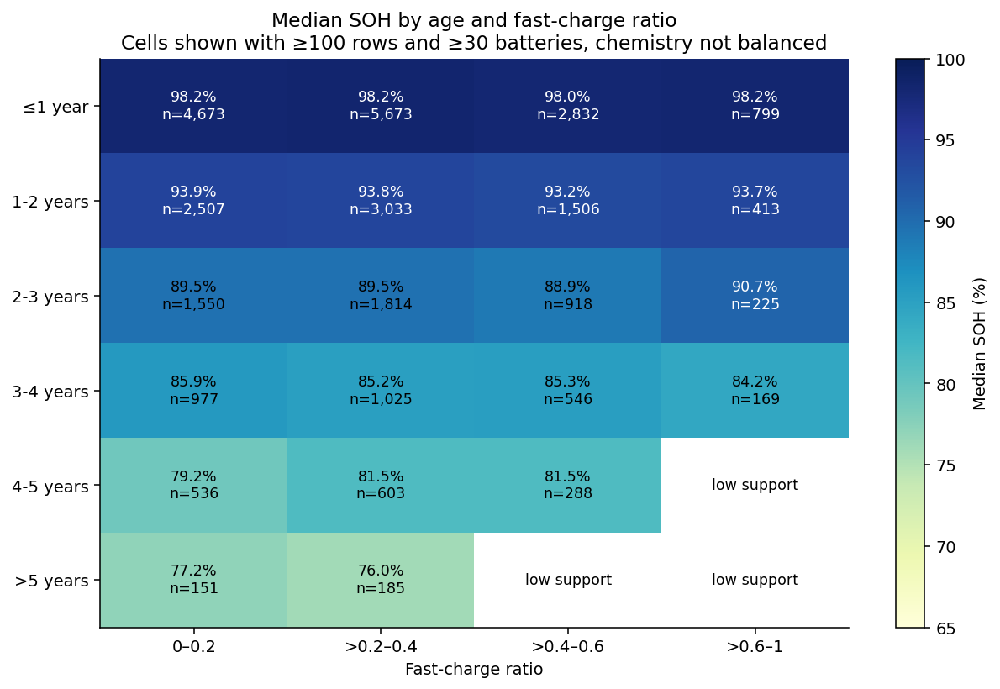
*Gambar 4.11 Peta panas median SOH (kiri) dan jumlah dukungan baris/baterai (kanan) menurut matriks kelompok usia baterai dan pita rasio pengisian cepat (fast_charge_ratio) pada data train.*

**Tabel 4.4 Median SOH (%) dan dukungan jumlah baterai unik (dalam tanda kurung) menurut kelompok usia dan pita rasio pengisian cepat**

| Kelompok Usia | Rasio Fast Charge 0 - 0,2 | Rasio Fast Charge > 0,2 - 0,4 | Rasio Fast Charge > 0,4 - 0,6 | Rasio Fast Charge > 0,6 - 1,0 |
| --- | --- | --- | --- | --- |
| <= 1 tahun | 98,210% (865 baterai, 4.673 baris) | 98,250% (1.133 baterai, 5.673 baris) | 97,990% (608 baterai, 2.832 baris) | 98,210% (156 baterai, 799 baris) |
| 1-2 tahun | 93,880% (695 baterai, 2.507 baris) | 93,830% (915 baterai, 3.033 baris) | 93,245% (479 baterai, 1.506 baris) | 93,650% (121 baterai, 413 baris) |
| 2-3 tahun | 89,485% (520 baterai, 1.550 baris) | 89,525% (672 baterai, 1.814 baris) | 88,875% (352 baterai, 918 baris) | 90,690% (92 baterai, 225 baris) |
| 3-4 tahun | 85,880% (359 baterai, 977 baris) | 85,210% (435 baterai, 1.025 baris) | 85,310% (227 baterai, 546 baris) | 84,210% (59 baterai, 169 baris) |
| 4-5 tahun | 79,210% (231 baterai, 536 baris) | 81,480% (271 baterai, 603 baris) | 81,515% (138 baterai, 288 baris) | 80,620% (36 baterai, 71 baris) |
| > 5 tahun | 77,150% (82 baterai, 151 baris) | 76,030% (97 baterai, 185 baris) | 76,795% (50 baterai, 92 baris) | 67,405% (11 baterai, 16 baris)* |

Sebagaimana ditunjukkan pada Gambar 4.11 dan Tabel 4.4, setelah dikelompokkan menurut usia baterai, gradien penurunan median SOH tetap didominasi secara vertikal oleh bertambahnya usia (turun dari sekitar 98,2% pada <= 1 tahun menjadi sekitar 76,0%-77,1% pada > 5 tahun), sedangkan pergeseran horizontal antar-pita fast_charge_ratio pada sel dengan dukungan memadai (>= 30 baterai) relatif kecil dan tidak selalu monoton (misalnya pada usia 3-4 tahun median SOH turun dari 85,880% pada pita 0-0,2 menjadi 84,210% pada pita >0,6-1,0, namun pada usia 2-3 tahun justru naik ke 90,690%). Angka ekstrem 67,405% pada sel (> 5 tahun, rasio > 0,6-1,0) hanya didukung oleh 11 baterai (16 baris) sehingga tidak memenuhi batas dukungan sampel. Analisis korelasi berlapis di dalam sel kimia dan usia yang sama (results/eda/stratified_associations.csv) mengungkap bahwa faktor intensitas penggunaan yang paling kuat membedakan SOH pada usia dan kimia yang sama adalah charge_cycles_per_month (Spearman mencapai -0,586 hingga -0,796 pada baterai LFP berusia >= 1 tahun), sedangkan efek fast_charge_ratio, avg_depth_of_discharge_pct, dan avg_ambient_temp_c bersifat sekunder dan interaktif (dengan korelasi negatif fast_charge_ratio mencapai -0,165 hingga -0,173 pada LFP berusia > 4 tahun).

### 4.8. Pola SOH Menurut Kategori Baterai dan Lingkungan

Perbandingan median SOH, jumlah observasi, dan median umur baterai lintas kategori produsen (manufacturer), model kendaraan (vehicle_model), zona iklim (climate_zone), versi firmware BMS (bms_firmware_version), dan kimia baterai ditampilkan secara berdampingan pada Gambar 4.12 (berdasarkan berkas results/eda/categorical_profiles.csv yang disajikan lengkap pada Lampiran 8.2, Tabel 8.3). Berbeda dengan fitur chemistry yang menampilkan rentang median SOH hingga 5,085 poin persentase (97,050% pada LFP vs 91,965% pada LMO), keempat fitur kategorikal lainnya menunjukkan variasi median SOH yang jauh lebih sempit namun berkaitan erat dengan komposisi median umur baterai di masing-masing kategori.

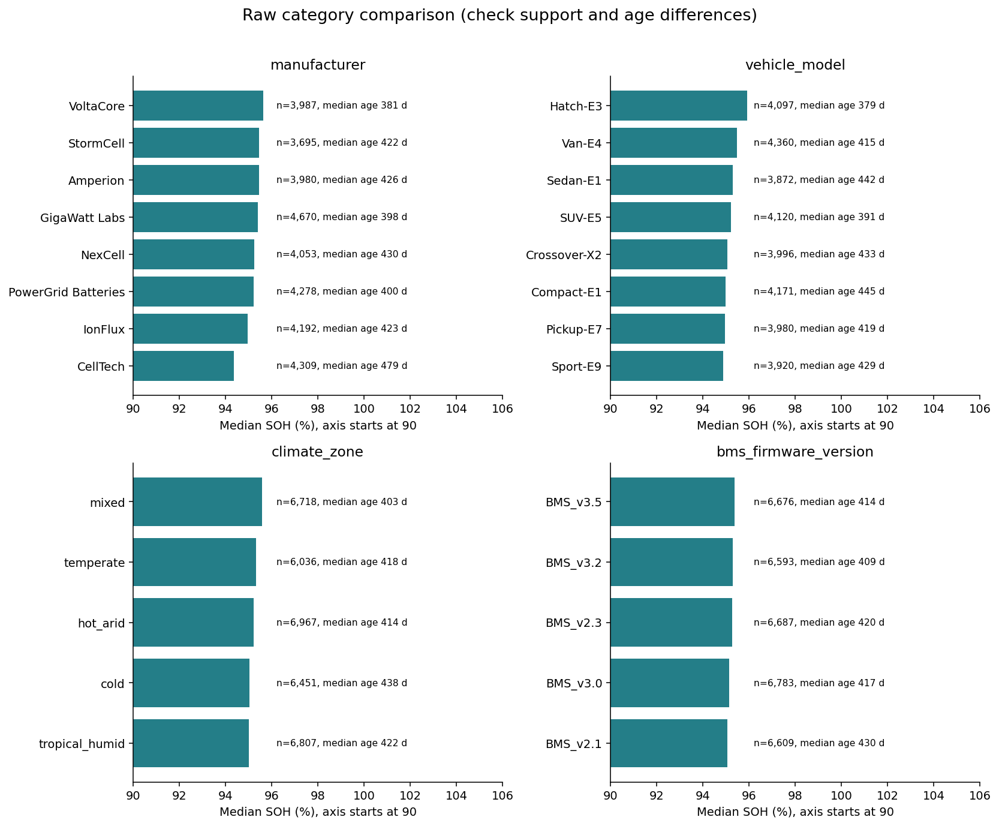
*Gambar 4.12 Perbandingan median SOH disertai jumlah baris observasi dan median umur baterai (hari) untuk setiap kategori pada kelima fitur kategorikal utama di data train.*

Pada fitur manufacturer (Gambar 4.12), tujuh dari delapan produsen memiliki median SOH yang berdekatan antara 94,965% (IonFlux, 4.192 baris, median umur 423,0 hari) hingga 95,620% (VoltaCore, 3.987 baris, median umur 381,0 hari), sedangkan CellTech memiliki median SOH paling rendah sebesar 94,370% (4.309 baris). Panel median umur pada Gambar 4.12 menjelaskan penyebabnya: baterai buatan CellTech pada data train memiliki median umur kalender paling tua yaitu 479,0 hari (median 456,0 siklus), dibandingkan VoltaCore yang hanya 381,0 hari (median 356,0 siklus). Pola pembaur usia serupa terlihat pada vehicle_model: model Hatch-E3 memiliki median SOH tertinggi (95,910%, 4.097 baris) karena median umurnya paling muda (379,0 hari, 327,0 siklus), sedangkan Sport-E9 (94,890%, 3.920 baris, median umur 429,0 hari dan 396,5 siklus) serta Compact-E1 (94,980%, 4.171 baris, median umur 445,0 hari) berusia lebih tua. Pada climate_zone, zona tropical_humid (95,020%, 6.807 baris, median umur 422,0 hari) dan cold (95,040%, 6.451 baris, median umur 437,5 hari) sedikit lebih rendah dibandingkan mixed (95,570%, 6.718 baris, median umur 403,0 hari) dan temperate (95,310%, 6.036 baris). Sementara itu, kelima kategori bms_firmware_version memiliki median SOH yang hampir seragam antara 95,060% (BMS_v2.1, 6.609 baris) hingga 95,380% (BMS_v3.5, 6.676 baris).

### 4.9. Lintasan SOH dan Perubahan Antarobservasi

#### 4.9.1. Lintasan SOH per Baterai

Untuk memeriksa bagaimana SOH berubah dari satu pengamatan ke pengamatan berikutnya di dalam unit baterai yang sama, Gambar 4.13 menampilkan contoh lintasan SOH terhadap tanggal observasi untuk masing-masing kimia baterai (LFP, NMC, NCA, dan LMO). Agar pemilihan contoh bebas dari bias subjektif (cherry-picking), diterapkan aturan pemilihan deterministik: dipilih tiga battery_id pertama berdasarkan urutan abjad leksikografis pada setiap jenis kimia yang memiliki sedikitnya 10 pengamatan bertanggal valid di data train, tanpa melihat nilai SOH-nya sama sekali.

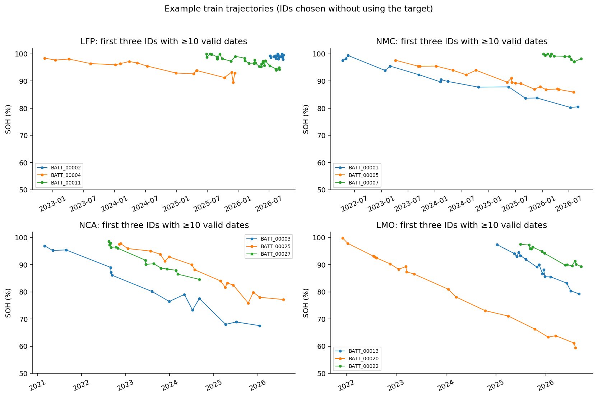
*Gambar 4.13 Contoh deterministik lintasan SOH terhadap tanggal observasi untuk tiga baterai pertama per jenis kimia yang memiliki minimal 10 pengamatan bertanggal pada data train.*

Lintasan individual pada Gambar 4.13 memperlihatkan bahwa meskipun tren jangka panjang SOH cenderung menurun seiring berjalannya tahun kalender (dengan kemiringan penurunan LMO dan NCA yang jauh lebih tajam dibandingkan LFP), lintasan dari titik ke titik tidaklah mulus melainkan sering mengalami fluktuasi naik-turun yang tajam (zig-zag). Di samping itu, keberadaan 1.581 baris data train yang kehilangan nilai observation_date membatasi pembacaan lintasan secara langsung: pengamatan yang tanggalnya kosong tidak dapat ditempatkan pada sumbu waktu tanpa mengarang tanggal buatan, sehingga garis penghubung antar-titik pada grafik hanya menghubungkan pengamatan bertanggal yang teramati dan dapat melompati pengamatan yang tanggalnya hilang.

#### 4.9.2. Perubahan SOH antarobservasi Bertanggal

Untuk mengkuantifikasi perilaku perubahan SOH antarobservasi di seluruh data train, dibentuk pasangan pengamatan berurutan dari baterai yang sama setelah membuang baris yang tidak memiliki observation_date dan mengurutkannya berdasarkan tanggal yang meningkat (pasangan dapat melompati baris yang tanggalnya kosong). Dari prosedur tersebut diperoleh 31.528 pasangan pengamatan bertanggal valid. Selisih SOH antarobservasi (delta_soh_pp) dibulatkan ke presisi pencatatan 0,01 poin persentase sebelum diklasifikasikan menjadi tiga arah perubahan: turun (< -0,01 poin), stabil (antara -0,01 hingga +0,01 poin), dan naik (> +0,01 poin). Distribusi selang hari, histogram perubahan SOH, dan proporsi arah perubahan ditampilkan pada Gambar 4.14 serta Tabel 4.5.

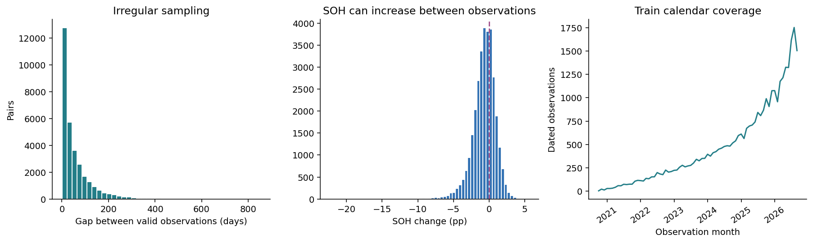
*Gambar 4.14 Distribusi selang waktu hari antarobservasi berurutan (kiri), histogram perubahan SOH dalam poin persentase (tengah), dan proporsi arah perubahan SOH pada 31.528 pasangan bertanggal di data train (kanan).*

**Tabel 4.5 Klasifikasi arah perubahan SOH antarobservasi bertanggal berurutan pada data train (31.528 pasangan)**

| Kategori Arah Perubahan SOH | Kriteria Selisih (delta_soh_pp) | Jumlah Pasangan Berurutan | Proporsi Pasangan (%) |
| --- | --- | --- | --- |
| Turun (Down: < -0,01 pp) | Penurunan SOH lebih dari 0,01 poin persentase | 21.028 | 66,696% |
| Stabil (-0,01 hingga +0,01 pp) | Perubahan SOH berada dalam batas presisi +-0,01 poin | 140 | 0,444% |
| Naik (Up: > +0,01 pp) | Kenaikan SOH lebih dari 0,01 poin persentase | 10.360 | 32,860% |
| Total Pasangan Bertanggal | Seluruh pasangan berurutan dengan tanggal menaik | 31.528 | 100,000% |

Tabel 4.5 dan Gambar 4.14 menunjukkan bahwa meskipun 66,696% (21.028 pasangan) mengalami penurunan SOH sesuai ekspektasi degradasi baterai, terdapat 32,860% (10.360 pasangan) yang justru mencatat kenaikan nilai SOH lebih dari 0,01 poin persentase pada tanggal yang lebih baru. Selain itu, panel kiri Gambar 4.14 menunjukkan bahwa selang waktu hari antarobservasi sangat bervariasi (mulai dari 1 hari hingga ratusan hari), sehingga histogram delta_soh_pp pada panel tengah bukanlah laju degradasi per hari yang terstandarisasi. Mengingat sumber data menyatakan bahwa dataset dibangkitkan secara sintetis dengan derau (noise) dan pada Subbab 3.5 terbukti bahwa penghitung siklus serta energi juga menurun pada 18,179% dan 21,272% pasangan, kenaikan SOH pada 32,860% pasangan ini merupakan artefak derau generator, bukan fenomena pemulihan kapasitas elektrokimia (physical regeneration) nyata.

### 4.10. Target Turunan, Pembacaan Sensor, dan Risiko Kebocoran Target

#### 4.10.1. Target Alternatif dan Variabel Turunan

Selain variabel target utama state_of_health_pct, tabel dataset menyediakan tiga kolom target alternatif yang berada pada posisi hilir yang sama, yaitu sisa umur pakai dalam siklus (remaining_useful_life_cycles, bertipe integer dengan rentang train 0 hingga 2.242 siklus, median 949,0 siklus), label risiko kegagalan (failure_risk_label), dan kategori tingkat degradasi (degradation_category). Distribusi ketiga target alternatif tersebut pada data train ditampilkan pada Gambar 4.15.

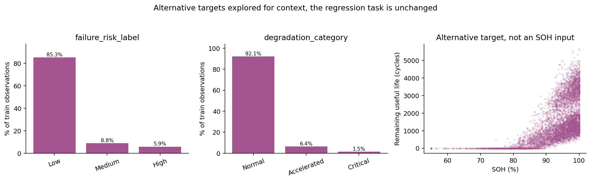
*Gambar 4.15 Proporsi kelas pada target alternatif failure_risk_label (kiri), degradation_category (tengah), dan diagram pencar hubungan SOH terhadap remaining_useful_life_cycles pada data train (kanan).*

Gambar 4.15 memperlihatkan bahwa komposisi kelas pada failure_risk_label sangat didominasi oleh risiko Low sebesar 85,262% (29.781 baris, median SOH 96,220%), diikuti Medium sebesar 8,838% (3.087 baris, median SOH 83,520%), dan High sebesar 5,901% (2.061 baris, median SOH 74,520%). Serupa dengan itu, degradation_category didominasi oleh kategori Normal sebesar 92,127% (32.179 baris, median SOH 95,770%), diikuti Accelerated sebesar 6,370% (2.225 baris, median SOH 77,760%), dan Critical sebesar 1,503% (525 baris, median SOH 65,270% yang berimpit tepat dengan jumlah baris pita SOH < 70%). Sementara itu, pemeriksaan pada kolom variabel turunan capacity_fade_pct membuktikan bahwa pada seluruh 48.131 baris non-kosong di dataset (33.594 baris di train), berlaku persamaan eksak capacity_fade_pct + state_of_health_pct = 100,0 dengan simpangan absolut maksimum 0,0. Memasukkan capacity_fade_pct atau salah satu dari ketiga target alternatif di atas sebagai fitur input akan menimbulkan kebocoran target (target leakage) yang fatal karena jaringan MLP hanya akan menyalin label kesehatan yang seharusnya diprediksi.

#### 4.10.2. Pembacaan Sensor sebagai Proksi SOH

Pemeriksaan terhadap empat variabel pembacaan sensor kelistrikan pada data train menunjukkan bahwa hambatan dalam (internal_resistance_mohm) memiliki korelasi negatif yang sangat kuat terhadap SOH (Spearman gabungan r_s = -0,730, Pearson r = -0,683 pada 33.465 pasangan, serta within-battery Spearman r_s = -0,762), sedangkan tegangan rata-rata (voltage_avg_v) memiliki korelasi positif lemah-menengah sebesar r_s = +0,164 (r = +0,164 pada 33.002 pasangan). Dua variabel lainnya, yaitu arus rata-rata (current_avg_a, r_s = +0,008) dan durasi pengisian rata-rata (charge_time_avg_min, r_s = +0,009), hampir tidak berkorelasi secara univariat dengan SOH.

Meskipun dalam rekayasa baterai fisik kenaikan hambatan dalam dan perubahan profil tegangan merupakan indikator elektrokimia yang sah, dokumentasi README sumber dataset secara eksplisit mencatat bahwa nilai pembacaan sensor kelistrikan di dalam simulator dibangkitkan sebagai fungsi matematis langsung dari SOH dan kimia baterai (dengan menyebut internal_resistance_mohm secara khusus). Selain itu, dataset tidak mendokumentasikan jendela waktu agregasi maupun protokol pengukuran untuk memperoleh nilai rata-rata tegangan, arus, dan hambatan dalam tersebut pada saat prediksi dilakukan. Oleh sebab itu, keempat kolom sensor tersebut diklasifikasikan sebagai kandidat proksi SOH (sensor_proxy) dan dikeluarkan secara konservatif dari himpunan fitur baseline agar model MLP belajar memetakan riwayat pemakaian, umur, dan lingkungan tanpa bergantung pada variabel yang diturunkan terbalik dari target.

## 5. Pembahasan

### 5.1. Sintesis Temuan terhadap Rumusan Masalah

Seluruh temuan dari tahap audit data (Bab 3) dan eksplorasi data (Bab 4) menjawab keempat pertanyaan pada Rumusan Masalah (Subbab 1.2) secara berurutan sebagai berikut:

1. Kualitas data, pola nilai hilang, sensitivitas IQR, dan konsistensi waktu (Menjawab Rumusan 1): Struktur tabel bebas dari duplikasi baris (0 duplikasi) dan pelanggaran batas fisik dasar (0 pelanggaran), namun seluruh 21 fitur utama memiliki nilai hilang antara 3,161% hingga 6,908% dengan selisih median SOH antara baris hilang dan terisi yang sempit (-0,240 hingga +0,280 poin persentase pada Gambar 3.1). Sebaliknya, nilai hilang sebesar 37,785% pada last_service_date bersifat struktural karena baterai tanpa tanggal servis memiliki median umur jauh lebih muda (174,0 hari vs 662,0 hari) dan median SOH lebih tinggi (97,790% vs 92,700% pada Gambar 3.2). Korelasi Spearman terhadap SOH terbukti sangat tahan terhadap pemfilteran pagar 1,5 x IQR (perubahan |r_s| <= 0,025 pada Tabel 3.3), sedangkan urutan waktu mengalami ketidakkonsistenan berupa 2.216 tanggal observasi yang hilang serta penurunan penghitung kumulatif cycle_count pada 18,179% pasangan dan total_energy_throughput_kwh pada 21,272% pasangan (Tabel 3.4).
2. Distribusi SOH, keterwakilan SOH rendah, dan pengaruh pembobotan baterai (Menjawab Rumusan 2): Distribusi state_of_health_pct pada data train sangat miring ke kiri (skewness -1,808, median 95,230%, rerata 92,919% pada Gambar 4.1), di mana 51,622% pengamatan berada pada kondisi sehat (>= 95%) dan hanya 6,361% berada di bawah ambang akhir masa pakai (< 80%, termasuk 1,503% atau 525 baris pada rentang kritis < 70% pada Tabel 4.1). Variasi jumlah pengamatan per baterai (7 hingga 37 baris) tidak menimbulkan bias pada ringkasan target karena rata-rata SOH berbobot sama per baterai (92,913%) hampir identik dengan rata-rata per observasi (92,919%) dan korelasi Spearman antara jumlah observasi dan rata-rata SOH baterai mendekati nol (r_s = 0,014 pada Gambar 4.2).
3. Hubungan fitur terhadap SOH dan pola antarkelompok (Menjawab Rumusan 3): Penurunan SOH berkorelasi negatif paling kuat dengan tiga variabel kumulatif, yaitu cycle_count (r_s = -0,907), battery_age_days (r_s = -0,842), dan total_energy_throughput_kwh (r_s = -0,841) baik pada tingkat gabungan, antar-baterai, maupun intra-baterai (Gambar 4.6), namun ketiganya saling berkorelasi sangat tinggi (r_s = +0,900 hingga +0,948 pada Gambar 4.8). Pada kelompok usia yang sama dengan bobot setara per baterai, kimia baterai menunjukkan urutan ketahanan SOH yang konsisten (LFP > NMC > NCA > LMO pada Gambar 4.9; misalnya pada usia 1-2 tahun rata-rata SOH LFP 96,237% vs LMO 89,270% pada Tabel 4.3), sedangkan di dalam sel kimia dan usia yang sama, laju siklus bulanan charge_cycles_per_month menjadi pembeda penggunaan terkuat (r_s mencapai -0,796).
4. Implikasi terhadap pemilihan input, prapemrosesan, dan evaluasi MLP (Menjawab Rumusan 4): Identitas eksak capacity_fade_pct + SOH = 100,0 (galat maksimum 0,0) dan ketergantungan internal_resistance_mohm (r_s = -0,730) pada formula target simulator mewajibkan eksklusi capacity_fade_pct, tiga target alternatif (Gambar 4.15), tiga kolom tanggal, dua kolom ID, serta empat kandidat proksi sensor dari model baseline, menyisakan 21 fitur utama yang setelah imputasi dan pengodean pada data train menghasilkan 67 neuron input standar (atau 63 neuron pada resep kompak).

### 5.2. Implikasi terhadap Preprocessing dan Seleksi Fitur

Temuan kuantitatif pada Bab 3 dan Bab 4 diterjemahkan secara langsung menjadi aturan perancangan tahap prapemrosesan (src/ev_battery/preprocessing.py) dan eksperimen seleksi fitur. Tidak ada satu pun transformasi yang ditetapkan secara spekulatif; setiap langkah prapemrosesan memiliki bukti empiris langsung dari hasil EDA sebagaimana dipetakan pada Tabel 5.1.

**Tabel 5.1 Pemetaan temuan EDA, bukti kuantitatif, dan implikasinya terhadap prapemrosesan serta seleksi fitur MLP**

| Aspek Prapemrosesan | Temuan Kunci dari Audit & EDA | Bukti Kuantitatif / Grafik | Implikasi Keputusan Teknis |
| --- | --- | --- | --- |
| Eksklusi Kebocoran & Proksi | capacity_fade_pct adalah komplemen eksak SOH; 4 kolom sensor diturunkan dari SOH di simulator. | capacity_fade_pct + SOH = 100,0 (galat 0,0); r_s resistansi dalam = -0,730 (Gambar 4.15, Gambar 8.3). | Keluarkan capacity_fade_pct, 3 target alternatif, 3 tanggal, 2 ID, dan 4 proksi sensor dari baseline; kunci 21 fitur utama. |
| Imputasi Numerik & Indikator Missing | Seluruh 15 fitur numerik utama hilang 3,16%-6,77%; selisih SOH kecil tapi bukan bukti MCAR multivariat. | Hilang 1.104-2.366 baris train; selisih median SOH -0,24 s.d. +0,28 pp (Tabel 3.1, Gambar 3.1). | Imputasi menggunakan median data train dilengkapi 15 kolom indikator biner (_missing) dan 1 indikator recall_flag_missing. |
| Encoding Fitur Kategorikal | 5 fitur kategorikal utama hilang 4,53%-6,91%; firmware BMS dinamis antarobservasi. | 30 kategori teramati + 5 kategori __MISSING__ pada data train (Gambar 4.5, Tabel 8.3). | Terapkan one-hot encoding dengan kategori eksplisit __MISSING__ dan penanganan kategori tak dikenal (total 35 kolom one-hot). |
| Penanganan Nilai Ekstrem (Outliers) | Fitur siklus, energi, dan jarak berekor panjang; aturan 1,5 x IQR ikut menandai SOH rendah dan recall. | Korelasi Spearman stabil di dalam vs luar IQR (selisih <= 0,025 pada Tabel 3.3, Gambar 3.3). | Jangan hapus baris berdasarkan 1,5 x IQR; uji pemotongan persentil train P1-P99 (clipped_standard) pada validasi. |
| Normalisasi Skala Input (Scaling) | Rentang fitur numerik berbeda hingga 5 orde besaran (rasio 0-1 vs energi 441.533 kWh). | Rentang [0; 0,937] hingga [0,1; 441.533,7] (Gambar 4.3, Gambar 4.4, Tabel 8.2). | Uji StandardScaler (z-score) vs MinMaxScaler [0, 1] yang di-fit hanya pada fitur kontinu data train. |
| Seleksi Fitur & Redundansi | Kolinearitas sangat tinggi antara usia, siklus, dan energi kumulatif serta jarak dan siklus bulanan. | Spearman +0,900 s.d. +0,948 dan +0,860 pada 30.582-32.081 pasangan (Tabel 4.2, Gambar 4.8). | Bandingkan resep lengkap 67 neuron input (baseline_standard) dengan resep kompak 63 neuron input (compact_standard). |

Berdasarkan Tabel 5.1, jumlah neuron pada lapisan input jaringan saraf tiruan MLP ditentukan secara eksak dari struktur kolom hasil prapemrosesan: 15 fitur numerik terimputasi + 15 indikator missing numerik + 1 fitur biner recall_flag + 1 indikator missing recall_flag + 35 kolom one-hot kategorikal (4 + 8 + 8 + 5 + 5 kategori asli ditambah 5 kategori __MISSING__) = 67 neuron input. Pada resep kompak (compact_standard), penghapusan dua fitur numerik yang redundan (total_energy_throughput_kwh dan avg_daily_distance_km) beserta dua indikator missing-nya menyusutkan dimensi input menjadi 67 - 4 = 63 neuron input.

### 5.3. Implikasi terhadap Input Tabular dan Evaluasi per Rentang SOH

Keputusan untuk memformulasikan model MLP sebagai regresi menggunakan input fitur tabular dari satu pengamatan tunggal (tanpa jendela waktu atau timesteps) didasarkan secara langsung pada bukti audit longitudinal di Subbab 3.5 dan Subbab 4.9. Terdapat tiga hambatan objektif yang membuat pembentukan timesteps tidak valid tanpa memanipulasi data: (1) hilangnya observation_date pada 2.216 baris global (1.581 baris di train), (2) ketidakberaturan jarak hari antarobservasi (Gambar 4.14 kiri), serta (3) inkonsistensi kronologis simulator di mana cycle_count turun pada 18,179% pasangan, total_energy_throughput_kwh turun pada 21,272% pasangan (Tabel 3.4), dan SOH naik > 0,01 poin persentase pada 32,860% pasangan berurutan (Tabel 4.5). Apabila data dipaksa menjadi sekuens berurutan melalui pengurutan ulang nilai SOH atau penghapusan baris yang tidak monoton, maka distribusi data akan menyimpang dari pembangkitan aslinya. Oleh sebab itu, representasi tabular per baris merupakan pilihan paling jujur dan bebas distorsi.

Dari sisi protokol evaluasi dan fungsi kerugian (loss function), ketimpangan distribusi target pada Subbab 4.1 (di mana 51,622% data train berada pada SOH >= 95% dan hanya 1,503% berada pada SOH < 70%, Tabel 4.1) serta struktur pengamatan berulang per baterai pada Subbab 4.2 (7 hingga 37 baris per baterai, Gambar 4.2) menuntut tiga langkah metodologis pada tahap pelatihan dan evaluasi akhir: (1) menggunakan metrik regresi pada skala asli poin persentase SOH (MAE, RMSE, dan R^2), bukan metrik akurasi klasifikasi; (2) menguji skema pembobotan sampel pada fungsi loss berdasarkan kebalikan frekuensi pita SOH (inverse dan inverse_sqrt weighting) sebagai padanan regresi dari penyeimbangan kelas; serta (3) melaporkan galat prediksi secara terpisah pada kelima rentang SOH (< 70%, 70%-<80%, 80%-<90%, 90%-<95%, dan >= 95%) sekaligus pada tingkat rata-rata per unit baterai (battery-level MAE dan RMSE).

### 5.4. Keterbatasan Data Sintetis dan Interpretasi Hubungan

Dalam menafsirkan seluruh hasil eksplorasi data pada laporan ini, terdapat empat keterbatasan utama yang harus dinyatakan secara transparan:

1. Sifat data yang sepenuhnya sintetis (fully synthetic): Dataset ini dibangkitkan oleh simulator komputer dengan aturan matematis, derau, serta penyuntikan nilai hilang dan pencilan buatan yang kode sumbernya tidak tersedia. Oleh karena itu, pola seperti kenaikan SOH antarobservasi (32,860%) atau perbedaan kurva degradasi antarkimia merupakan refleksi dari persamaan generator, bukan hukum elektrokimia baru pada armada kendaraan listrik di dunia nyata.
2. Ketergantungan pengamatan berulang (non-independence): Ke-34.929 baris pada data train berasal dari 1.820 unit baterai yang diamati berulang kali. Baris-baris dari baterai yang sama saling berkorelasi, sehingga ukuran sampel independen yang sesungguhnya adalah jumlah baterai (1.820), dan pembagian grup berbasis battery_id hanya menguji generalisasi ke baterai baru dari simulator yang sama, bukan ke periode waktu masa depan atau populasi kendaraan pabrikan nyata.
3. Keterbatasan ukuran sampel pada kelompok ekstrem: Meskipun total baris terlihat besar, beberapa irisan kelompok memiliki dukungan baterai yang sangat tipis, seperti rentang SOH kritis < 70% (hanya 525 baris di train), kimia LMO pada usia > 5 tahun (hanya 22 baterai unik dan 51 baris pada Tabel 4.3), serta sel usia > 5 tahun dengan rasio fast charge > 0,6-1,0 (hanya 11 baterai dan 16 baris pada Tabel 4.4). Kesimpulan pada irisan kelompok kecil tersebut memiliki ketidakpastian (variansi) yang jauh lebih lebar.
4. Faktor pembaur (confounding) pada analisis univariat dan dua arah: Perbandingan SOH menurut produsen, model kendaraan, maupun zona iklim pada Gambar 4.12 dipengaruhi oleh perbedaan median umur dan jumlah siklus di setiap kategori (misalnya CellTech tampak memiliki SOH terendah karena median umurnya paling tua, yaitu 479,0 hari). Korelasi deskriptif pada laporan ini hanya mengukur asosiasi statistik di dalam data pengamatan dan tidak boleh diinterpretasikan sebagai hubungan sebab-akibat (kausal).

## 6. Penutup

### 6.1. Kesimpulan

Berdasarkan hasil audit kualitas data dan eksplorasi pada 34.929 observasi dari 1.820 baterai data latih (train), dapat ditarik empat kesimpulan utama yang menjawab tujuan analisis:

1. Dataset memiliki integritas skema dan rentang fisik yang bersih (0 duplikasi baris dan 0 pelanggaran rentang dasar), namun mengandung nilai hilang sebesar 3,161% hingga 6,908% pada 21 fitur utama (selisih median SOH -0,240 s.d. +0,280 poin persentase), nilai hilang struktural sebesar 37,785% pada last_service_date (selisih median SOH +5,090 poin persentase akibat perbedaan median umur 174,0 vs 662,0 hari), ketiadaan observation_date pada 2.216 baris global (1.581 baris train), penurunan penghitung kumulatif cycle_count (18,179% pasangan) serta total_energy_throughput_kwh (21,272% pasangan), dan kenaikan SOH > 0,01 poin persentase pada 32,860% dari 31.528 pasangan pengamatan bertanggal.
2. Distribusi target state_of_health_pct pada data train menceng kuat ke arah baterai sehat (rentang 55,000%-100,000%, median 95,230%, rerata 92,919%, skewness -1,808), di mana 51,622% pengamatan berada pada SOH >= 95% dan hanya 6,361% berada pada SOH < 80% (termasuk 1,503% pada SOH < 70%). Pembobotan setara per baterai menghasilkan median (95,210%) dan rerata (92,913%) yang konsisten dengan tingkat observasi (r_s = 0,014 antara jumlah observasi dan rata-rata SOH baterai).
3. Tiga fitur kumulatif memiliki asosiasi negatif terkuat terhadap SOH, yakni cycle_count (Spearman r_s = -0,907), battery_age_days (r_s = -0,842), dan total_energy_throughput_kwh (r_s = -0,841), namun ketiganya saling redundan (r_s antara +0,900 hingga +0,948), begitu pula pasangan avg_daily_distance_km dan charge_cycles_per_month (r_s = +0,860). Pada kelompok usia yang sama dengan bobot setara per baterai, urutan ketahanan SOH antarkimia bertahan konsisten (LFP > NMC > NCA > LMO), sementara pola hubungan fitur terhadap SOH terbukti tangguh terhadap pemfilteran kandidat pencilan 1,5 x IQR (perubahan |r_s| <= 0,025).
4. Audit kebocoran target membuktikan bahwa capacity_fade_pct identik dengan 100 - SOH (simpangan maksimum 0,0 pada 48.131 baris) dan internal_resistance_mohm (r_s = -0,730) merupakan kandidat proksi target dari formula simulator, sehingga keduanya bersama tiga target alternatif, tiga kolom tanggal, dan dua kolom identitas wajib dikeluarkan dari fitur baseline, menghasilkan kontrak 21 fitur utama untuk pemodelan regresi tabular.

### 6.2. Saran untuk Tahap Berikutnya

Berdasarkan kesimpulan di atas, disusun lima saran yang dapat ditindaklanjuti secara langsung pada tahap prapemrosesan, pelatihan MLP, dan evaluasi akhir:

1. Terapkan imputasi median yang di-fit hanya pada data train disertai penambahan 16 kolom indikator biner nilai hilang (15 fitur numerik + recall_flag) dan kategori eksplisit __MISSING__ pada one-hot encoding kelima fitur kategorikal untuk menangani nilai hilang 3,161%-6,908% tanpa kehilangan informasi pola kekosongan data.
2. Uji dan bandingkan empat resep prapemrosesan pada data validasi (7.499 baris, 390 baterai), yaitu baseline_standard (StandardScaler, 67 neuron input), baseline_minmax (MinMaxScaler, 67 neuron input), clipped_standard (pemotongan persentil P1-P99 sebelum standardisasi, 67 neuron input), serta compact_standard (63 neuron input setelah menghapus fitur redundan total_energy_throughput_kwh dan avg_daily_distance_km).
3. Gunakan arsitektur MLP feedforward dengan input tabular satu baris per pengamatan tanpa membentuk timesteps atau memaksakan pengurutan monoton pada lintasan baterai yang tanggal dan penghitung kumulatifnya tidak konsisten.
4. Eksperimenkan skema pembobotan sampel berbasis frekuensi pita SOH (inverse dan inverse_sqrt weighting) pada fungsi loss selama pelatihan backpropagation untuk menguji apakah penekanan lebih besar pada sampel SOH rendah (< 80% dan < 70%) dapat menurunkan galat pada ekor distribusi tanpa merusak akurasi global.
5. Wajibkan pelaporan metrik evaluasi akhir (MAE, RMSE, dan R^2) secara terpisah untuk masing-masing dari kelima rentang SOH (< 70%, 70%-<80%, 80%-<90%, 90%-<95%, >= 95%) serta pada tingkat rata-rata per unit baterai, agar kelemahan prediksi pada baterai yang terdegradasi berat (< 70% SOH) terukur secara transparan.

## 7. Daftar Pustaka

Daftar pustaka berikut memuat sumber dataset, dokumentasi teknis repositori, dan referensi metode analisis serta jaringan saraf tiruan yang dirujuk secara langsung di dalam laporan ini (disusun secara konsisten menggunakan gaya sitasi APA Edisi ke-7):

1. Baghira, V. (2026). EV Battery Health & Degradation Dataset [Data set]. Kaggle. https://www.kaggle.com/datasets/vinay24baghira/ev-battery-health-and-degradation-dataset (Lisensi Creative Commons Zero v1.0 Universal / CC0).
2. Cendana, H., Minarto, O. S., Faiqunnabil, M. H., & Pasunda, A. J. (2026). EV-Battery-Health: SOH estimation with a from-scratch MLP (Dataset Card, Methodology, Audit Report, and EDA Report). Repositori GitHub Program Studi Teknik Informatika, Fakultas Ilmu Komputer, Universitas Brawijaya. https://github.com/HUB37T/EV-Battery-Health
3. Efron, B., & Tibshirani, R. J. (1993). An introduction to the bootstrap. Chapman & Hall/CRC.
4. Goodfellow, I., Bengio, Y., & Courville, A. (2016). Deep learning. MIT Press.
5. Harris, C. R., Millman, K. J., van der Walt, S. J., Gommers, R., Virtanen, P., Cournapeau, D., Wieser, E., Taylor, J., Berg, S., Smith, N. J., Kern, R., Picus, M., Hoyer, S., van Kerkwijk, M. H., Brett, M., Haldane, A., del Rio, J. F., Wiebe, M., Peterson, P., ... Oliphant, T. E. (2020). Array programming with NumPy. Nature, 585(7825), 357-362. https://doi.org/10.1038/s41586-020-2649-2
6. Little, R. J. A., & Rubin, D. B. (2019). Statistical analysis with missing data (3rd ed.). John Wiley & Sons.
7. Rumelhart, D. E., Hinton, G. E., & Williams, R. J. (1986). Learning representations by back-propagating errors. Nature, 323(6088), 533-536. https://doi.org/10.1038/323533a0
8. Spearman, C. (1904). The proof and measurement of association between two things. The American Journal of Psychology, 15(1), 72-101. https://doi.org/10.2307/1412159
9. Tukey, J. W. (1977). Exploratory data analysis. Addison-Wesley.

## 8. Lampiran

### 8.1. Kamus Data dan Pemetaan Kolom

Tabel 8.1 pada lampiran ini menyajikan kamus data lengkap untuk seluruh 35 kolom asli di dalam berkas ev_battery_health.csv (dirujuk dari Subbab 2.3), mencakup tipe data, satuan pengukuran, jumlah dan persentase nilai hilang pada seluruh dataset (50.000 baris) maupun pada subset train (34.929 baris), peran pemodelan di dalam kontrak fitur (configs/feature_contract.json), serta catatan alasan pemilihan atau risiko kebocorannya.

**Tabel 8.1 Kamus data lengkap, cakupan nilai hilang, peran kontrak fitur, dan catatan risiko kebocoran untuk seluruh 35 kolom**

| No | Nama Kolom | Tipe | Satuan | Hilang Global (%) | Hilang Train | Peran Kontrak | Catatan Peran / Risiko Kebocoran |
| --- | --- | --- | --- | --- | --- | --- | --- |
| 1 | battery_id | string | - | 0 (0,000%) | 0 | excluded | Group ID used for splitting, not a feature. |
| 2 | observation_id | string | - | 0 (0,000%) | 0 | excluded | Observation ID used for tracking, not a feature. |
| 3 | chemistry | categorical | - | 3.459 (6,918%) | 2.405 | primary_feature | Baseline candidate, preprocessing not fitted yet. |
| 4 | manufacturer | categorical | - | 2.461 (4,922%) | 1.765 | primary_feature | Baseline candidate, preprocessing not fitted yet. |
| 5 | vehicle_model | categorical | - | 3.515 (7,030%) | 2.413 | primary_feature | Baseline candidate, preprocessing not fitted yet. |
| 6 | pack_capacity_kwh | float | kWh | 2.302 (4,604%) | 1.584 | primary_feature | Baseline candidate, preprocessing not fitted yet. |
| 7 | manufacture_date | date | YYYY-MM-DD | 1.910 (3,820%) | 1.356 | excluded | Raw date excluded from the baseline, battery_age_days is used instead. |
| 8 | observation_date | date | YYYY-MM-DD | 2.216 (4,432%) | 1.581 | excluded | Raw date excluded from the baseline, battery_age_days is used instead. |
| 9 | battery_age_days | int | days | 3.002 (6,004%) | 2.115 | primary_feature | Baseline candidate, preprocessing not fitted yet. |
| 10 | cycle_count | int | cycles | 2.269 (4,538%) | 1.592 | primary_feature | Baseline candidate, preprocessing not fitted yet. |
| 11 | climate_zone | categorical | - | 2.719 (5,438%) | 1.950 | primary_feature | Baseline candidate, preprocessing not fitted yet. |
| 12 | avg_daily_distance_km | float | km | 2.118 (4,236%) | 1.485 | primary_feature | Baseline candidate, preprocessing not fitted yet. |
| 13 | avg_charging_power_kw | float | kW | 2.140 (4,280%) | 1.513 | primary_feature | Baseline candidate, preprocessing not fitted yet. |
| 14 | fast_charge_ratio | float | ratio 0-1 | 3.405 (6,810%) | 2.366 | primary_feature | Baseline candidate, preprocessing not fitted yet. |
| 15 | avg_depth_of_discharge_pct | float | % | 2.832 (5,664%) | 1.996 | primary_feature | Baseline candidate, preprocessing not fitted yet. |
| 16 | avg_state_of_charge_pct | float | % | 3.138 (6,276%) | 2.151 | primary_feature | Baseline candidate, preprocessing not fitted yet. |
| 17 | charge_cycles_per_month | float | count/month | 2.054 (4,108%) | 1.426 | primary_feature | Baseline candidate, preprocessing not fitted yet. |
| 18 | total_energy_throughput_kwh | float | kWh | 3.370 (6,740%) | 2.362 | primary_feature | Baseline candidate, preprocessing not fitted yet. |
| 19 | avg_ambient_temp_c | float | °C | 3.282 (6,564%) | 2.270 | primary_feature | Baseline candidate, preprocessing not fitted yet. |
| 20 | humidity_pct | float | % | 2.737 (5,474%) | 1.936 | primary_feature | Baseline candidate, preprocessing not fitted yet. |
| 21 | altitude_m | float | meters | 2.322 (4,644%) | 1.632 | primary_feature | Baseline candidate, preprocessing not fitted yet. |
| 22 | internal_resistance_mohm | float | mΩ | 2.104 (4,208%) | 1.464 | excluded | Candidate synthetic sensor proxy, only for a separate ablation after reviewing origin and availability. |
| 23 | voltage_avg_v | float | V | 2.807 (5,614%) | 1.927 | excluded | Candidate synthetic sensor proxy, only for a separate ablation after reviewing origin and availability. |
| 24 | current_avg_a | float | A | 2.487 (4,974%) | 1.772 | excluded | Candidate synthetic sensor proxy, only for a separate ablation after reviewing origin and availability. |
| 25 | charge_time_avg_min | float | minutes | 2.091 (4,182%) | 1.413 | excluded | Candidate synthetic sensor proxy, only for a separate ablation after reviewing origin and availability. |
| 26 | peak_temp_during_fast_charge_c | float | °C | 2.128 (4,256%) | 1.490 | primary_feature | Baseline candidate, preprocessing not fitted yet. |
| 27 | capacity_fade_pct | float | % | 1.869 (3,738%) | 1.335 | excluded | Direct identity 100 - SOH, target leakage. |
| 28 | service_count | int | count | 1.600 (3,200%) | 1.104 | primary_feature | Baseline candidate, preprocessing not fitted yet. |
| 29 | last_service_date | date | YYYY-MM-DD | 18.831 (37,662%) | 13.198 | excluded | Raw date excluded from the baseline, battery_age_days is used instead. |
| 30 | bms_firmware_version | categorical | - | 2.328 (4,656%) | 1.581 | primary_feature | Baseline candidate, preprocessing not fitted yet. |
| 31 | recall_flag | binary | 0/1 | 2.646 (5,292%) | 1.845 | primary_feature | Baseline candidate, preprocessing not fitted yet. |
| 32 | state_of_health_pct | float [TARGET] | % | 0 (0,000%) | 0 | target | Target |
| 33 | remaining_useful_life_cycles | int [TARGET] | cycles | 0 (0,000%) | 0 | excluded | Alternative target or health label, not an input for SOH regression. |
| 34 | failure_risk_label | categorical [TARGET] | - | 0 (0,000%) | 0 | excluded | Alternative target or health label, not an input for SOH regression. |
| 35 | degradation_category | categorical [TARGET] | - | 0 (0,000%) | 0 | excluded | Alternative target or health label, not an input for SOH regression. |

### 8.2. Tabel Statistik dan Gambar Pendukung

Subbab lampiran ini memuat tabel statistik deskriptif lengkap dan grafik audit pendukung yang dirujuk dari Bab 3 dan Bab 4. Tabel 8.2 merangkum profil distribusi numerik beserta jumlah kandidat pencilan di luar pagar 1,5 x IQR pada data train (dirujuk dari Subbab 3.4 dan 4.3.1), sedangkan Tabel 8.3 menyajikan profil lengkap seluruh kategori pada fitur kategorikal, fitur biner, dan target alternatif pada data train (dirujuk dari Subbab 4.3.2 dan 4.8).

**Tabel 8.2 Profil statistik deskriptif lengkap dan kandidat pencilan 1,5 x IQR untuk seluruh variabel numerik pada data train**

| Variabel Numerik | Count | Mean | Std | Min | P25 | Median | P75 | Max | Skewness | Di Luar 1,5 x IQR |
| --- | --- | --- | --- | --- | --- | --- | --- | --- | --- | --- |
| pack_capacity_kwh | 33.345 | 72,631 | 14,400 | 40,100 | 62,500 | 72,500 | 82,500 | 99,900 | -0,098 | 0 (0,000%) |
| battery_age_days | 32.814 | 555,565 | 476,557 | 1,000 | 167,000 | 418,000 | 835,000 | 2.184,000 | 0,992 | 445 (1,356%) |
| cycle_count | 33.337 | 572,371 | 606,371 | 1,000 | 136,000 | 372,000 | 800,000 | 5.073,000 | 1,918 | 1.684 (5,051%) |
| avg_daily_distance_km | 33.444 | 50,487 | 39,826 | 3,000 | 22,500 | 39,300 | 66,800 | 400,000 | 1,825 | 1.523 (4,554%) |
| avg_charging_power_kw | 33.416 | 31,975 | 17,701 | 1,496 | 19,000 | 28,600 | 41,800 | 147,772 | 0,997 | 787 (2,355%) |
| fast_charge_ratio | 32.563 | 0,293 | 0,172 | 0,000 | 0,161 | 0,272 | 0,405 | 0,937 | 0,567 | 216 (0,663%) |
| avg_depth_of_discharge_pct | 32.933 | 64,754 | 15,820 | 10,000 | 54,100 | 65,000 | 75,900 | 100,000 | -0,146 | 130 (0,395%) |
| avg_state_of_charge_pct | 32.778 | 67,624 | 10,127 | 30,900 | 60,800 | 67,900 | 74,600 | 95,000 | -0,116 | 121 (0,369%) |
| charge_cycles_per_month | 33.503 | 20,307 | 10,289 | 2,000 | 12,800 | 19,000 | 26,600 | 57,500 | 0,568 | 331 (0,988%) |
| total_energy_throughput_kwh | 32.567 | 38.685,231 | 42.928,649 | 36,400 | 8.772,200 | 24.155,300 | 53.217,100 | 402.419,900 | 2,178 | 1.837 (5,641%) |
| avg_ambient_temp_c | 32.659 | 21,135 | 12,174 | -23,400 | 13,000 | 21,500 | 29,600 | 83,715 | -0,123 | 156 (0,478%) |
| humidity_pct | 32.993 | 54,915 | 17,830 | 5,000 | 42,700 | 54,800 | 67,000 | 100,000 | -0,008 | 111 (0,336%) |
| altitude_m | 33.297 | 298,664 | 296,691 | 0,000 | 86,000 | 209,000 | 416,000 | 3.214,000 | 1,955 | 1.574 (4,727%) |
| peak_temp_during_fast_charge_c | 33.439 | 26,705 | 12,771 | -10,904 | 18,100 | 26,900 | 35,550 | 89,820 | -0,041 | 154 (0,461%) |
| service_count | 33.825 | 1,415 | 1,664 | 0,000 | 0,000 | 1,000 | 2,000 | 15,000 | 1,619 | 1.043 (3,084%) |
| recall_flag | 33.084 | 0,016 | 0,124 | 0,000 | 0,000 | 0,000 | 0,000 | 1,000 | 7,795 | 519 (1,569%) |
| internal_resistance_mohm | 33.465 | 49,298 | 21,678 | 7,677 | 34,800 | 42,920 | 56,990 | 307,090 | 2,046 | 1.852 (5,534%) |
| voltage_avg_v | 33.002 | 363,925 | 12,257 | 318,500 | 355,200 | 365,600 | 372,975 | 401,700 | -0,354 | 43 (0,130%) |
| current_avg_a | 33.157 | 137,643 | 20,016 | 25,347 | 125,000 | 137,100 | 150,100 | 291,816 | 0,213 | 474 (1,430%) |
| charge_time_avg_min | 33.516 | 126,249 | 108,855 | 5,471 | 60,500 | 94,400 | 151,700 | 1.190,084 | 2,807 | 2.252 (6,719%) |
| state_of_health_pct | 34.929 | 92,919 | 7,193 | 55,000 | 90,080 | 95,230 | 98,050 | 100,000 | -1,808 | 1.729 (4,950%) |

**Tabel 8.3 Profil dukungan baris, baterai unik, median/rerata SOH, median usia, dan median siklus per kategori pada data train**

| Fitur | Kategori | Baris | Proporsi (%) | Baterai Unik | Median SOH | Mean SOH | Median Usia (hari) | Median Siklus |
| --- | --- | --- | --- | --- | --- | --- | --- | --- |
| chemistry | LFP | 9.805 | 28,071% | 546 | 97,050% | 96,130% | 422,0 | 357,0 |
| chemistry | LMO | 4.850 | 13,885% | 268 | 91,965% | 89,272% | 408,5 | 374,0 |
| chemistry | Missing | 2.405 | 6,885% | 1.345 | 95,200% | 92,860% | 429,5 | 385,0 |
| chemistry | NCA | 6.985 | 19,998% | 393 | 93,580% | 91,295% | 439,5 | 409,0 |
| chemistry | NMC | 10.884 | 31,160% | 613 | 94,730% | 92,706% | 404,0 | 355,5 |
| manufacturer | Amperion | 3.980 | 11,395% | 216 | 95,440% | 93,321% | 426,0 | 360,0 |
| manufacturer | CellTech | 4.309 | 12,336% | 235 | 94,370% | 91,936% | 479,0 | 456,0 |
| manufacturer | GigaWatt Labs | 4.670 | 13,370% | 260 | 95,405% | 92,982% | 398,0 | 340,0 |
| manufacturer | IonFlux | 4.192 | 12,001% | 228 | 94,965% | 92,707% | 423,0 | 372,0 |
| manufacturer | Missing | 1.765 | 5,053% | 1.145 | 95,340% | 92,977% | 420,0 | 373,0 |
| manufacturer | NexCell | 4.053 | 11,604% | 226 | 95,240% | 93,255% | 430,0 | 362,0 |
| manufacturer | PowerGrid Batteries | 4.278 | 12,248% | 236 | 95,215% | 92,821% | 400,0 | 368,0 |
| manufacturer | StormCell | 3.695 | 10,579% | 200 | 95,450% | 93,263% | 422,0 | 364,0 |
| manufacturer | VoltaCore | 3.987 | 11,415% | 219 | 95,620% | 93,146% | 381,0 | 356,0 |
| vehicle_model | Compact-E1 | 4.171 | 11,941% | 230 | 94,980% | 92,630% | 445,0 | 388,0 |
| vehicle_model | Crossover-X2 | 3.996 | 11,440% | 225 | 95,070% | 93,020% | 433,0 | 402,5 |
| vehicle_model | Hatch-E3 | 4.097 | 11,730% | 231 | 95,910% | 93,765% | 379,0 | 327,0 |
| vehicle_model | Missing | 2.413 | 6,908% | 1.339 | 95,140% | 92,755% | 421,0 | 367,0 |
| vehicle_model | Pickup-E7 | 3.980 | 11,395% | 223 | 94,955% | 92,343% | 419,0 | 367,0 |
| vehicle_model | SUV-E5 | 4.120 | 11,795% | 234 | 95,230% | 92,844% | 391,0 | 365,5 |
| vehicle_model | Sedan-E1 | 3.872 | 11,085% | 216 | 95,310% | 92,953% | 442,0 | 366,0 |
| vehicle_model | Sport-E9 | 3.920 | 11,223% | 223 | 94,890% | 92,670% | 429,0 | 396,5 |
| vehicle_model | Van-E4 | 4.360 | 12,482% | 238 | 95,480% | 93,187% | 415,0 | 364,0 |
| climate_zone | Missing | 1.950 | 5,583% | 1.188 | 95,150% | 92,967% | 412,0 | 359,0 |
| climate_zone | cold | 6.451 | 18,469% | 357 | 95,040% | 92,597% | 437,5 | 410,0 |
| climate_zone | hot_arid | 6.967 | 19,946% | 379 | 95,220% | 92,791% | 414,0 | 379,0 |
| climate_zone | mixed | 6.718 | 19,233% | 367 | 95,570% | 93,271% | 403,0 | 336,0 |
| climate_zone | temperate | 6.036 | 17,281% | 342 | 95,310% | 93,385% | 418,0 | 371,0 |
| climate_zone | tropical_humid | 6.807 | 19,488% | 375 | 95,020% | 92,580% | 422,0 | 370,0 |
| bms_firmware_version | BMS_v2.1 | 6.609 | 18,921% | 1.757 | 95,060% | 92,817% | 430,5 | 382,0 |
| bms_firmware_version | BMS_v2.3 | 6.687 | 19,145% | 1.780 | 95,260% | 92,911% | 420,0 | 371,0 |
| bms_firmware_version | BMS_v3.0 | 6.783 | 19,419% | 1.785 | 95,150% | 92,897% | 417,0 | 374,0 |
| bms_firmware_version | BMS_v3.2 | 6.593 | 18,875% | 1.773 | 95,310% | 92,976% | 409,0 | 364,0 |
| bms_firmware_version | BMS_v3.5 | 6.676 | 19,113% | 1.772 | 95,380% | 93,014% | 414,0 | 365,0 |
| bms_firmware_version | Missing | 1.581 | 4,526% | 1.072 | 95,230% | 92,829% | 424,0 | 378,5 |
| recall_flag | 0.0 | 32.565 | 93,232% | 1.820 | 95,230% | 92,908% | 418,0 | 372,0 |
| recall_flag | 1.0 | 519 | 1,486% | 460 | 95,340% | 93,165% | 433,5 | 338,0 |
| recall_flag | Missing | 1.845 | 5,282% | 1.147 | 95,270% | 93,039% | 414,0 | 372,0 |
| failure_risk_label | High | 2.061 | 5,901% | 403 | 74,520% | 73,058% | 1.433,0 | 1.856,0 |
| failure_risk_label | Low | 29.781 | 85,262% | 1.820 | 96,220% | 95,262% | 333,0 | 289,0 |
| failure_risk_label | Medium | 3.087 | 8,838% | 758 | 83,520% | 83,573% | 1.046,0 | 1.162,0 |
| degradation_category | Accelerated | 2.225 | 6,370% | 494 | 77,760% | 78,362% | 1.263,0 | 1.535,5 |
| degradation_category | Critical | 525 | 1,503% | 128 | 65,270% | 63,738% | 1.603,0 | 2.618,0 |
| degradation_category | Normal | 32.179 | 92,127% | 1.820 | 95,770% | 94,401% | 371,0 | 325,0 |

Sebagai pelengkap visual dari tahapan audit awal (00_data_audit.ipynb dan results/audit/AUDIT_REPORT.md), Gambar 8.1 hingga Gambar 8.4 berikut menampilkan keempat grafik diagnostik awal pada data train sebelum analisis diperdalam pada tahap EDA.

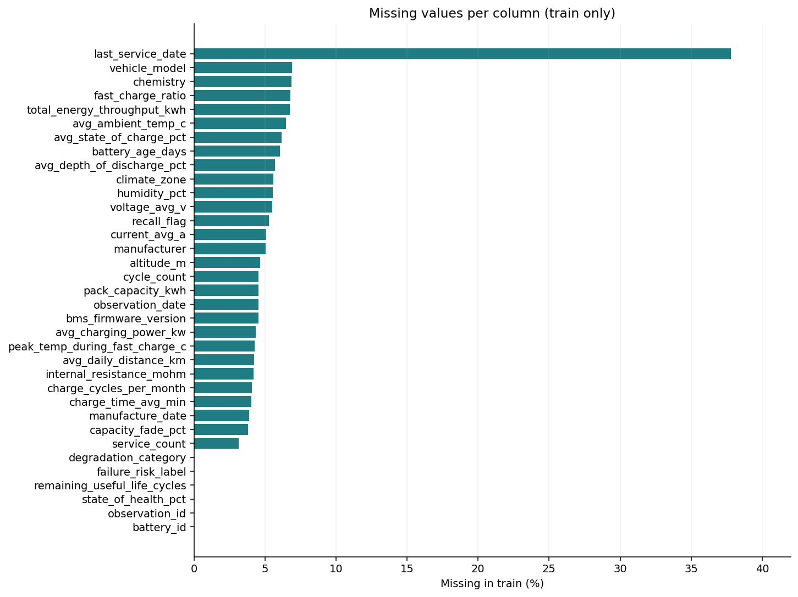
*Gambar 8.1 Profil persentase nilai hilang pada setiap kolom di himpunan data train hasil tahap audit awal (00_data_audit.ipynb).*

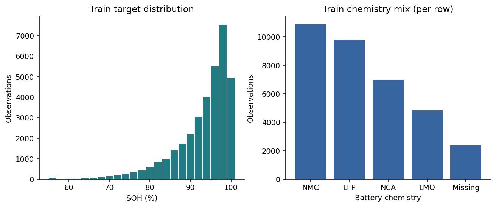
*Gambar 8.2 Profil awal distribusi target SOH dan proporsi pengamatan per jenis kimia baterai pada data train hasil tahap audit awal.*

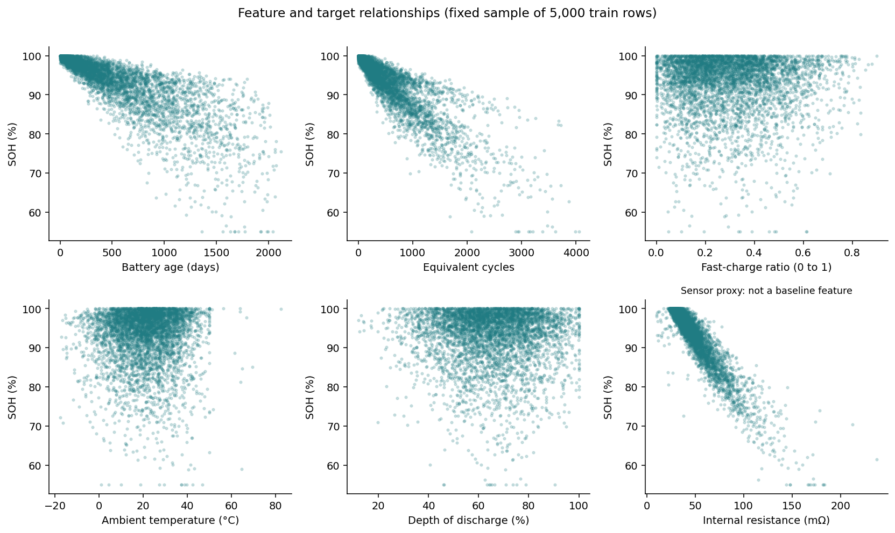
*Gambar 8.3 Hubungan awal antara fitur utama serta kandidat proksi sensor (internal_resistance_mohm) terhadap SOH pada sampel deterministik 5.000 baris data train.*

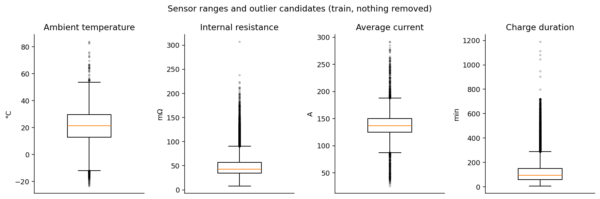
*Gambar 8.4 Diagram kotak-garis (boxplot) pemeriksaan rentang nilai dan kandidat pencilan 1,5 x IQR pada variabel sensor di data train.*

### 8.3. Notebook dan Petunjuk Reproduksi EDA

Seluruh angka, tabel, dan grafik di dalam laporan ini dihasilkan secara deterministik dan dapat direproduksi sepenuhnya dari repositori proyek tanpa penyuntingan manual. Rincian artefak kode, notebook, laporan repositori, dan sidik jari data adalah sebagai berikut:

1. Repositori Kode dan Laporan EDA: https://github.com/HUB37T/EV-Battery-Health (komit referensi pipeline: 048e88f). Modul kode sumber berada pada src/ev_battery/audit.py dan src/ev_battery/eda.py, sedangkan laporan Markdown otomatis tersimpan pada results/audit/AUDIT_REPORT.md dan results/eda/EDA_REPORT.md serta laporan terstruktur bahasa Indonesia pada docs/laporan_eda/README.md.
2. Notebook Interaktif: notebooks/00_data_audit.ipynb (tahap audit skema, validitas, kebocoran target, dan pembagian grup baterai) serta notebooks/01_eda.ipynb (tahap eksplorasi distribusi, korelasi, perbandingan kimia-usia, nilai hilang, sensitivitas IQR, dan kualitas waktu pada data train).
3. Sumber Data dan Hash Verifikasi: Dataset publik Kaggle EV Battery Health & Degradation Dataset (https://www.kaggle.com/datasets/vinay24baghira/ev-battery-health-and-degradation-dataset). Berkas data/raw/ev_battery_health.csv memiliki SHA-256 cacdf6afcf50db86583be3754207a89acbfd60b04dfff8f69b71e29cfd78218d, manifest pembagian grup data/splits/battery_split.csv memiliki SHA-256 9529f65692528d6f9ed63773880a84c75d0b28d0a8b7803018a2bcd9ac00b8ad, dan kontrak fitur configs/feature_contract.json memiliki SHA-256 1cffec850bb7b84a5837d635ec4055d6d6fd1921dd54e7e56f587eb4138edb8b.
4. Lingkungan Eksekusi Terkunci: Python 3.13.1 (kompatibel dengan Python 3.12+), NumPy 2.2.5, pandas 2.3.2, SciPy 1.16.1, Matplotlib 3.10.6, nbformat 5.10.4, dan nbclient 0.10.2 (seed acak global dan bootstrap: 42, jumlah replikasi bootstrap: 1.000).
5. Langkah Perintah Reproduksi dari Akar Repositori: (a) buat lingkungan virtual dan pasang paket dengan perintah make venv && make install (atau python3 -m venv .venv && .venv/bin/pip install -e ".[dev]"); (b) unduh dan verifikasi dataset dari Kaggle dengan perintah make data (atau python scripts/download_data.py); (c) jalankan tahapan audit dan EDA dengan perintah make audit && make eda (atau python -m ev_battery audit diikuti python -m ev_battery eda); serta (d) eksekusi ulang kedua notebook secara otomatis dengan perintah python scripts/run_notebook.py notebooks/00_data_audit.ipynb notebooks/01_eda.ipynb.
