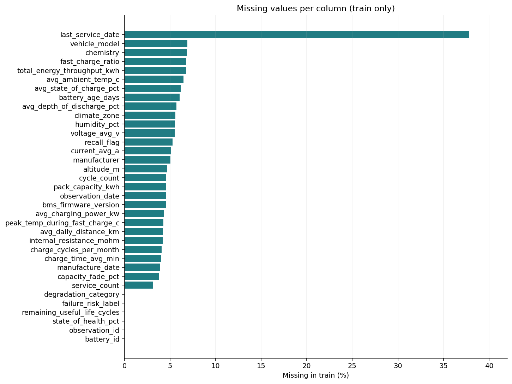
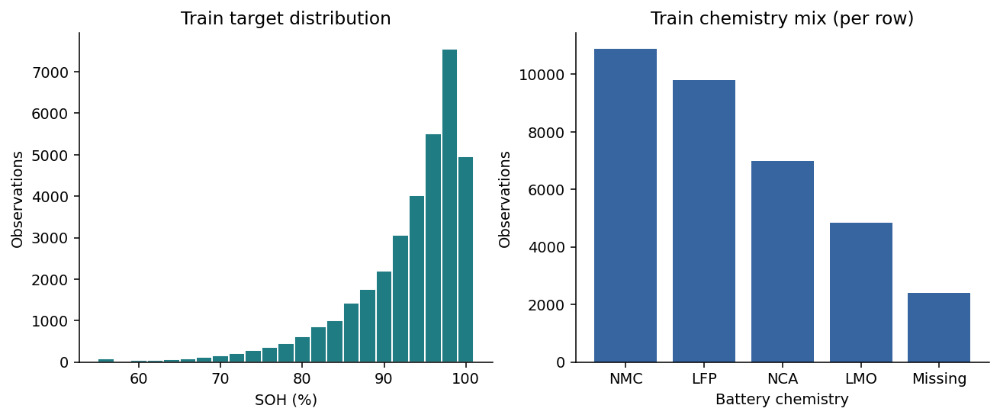
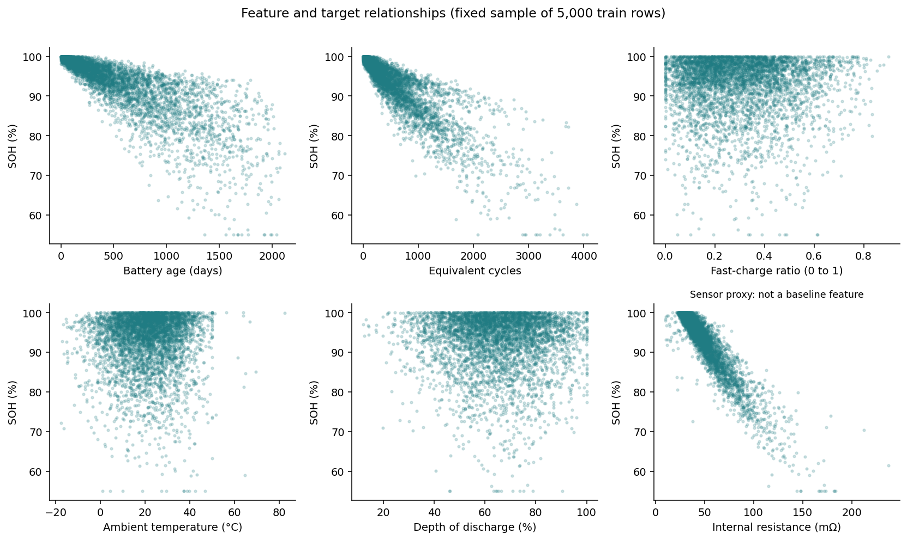
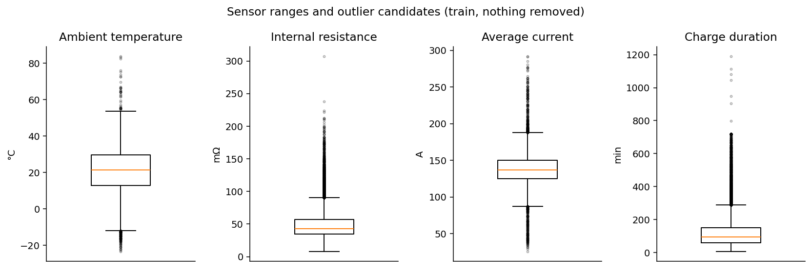

# Dataset Audit and Initial Train Profile

## Key decisions

- Task: **regression of SOH at observation time for unseen batteries**, target `state_of_health_pct`.
- The source README describes the data as synthetic, not real fleet telemetry. No model is trained at this stage.
- Full dataset: **50,000 rows, 35 columns, 2,600 batteries**.
- 70/15/15 split by **battery_id** with seed 42. No battery appears in more than one subset. The ratios apply to batteries, so row counts are not exactly 70/15/15.
- Distribution and relationship profiles and IQR bounds use train only. Global checks are limited to schema, IDs, dates, missingness, basic ranges and the target identity. The test split is not used for any selection or scoring.
- `21` raw candidate features **before encoding**. The number of input neurons is only known after preprocessing is fitted on train.

## Source and version

[Kaggle dataset](https://www.kaggle.com/datasets/vinay24baghira/ev-battery-health-and-degradation-dataset). Column definitions come from `data/raw/README.md` and `data/raw/data_dictionary .csv` in the downloaded archive. The source README states a **CC0** licence and fully synthetic data. The dictionary file name contains a space before `.csv` and is kept as is. The archive does not contain the sample notebook mentioned in its README.

CSV SHA-256: `cacdf6afcf50db86583be3754207a89acbfd60b04dfff8f69b71e29cfd78218d`.
Environment details and documentation hashes are stored in `provenance.json`. The split manifest `../../data/splits/battery_split.csv` is locked to this CSV version. All outputs can be regenerated without modifying the CSV.

## Split manifest

| split | batteries | rows | row_pct |
| --- | --- | --- | --- |
| train | 1820 | 34929 | 69.858 |
| validation | 390 | 7499 | 14.998 |
| test | 390 | 7572 | 15.144 |

The manifest has one row per battery. Join on `battery_id` to select rows. Never split randomly by observation. The algorithm sorts battery IDs, permutes them with NumPy `default_rng(42)`, and assigns train, validation and test in that order. There is no stratification on the target and the seed was not chosen from model scores.

## Global integrity

- Fully duplicated rows: 0. Duplicated `observation_id`: 0.
- Missing targets: 0. Infinite numeric values: 0.
- Missing `observation_date`: 2216. Duplicated battery and date among rows with a date: 0. Missing dates are not treated as same-day measurements.
- Non-empty dates that failed to parse: 0.
- Observation before manufacture: 0. Service after observation: 0. Service before manufacture: 0.
- Age inconsistent with the date difference: 0 of 43,199 checkable rows.
- Observations per battery: 7 to 37, mean 19.23. The source README says roughly 10 to 40. The audited numbers are used.
- No conflicting non-missing values were found in the static attributes checked (chemistry, manufacturer, model, nominal capacity, manufacture date, climate zone). This does not prove that every column is constant per battery.

## Missing values

This table is a quality audit of the whole CSV, not imputer statistics. Imputation statistics are computed from train only.

| column | missing_count | missing_pct |
| --- | --- | --- |
| last_service_date | 18831 | 37.662 |
| vehicle_model | 3515 | 7.03 |
| chemistry | 3459 | 6.918 |
| fast_charge_ratio | 3405 | 6.81 |
| total_energy_throughput_kwh | 3370 | 6.74 |
| avg_ambient_temp_c | 3282 | 6.564 |
| avg_state_of_charge_pct | 3138 | 6.276 |
| battery_age_days | 3002 | 6.004 |
| avg_depth_of_discharge_pct | 2832 | 5.664 |
| voltage_avg_v | 2807 | 5.614 |
| humidity_pct | 2737 | 5.474 |
| climate_zone | 2719 | 5.438 |
| recall_flag | 2646 | 5.292 |
| current_avg_a | 2487 | 4.974 |
| manufacturer | 2461 | 4.922 |
| bms_firmware_version | 2328 | 4.656 |
| altitude_m | 2322 | 4.644 |
| pack_capacity_kwh | 2302 | 4.604 |
| cycle_count | 2269 | 4.538 |
| observation_date | 2216 | 4.432 |
| avg_charging_power_kw | 2140 | 4.28 |
| peak_temp_during_fast_charge_c | 2128 | 4.256 |
| avg_daily_distance_km | 2118 | 4.236 |
| internal_resistance_mohm | 2104 | 4.208 |
| charge_time_avg_min | 2091 | 4.182 |
| charge_cycles_per_month | 2054 | 4.108 |
| manufacture_date | 1910 | 3.82 |
| capacity_fade_pct | 1869 | 3.738 |
| service_count | 1600 | 3.2 |

`last_service_date` is not always missing because of data corruption: 18,205 rows with a missing service date have `service_count = 0`, 626 also have a missing `service_count`, and 0 have `service_count > 0`. These dates must not all be imputed as real service dates, so the column is excluded from the baseline.

## Target leakage and sensor proxies

Across the 48,131 rows that have `capacity_fade_pct`, **capacity_fade_pct + SOH = 100** with a maximum absolute deviation of 0.0. This is a direct identity, so `capacity_fade_pct` is never used as an input.

The three alternative targets (`remaining_useful_life_cycles`, `failure_risk_label`, `degradation_category`) are also excluded. The source README states that the electrical measurements are derived from SOH and chemistry, naming internal resistance explicitly. Internal resistance, voltage, current and charge time are therefore conservatively excluded from the baseline and kept only as candidates for a separate sensor ablation. A real measured sensor can be valid for current-state estimation, but in this synthetic dataset such columns may act as target proxies.

Feature roles and reasons are stored in `../../configs/feature_contract.json` and `schema_audit.csv`. The main features cover chemistry and metadata, age and usage, and environment. Availability of every summary at observation time is an assumption, because the source does not document aggregation windows.

## Temporal feasibility

| counter | eligible_pairs | decreasing_pairs |
| --- | --- | --- |
| cycle_count | 43017 | 7820 |
| battery_age_days | 42320 | 0 |
| total_energy_throughput_kwh | 41948 | 8923 |

The check compares consecutive valid measurements of the same battery after dropping missing dates or counter values, and only where the date increases. Pairs may skip missing observations. `cycle_count` and throughput are defined as cumulative yet frequently decrease. This is treated as an inconsistency of the synthetic data rather than repaired by sorting, cumulative maxima or mass deletion.

**Decision:** a tabular baseline without timesteps. Forecasting and windowing are deferred. The group split tests generalisation to unseen batteries, not to future time periods.

## Initial train profile

Train rows: 34,929. Train SOH: min 55.00, median 95.23, mean 92.92, max 100.00 percent.

| soh_band_pct | train_rows | train_pct |
| --- | --- | --- |
| <70 | 525 | 1.503 |
| 70–<80 | 1697 | 4.858 |
| 80–<90 | 6412 | 18.357 |
| 90–<95 | 8264 | 23.659 |
| >=95 | 18031 | 51.622 |

The target is unevenly distributed. Because the target is continuous, SMOTE or class balancing is not applied. Final evaluation must report errors per SOH band with sample counts instead of relying on aggregate MAE alone.

Missingness affects both numeric and categorical features. Median imputation and an explicit missing category are reasonable baselines. No imputer or scaler is fitted in this audit.

Chemistry shares are counted per observation, not per battery, and observations of the same battery are correlated. Row shares must not be read as real fleet prevalence.

The plots use a deterministic sample of at most 5,000 train rows and skip missing pairs. They show observational relationships inside a simulator, not causal effects. Internal resistance is shown to discuss proxy risk. It is not part of the baseline.

Points beyond the whiskers are candidates for inspection, not confirmed errors. `outlier_flags_train.csv` applies the 1.5 x IQR rule on train without removing or clipping values. The source mentions injected sensor outliers but provides no mask of affected rows.

## Next stage

The deeper train-only EDA is in `../eda/EDA_REPORT.md`. Preprocessing, the MLP study and the final evaluation follow in later stages. This report contains the audit and an initial profile only, **not the full EDA, final preprocessing or any prediction results**.
