# Exploratory Data Analysis (Train Only)

## Summary

1. The analysis uses **34,929 observations from 1,820 train batteries**. Validation and test are not summarised, plotted or used to choose patterns.
2. SOH is skewed towards healthy batteries: median **95.23%**, mean **92.92%**, **51.62%** of observations at or above 95% and **6.36%** below 80%. Errors on low SOH must be reported separately.
3. Cycle count has the strongest association with SOH among the main features (Spearman **-0.907**). Age and cumulative energy are also strong. The three are strongly related to each other, so they are not three independent pieces of evidence.
4. Chemistries differ in their SOH distribution. Within the same age band, with equal weight per battery, the differences remain, but usage conditions are not fully controlled. This is a simulator pattern, not a causal effect of chemistry in a real fleet.
5. For the main features, the median SOH gap between missing and observed rows ranges from **-0.24 to 0.28 percentage points**. This does not prove MCAR. Missing service dates differ strongly and are linked to the usage stage.
6. Across **31,528** consecutive pairs with valid dates, SOH increases by more than 0.01 points in **10,360 (32.86%)** pairs. Intervals are irregular and cumulative counters are inconsistent, so timesteps are not built and SOH increases are not interpreted as physical recovery.
7. No preprocessing is fitted, no final feature selection is made and no model is trained here. The raw data and the split manifest are unchanged.

## 1. Questions, source and units

Goal: describe distributions, relationships, data quality and observation structure before designing preprocessing and the MLP experiments.

Source: [Kaggle EV Battery Health & Degradation](https://www.kaggle.com/datasets/vinay24baghira/ev-battery-health-and-degradation-dataset). The README and data dictionary in the archive describe the data as **fully synthetic** (CC0), with injected missing values and outliers, and electrical measurements related to SOH and chemistry. The generator and the injection masks are not available.

The CSV and manifest hashes are recorded in `eda_provenance.json`. The CSV is read only to select train rows from the manifest. Every EDA function receives train only. Data is never combined across subsets to recover missing values.

Two summary units are used:
- **Observation:** one measurement row. Batteries with more rows carry more weight.
- **Battery:** the grouping unit. For the chemistry and age curves, each battery contributes one mean SOH per age band, which is then averaged across batteries.

`chemistry_group` is an EDA-only label: the single non-missing chemistry value that is consistent across the battery's **train** observations. The raw chemistry column stays unchanged and its missingness is still counted. It is not an imputer for model inputs. Raw category comparisons use the original row values, including Missing.

No p-values are computed, because the 34,929 rows are not independent. Correlations and group differences are descriptive. No causal claims or battery safety recommendations are drawn from a simulator.

## 2. Target distribution and units of analysis

- Train SOH: 55.00% to 100.00%, median 95.23%, mean 92.92%.
- Exactly 100%: 1,603 rows. Exactly 55%: 80 rows. Pile-up at the observed bounds is consistent with clipping or rounding in the simulator, but the generator is not available to confirm it.
- Median with equal weight per battery: 95.21%. Mean with equal weight per battery: 92.91%.
- Spearman correlation between observations per battery and battery mean SOH: 0.014. This checks for bias from the number of observations. It does not prove independent sampling.

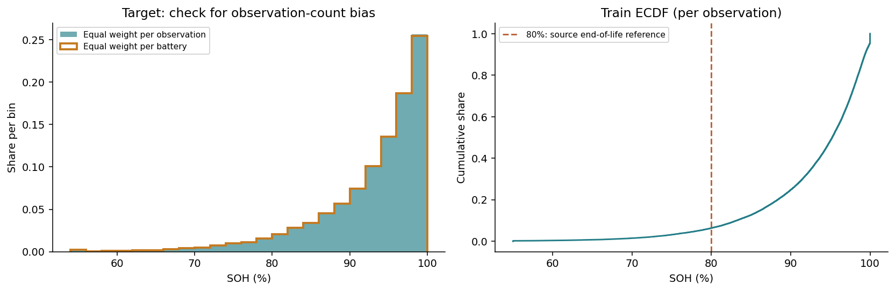

Both histograms use the same bins. The orange line weights each row by 1 / (rows of its battery). The ECDF shows the share of observations at or below each SOH value. The 80% line is the end-of-life reference from the dataset documentation, not a class threshold introduced here.

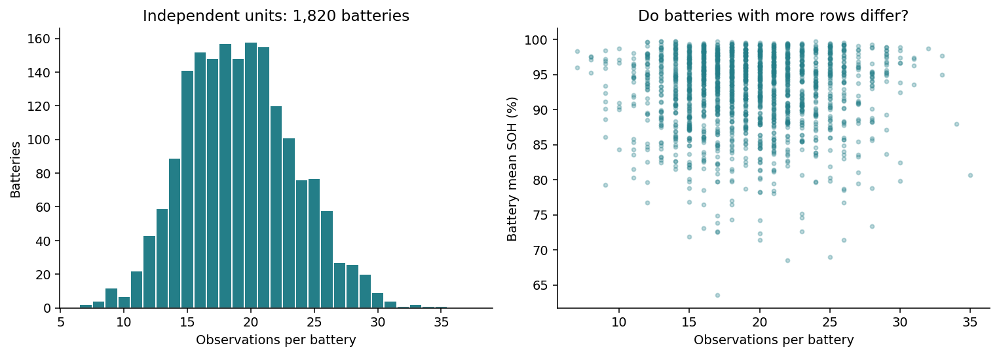

**Implication:** use MAE and RMSE on the original target scale, not a regression "accuracy". Final evaluation should include SOH bands and per-battery summaries. The nominal sample size is not the number of independent batteries.

## 3. All numeric and categorical features

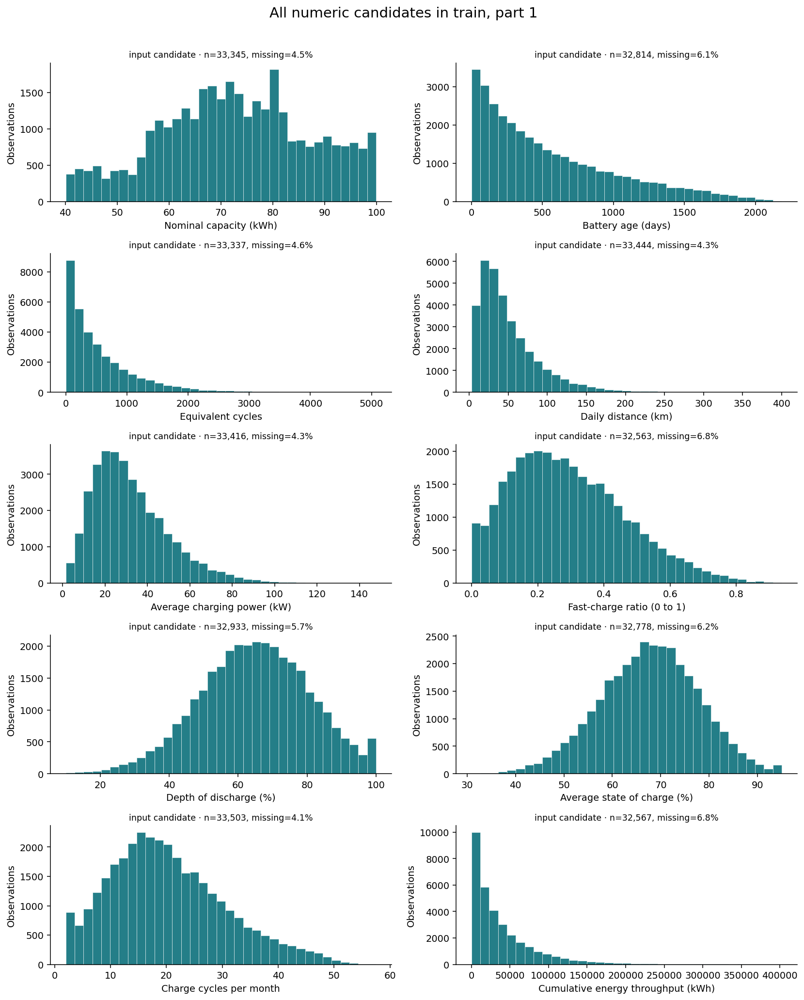

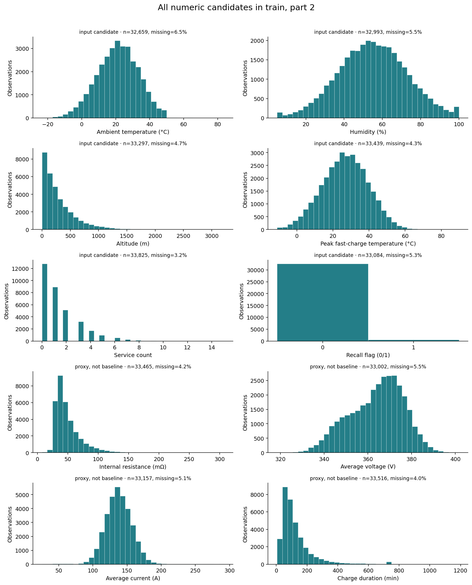

All 15 numeric candidates, `recall_flag` and the four sensor proxy candidates are covered. Every panel shows observed and missing counts. Histograms keep outliers. Minimum, p1, p5, quartiles, p95, p99, maximum and skewness are in `numeric_distributions.csv` and `tails_and_iqr.csv`.

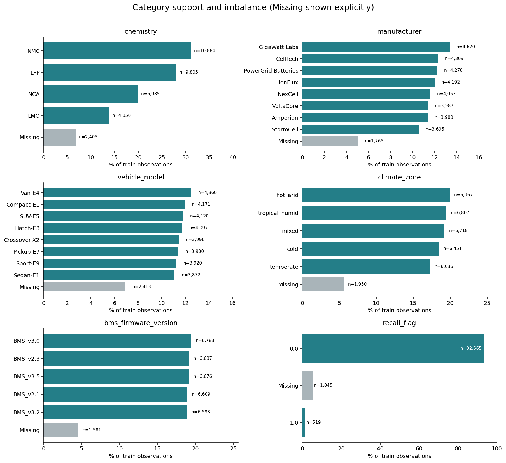

The Missing category is not a new battery type. Firmware and recall status can change between observations and should not be treated as static attributes. Batteries in changing categories can overlap, so their counts must not be summed as if categories were mutually exclusive per battery. `recall_flag = 1` is rare. Row counts are shown so that small groups are not over-interpreted.

**Implication:** numeric imputation, encoding of unseen categories, numeric scaling and binary handling are designed in preprocessing. Weakly correlated features and rare categories are not removed on the basis of EDA alone.

## 4. Chemistry and age: a fairer comparison

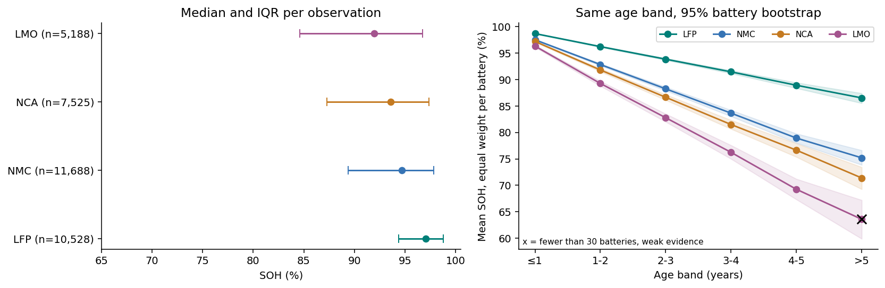

The left panel shows observation-level median and IQR, not confidence intervals. The right panel groups age into fixed yearly bands, averages SOH per battery within each band, and gives each battery equal weight.

Example for the **1-2 years** band:

| chemistry | rows | batteries | battery_balanced_mean_soh | ci95_low | ci95_high |
| --- | --- | --- | --- | --- | --- |
| LFP | 2439 | 469 | 96.237 | 96.119 | 96.348 |
| LMO | 1168 | 226 | 89.27 | 88.781 | 89.709 |
| NCA | 1665 | 344 | 91.817 | 91.513 | 92.115 |
| NMC | 2718 | 501 | 92.845 | 92.634 | 93.038 |

Bands in the right panel are 95% percentile bootstrap intervals from **1,000 battery resamples within each chemistry and age cell** (seed 42). They are pointwise intervals for the cell mean, not for the whole curve or for differences between chemistries, and they do not address confounding. They are not used as significance tests. The same battery can appear in several age bands, so points along a curve are correlated.

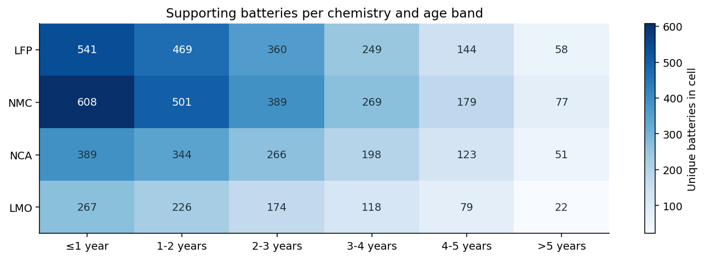

Cells with fewer than 30 batteries are marked with x on the curve. Low-support cells:

| chemistry | age_band | rows | batteries |
| --- | --- | --- | --- |
| LMO | >5 years | 51 | 22 |

**Conclusion:** chemistry and age should be considered together because the patterns differ between chemistries. These curves summarise observations and batteries across age bands. They are not controlled degradation curves of single batteries and do not show that any chemistry is always better.

## 5. Numeric relationships, nonlinearity and redundancy

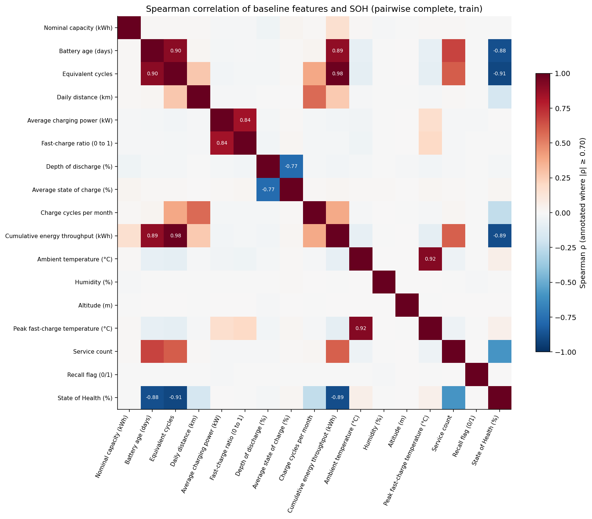

Spearman measures rank-based monotonic association and does not assume a straight line. Pearson complements it for linear association. Correlations use pairwise-complete rows without imputation. Pair counts range from **30,368 to 33,825** in the stored matrix. See `correlation_pair_counts.csv`.

Strongest target associations among baseline and proxy candidates:

| feature | role | pairwise_rows | batteries | pearson_pooled | spearman_pooled |
| --- | --- | --- | --- | --- | --- |
| cycle_count | primary | 33337 | 1820 | -0.873 | -0.907 |
| internal_resistance_mohm | proxy_not_baseline | 33465 | 1820 | -0.928 | -0.896 |
| total_energy_throughput_kwh | primary | 32567 | 1820 | -0.822 | -0.886 |
| battery_age_days | primary | 32814 | 1820 | -0.809 | -0.881 |
| service_count | primary | 33825 | 1820 | -0.564 | -0.593 |
| charge_cycles_per_month | primary | 33503 | 1820 | -0.275 | -0.244 |
| avg_daily_distance_km | primary | 33444 | 1820 | -0.177 | -0.169 |
| avg_ambient_temp_c | primary | 32659 | 1820 | 0.024 | 0.056 |
| peak_temp_during_fast_charge_c | primary | 33439 | 1820 | 0.022 | 0.053 |
| voltage_avg_v | proxy_not_baseline | 33002 | 1820 | 0.048 | 0.023 |

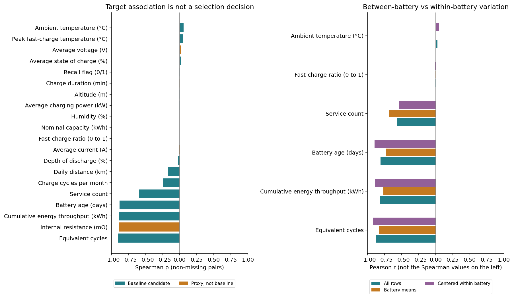

The right panel compares **Pearson** coefficients, not the Spearman values on the left: pooled over all observed pairs, between batteries using per-battery means, and within batteries after subtracting each battery's mean. Centering is not a causal model and does not control for age, chemistry or other variables. Features that are constant within a battery have no defined centered correlation. Those values are left empty.

Main-feature pairs with |Spearman| at or above 0.70 (an exploratory threshold, not a removal rule):

| feature_a | feature_b | spearman | pairwise_rows |
| --- | --- | --- | --- |
| cycle_count | total_energy_throughput_kwh | 0.984 | 31064 |
| avg_ambient_temp_c | peak_temp_during_fast_charge_c | 0.92 | 31255 |
| battery_age_days | cycle_count | 0.903 | 31304 |
| battery_age_days | total_energy_throughput_kwh | 0.89 | 30582 |
| avg_charging_power_kw | fast_charge_ratio | 0.841 | 31147 |
| avg_depth_of_discharge_pct | avg_state_of_charge_pct | -0.767 | 30917 |

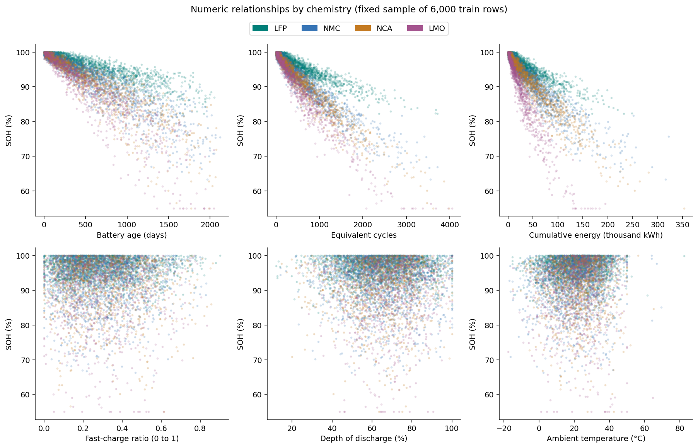

The scatter plots use a deterministic sample of 6,000 train rows with no fitted lines. More cycles and greater age generally go with lower SOH, but the spread and the chemistry differences show that a single linear relationship does not describe all observations. This motivates testing an MLP. It does not prove that an MLP will score best.

**Implication:** overlapping usage features are compared in controlled experiments later. Weak pooled correlations for fast charging, depth of discharge and temperature do not prove that these features are useless or that the factors do not matter for real batteries. In particular, the train Spearman correlation between fast-charge ratio and SOH is only about -0.003. The source mentions a fast-charge penalty in the simulator, but without the generator it is impossible to check how observed features relate to latent parameters.

## 6. Conditional patterns: do not rely on pooled correlations

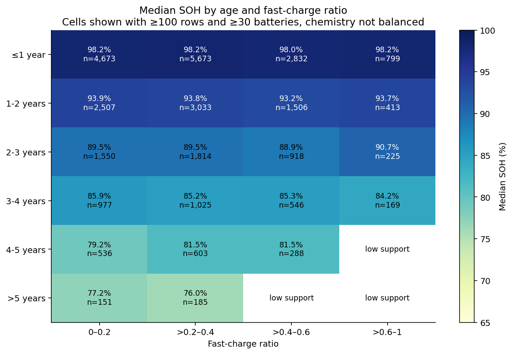

The grid uses fixed age and ratio bands and shows median SOH with the number of observations. Only cells with at least 100 rows and 30 batteries are shown. Chemistry and other usage factors are not balanced. The grid helps separate age variation from fast-charge variation. It does not identify a causal effect of charging.

`stratified_associations.csv` computes Spearman correlations for fast-charge ratio, depth of discharge, temperature, charging frequency and `service_count` within chemistry by age cells with the same support rules. Age bands are still wide, so confounding within cells is possible. Cells are not pooled into a single "effect" and are not cherry-picked.

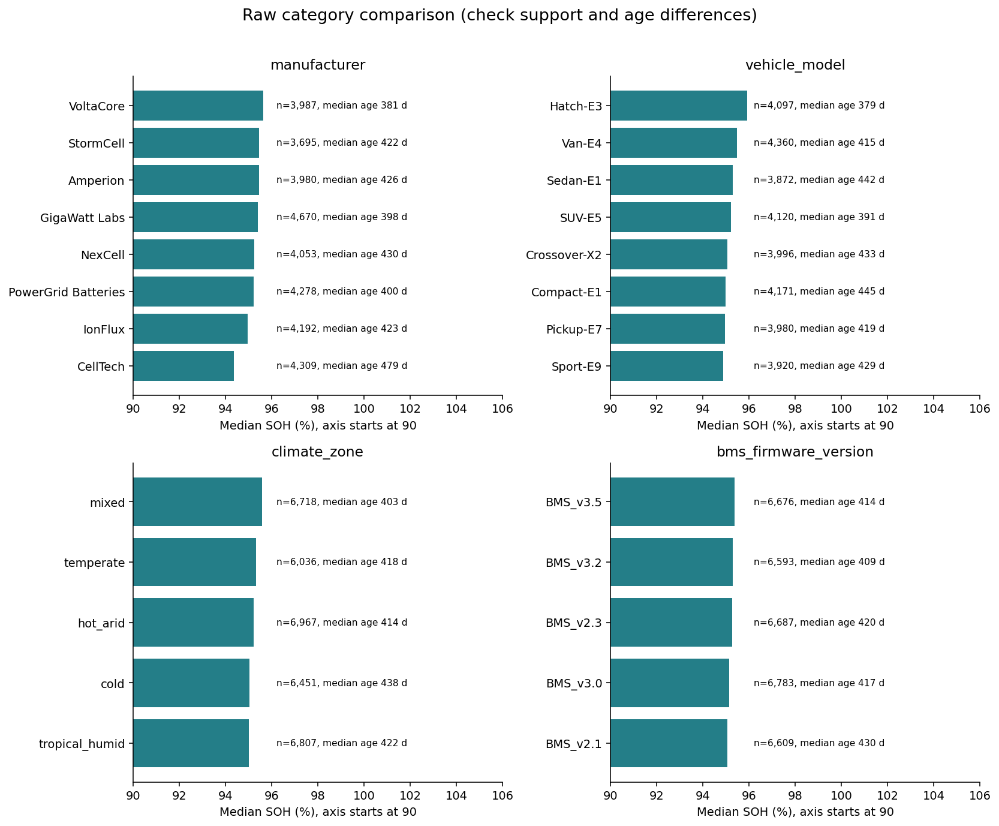

Manufacturer, model, climate and firmware categories are compared together with their support and median age. The SOH axis starts at 90%, marked explicitly, so the variation is visible. Small differences are not automatically important, and age differences can explain part of the raw gap.

## 7. Missingness

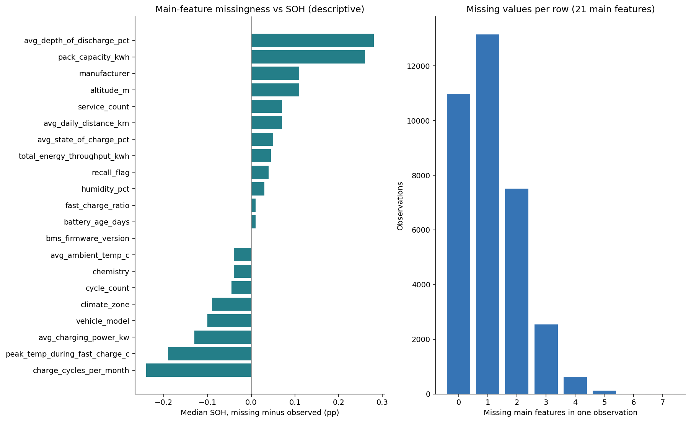

The missing versus observed median gap is descriptive only: missingness can be related to conditions, to the injection process or to group composition. Small gaps do not prove Missing Completely At Random. Correlations between missing indicators (`missingness_phi.csv`) and all ordered pairs (`missingness_pairs.csv`) are stored without changing the data. The maximum |phi| is about 0.017 in train, so no large linear co-missingness appears among the indicator pairs checked. Nonlinear or conditional dependence is not ruled out.

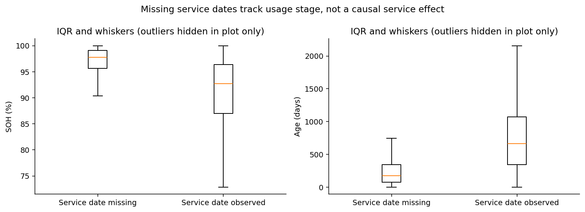

Median SOH is **97.79%** when the service date is missing and **92.70%** when it is observed. Median ages are **174** and **662** days. This is consistent with different usage stages and is **not** evidence that servicing reduces health. Service dates are not imputed here.

## 8. Outliers and sensitivity

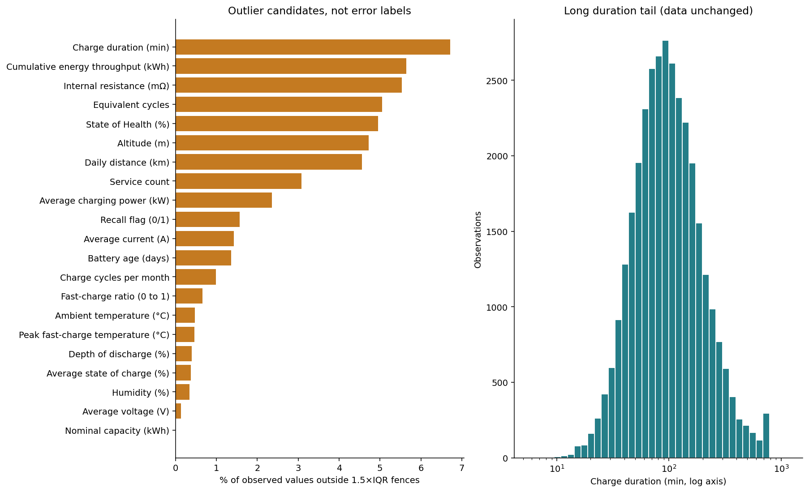

The 1.5 x IQR fences only mark values that are extreme relative to the train distribution. Low target values and rare binary flags can also be flagged without being errors, so this rule is not used to remove outliers.

The charge-duration histogram uses a log axis to show the tail. The raw values are not log-transformed for the model at this stage. `outlier_association_sensitivity.csv` compares Spearman on all pairs with Spearman inside each feature's IQR fences. This is a sensitivity analysis, not a decision to drop rows, and the denominators are recorded. For `recall_flag` the fences keep only zeros, so the filtered correlation is undefined and left empty. For cycles, age and energy the strong negative relationship remains inside the fences, which does not prove that removing outliers would improve predictions. There is no official mask of injected outliers.

## 9. Temporal structure and simulator consistency

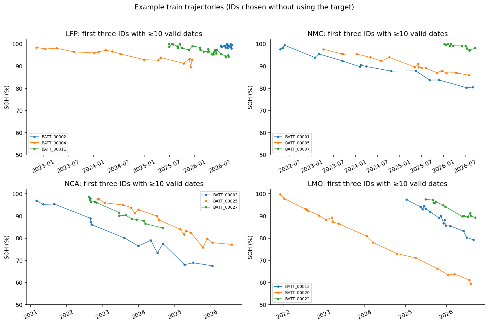

Examples are chosen deterministically: the first three IDs in alphabetical order per chemistry with at least 10 dated observations. SOH values are not used to choose them. These trajectories do not summarise the population, and missing dates are not invented or connected as known intervals.

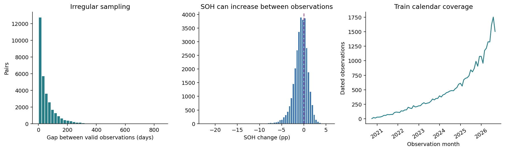

| label | rows | pct_pairs |
| --- | --- | --- |
| down >0.01 pp | 20498 | 65.015 |
| stable ±0.01 pp | 670 | 2.125 |
| up >0.01 pp | 10360 | 32.86 |

Differences are computed between dated observations of the same battery with increasing dates. Pairs may skip observations whose date is missing. SOH changes are rounded to the recorded precision of 0.01 points before classifying them as down, stable or up, so floating-point artefacts do not move values at the boundary. Because intervals vary, the delta-SOH histogram is **not a degradation rate per day**. SOH increases in some pairs. The source describes the data as synthetic and noisy, but the mechanism behind each increase cannot be confirmed without the generator. Decreasing cycle and energy counters were already identified in the audit.

**Implication:** keeping a tabular baseline and deferring timesteps is justified. Trajectories are not forced to be monotonic or sorted by the target. The group split tests new batteries, not new calendar periods.

## 10. Alternative targets: understood, not used as inputs

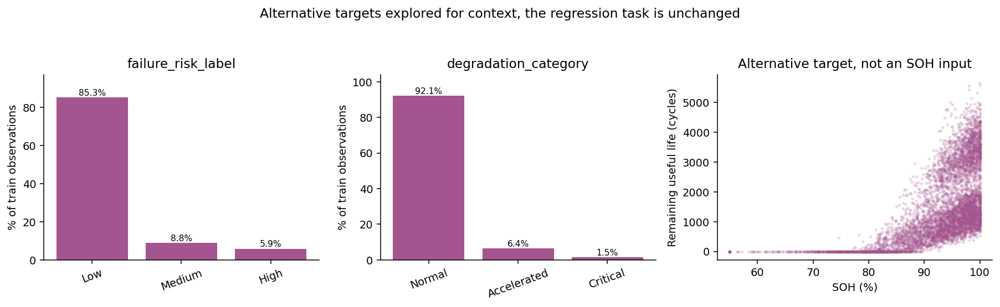

Risk and degradation labels help to understand the simulator mix and class imbalance, but the task remains SOH regression. In train, Low, Medium and High risk account for about 85.26%, 8.84% and 5.90%, consistent with the composition described by the source. Normal degradation reaches 92.13%. RUL, risk and degradation are neither features nor auxiliary tasks. `capacity_fade_pct` equals 100 minus SOH and stays excluded. A perfect correlation with it is not predictive skill.

## 11. Decisions supported by the EDA

| Finding | Implication for later stages | Limit of the conclusion |
| --- | --- | --- |
| Target skewed towards high SOH | Report errors per SOH band and per battery | Do not automatically rebalance a continuous target |
| Age, cycles and energy strongly related | Important candidate features, test redundant subsets | Not three independent causes |
| Chemistries differ within the same age band | Keep chemistry, allow nonlinear interactions | Usage conditions not fully controlled |
| Numeric and categorical missingness, structural service missingness | Train-only imputation and encoding of unseen categories | Not all missingness is equivalent or MCAR |
| Very different feature ranges | Standardise numeric features in the baseline | Scaler statistics are fitted in preprocessing, not here |
| Sensor tails and rare values | Evaluate targeted outlier handling and sensitivity | IQR is not ground truth for errors |
| Repeated observations and temporal quality | Keep the group split, defer timesteps | No forecasting claim |
| Proxies and derived targets | Keep leaking columns excluded, sensors only in a separate ablation | Not a universal ban on real measured sensors |

The initial feature list is **unchanged**. No score-based feature selection, model, imputer, encoder, scaler, balancing or tuning is applied in this stage.

## 12. Reproduction

- Notebook: `../../notebooks/01_eda.ipynb` with questions, methods, tables, figures, interpretation and checks.
- Commands from the repository root: `python -m ev_battery eda` and `python scripts/run_notebook.py notebooks/01_eda.ipynb`.
- All 35 columns are listed in `column_coverage.csv`, including IDs, dates and alternative targets with their roles.
- Every table is computed from train. Figures are saved as 140 dpi PNG.
- No naive row-level p-values, no causal conclusions, and no use of holdout data to refine the narrative.

Main limitations: synthetic data, unavailable generator, undocumented aggregation windows, missing values and outliers without original masks, repeated observations, small-support groups, and confounding that is not fully controlled.
