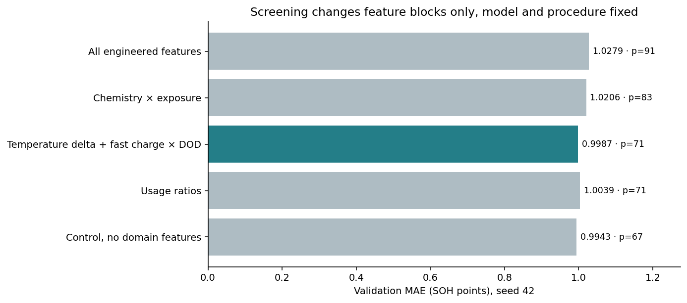
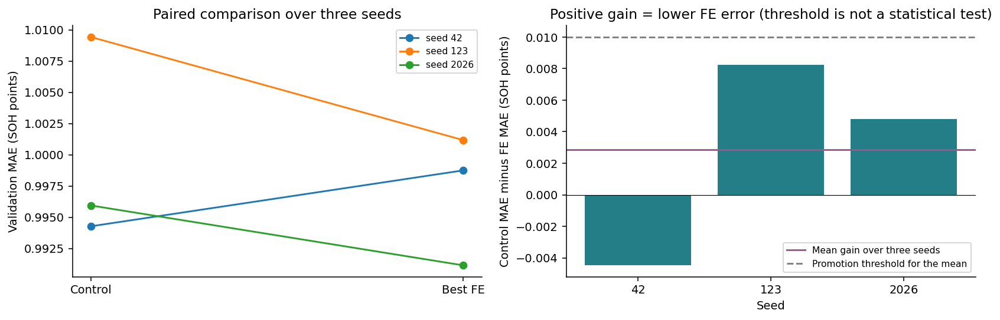
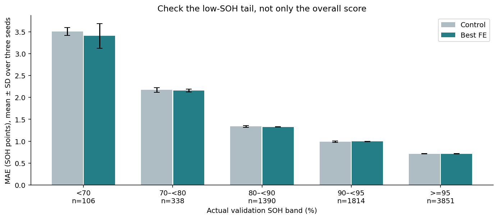
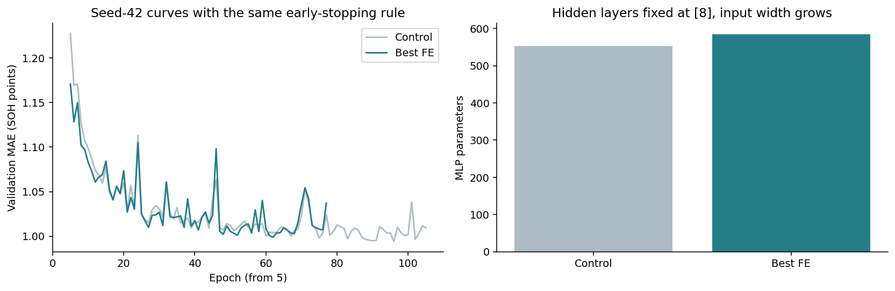

# Feature Engineering Ablation for the MLP

## Result and recommendation

**Recommendation: keep the control without domain features as the main candidate.** The new features were genuinely tested, and a small improvement is not by itself a reason to add complexity.

- The control is the notebook 03 candidate, **not** the original baseline.
- Three-seed mean validation MAE: control **0.99988 ± 0.00831**, best engineered variant **0.99702 ± 0.00523** SOH points.
- Mean paired gain **0.00286 points** (0.29% relative to the control MAE), better on **2/3** seeds.
- Inputs: control 67, best variant 71. Parameters 553 to 585 (**+5.8%**), hidden layers fixed at [8].
- Promotion rule fixed before training: mean gain of at least **0.01 points** and better on at least two seeds. Passed: **False**. This is a practical heuristic, not a significance test or a physical threshold.
- The test split is not transformed, loaded or evaluated. The synthetic data still limits generalisation.

## 1. Question and protocol

Do derived features reduce MLP error when the hidden layers, activation, output, loss, learning rate, batch size, seeds, checkpointing and early stopping are unchanged? The control is frozen from run `run_d38f33266c77`: `baseline_standard`, 67 inputs, hidden [8] sigmoid, linear output, MSE loss, gradient descent with learn_rate 0.1, batch size 32, sample weighting `none`, max_error 0, at most 200 epochs, patience 15.

Four variants are screened on seed 42, then only the variant with the lowest screening MAE is confirmed on seeds 42, 123 and 2026. The three existing control runs are reused with identical fingerprints. The engineered variants add **6 training runs**, and the notebook 03 study history stays intact.

Validation is used for both screening and confirmation, so this is not yet an independent final evaluation. The search is not extended until results look good, and no best seed is selected.

## 2. Feature definitions

| block | feature | formula | unit |
| --- | --- | --- | --- |
| usage_rates | fe_cycles_per_day | cycle_count / battery_age_days | cycles/day, snapshot ratio |
| usage_rates | fe_energy_per_cycle_kwh | total_energy_throughput_kwh / cycle_count | kWh/cycle |
| context | fe_charge_ambient_delta_c | peak_temp_during_fast_charge_c - avg_ambient_temp_c | °C |
| context | fe_fastcharge_dod_interaction | fast_charge_ratio * avg_depth_of_discharge_pct / 100 | ratio interaction |
| chemistry | fe_chem_<chemistry>_log_cycles | I(chemistry=c) * log1p(cycle_count) | interaction, 4 columns from train chemistries |
| chemistry | fe_chem_<chemistry>_log_age_years | I(chemistry=c) * log1p(battery_age_days / 365.25) | interaction, 4 columns from train chemistries |

Chemistry categories are taken from the non-missing categories of the frozen train encoder. For a known chemistry, the non-matching interaction columns are zero. For a missing or unseen chemistry, or a missing exposure, the interaction becomes missing. Unknown values are never mapped to one of the known chemistries.

Ratios are only computed when the denominator is positive and both operands are present after domain checks. No epsilon or floor changes the meaning of a division. Unavailable values stay missing until the extra imputation. The target, `capacity_fade_pct`, RUL, risk and degradation labels, IDs, future data and group fills are never used.

Cumulative ratios are snapshot summaries, not degradation rates or evidence of a physical mechanism. Non-monotonic cycle and energy counters remain a limitation of the source, and feature engineering does not repair them.

## 3. Extra preprocessing and fairness

All **67 base pipeline outputs remain bit-for-bit identical** as the input prefix. New features are appended together with their own missing indicators. Medians, 0.5% and 99.5% caps for the two ratios and the temperature delta, and the extra scaler are fitted on train only. The two ratios use signed `log1p` after capping. Chemistry interactions are built on log exposure and are not logged twice. The fast-charge by depth-of-discharge product is not capped because it is already a valid product of ratios.

The target scaler is reused without refitting. No observations or low-SOH rows are removed and no new test arrays are created. The source CSV is read in chunks with input and ID columns only, and test rows are dropped while loading, before any arithmetic or statistics. Target labels are not read in this step.

The MLP configuration is identical except for the input width and the resulting parameter count. Because parameters increase, this ablation measures the combined effect of the feature representation and input capacity, not a causal effect of the features at a fixed parameter count. All parameter counts are recorded.

## 4. Screening

| variant | run_id | seed | input_neurons | parameters | train_mae_pp | validation_mae_pp | validation_rmse_pp | validation_r2 | best_epoch | epochs_actual |
| --- | --- | --- | --- | --- | --- | --- | --- | --- | --- | --- |
| control_no_domain_features | run_d38f33266c77 | 42 | 67 | 553 | 0.96289 | 0.99428 | 1.50387 | 0.9541 | 96 | 105 |
| fe_usage_rates | run_7ac583b421aa | 42 | 71 | 585 | 0.97804 | 1.00386 | 1.51949 | 0.95314 | 27 | 42 |
| fe_context | run_e21ad1bdee43 | 42 | 71 | 585 | 0.96977 | 0.99875 | 1.50901 | 0.95379 | 62 | 77 |
| fe_chemistry | run_ef40e49e41fe | 42 | 83 | 681 | 0.99445 | 1.02063 | 1.53223 | 0.95235 | 27 | 42 |
| fe_combined | run_faecfabf2d13 | 42 | 91 | 745 | 0.9889 | 1.02786 | 1.53416 | 0.95223 | 41 | 42 |

The screening winner is `fe_context`. A block can make results worse, so not every derived feature has to be used, and losing variants are kept in the record. Single-seed screening can be sensitive to optimisation noise, which is why it is followed by three-seed confirmation. Only the winner is confirmed, so a very small gap to the ratio variant does not prove that the ranking is stable on other seeds.

## 5. Paired confirmation

| variant | n_seeds | mae_mean_pp | mae_sd_pp | rmse_mean_pp | r2_mean | parameters |
| --- | --- | --- | --- | --- | --- | --- |
| control_no_domain_features | 3 | 0.99988 | 0.00831 | 1.50328 | 0.95414 | 553 |
| fe_context | 3 | 0.99702 | 0.00523 | 1.50461 | 0.95406 | 585 |

| seed | control_no_domain_features | fe_context | mae_improvement_pp |
| --- | --- | --- | --- |
| 42 | 0.99428 | 0.99875 | -0.00447 |
| 123 | 1.00942 | 1.00117 | 0.00825 |
| 2026 | 0.99594 | 0.99115 | 0.00479 |

SD is the sample SD over three seeds on a fixed split, not a population CI or evidence of significance. The 0.01-point threshold applies to the **mean gain**, not to each seed. The engineered variant is better on 2 of 3 seeds. With n = 3, both the direction and the size of the gain matter.

## 6. Low-SOH tail and complexity

| variant | band | n_rows | batteries | mae_mean_pp | mae_sd_pp |
| --- | --- | --- | --- | --- | --- |
| control_no_domain_features | <70 | 106 | 28 | 3.51128 | 0.08834 |
| control_no_domain_features | 70–<80 | 338 | 80 | 2.17285 | 0.05553 |
| control_no_domain_features | 80–<90 | 1390 | 218 | 1.33646 | 0.02355 |
| control_no_domain_features | 90–<95 | 1814 | 305 | 0.98765 | 0.01782 |
| control_no_domain_features | >=95 | 3851 | 384 | 0.71208 | 0.00384 |
| fe_context | <70 | 106 | 28 | 3.41149 | 0.28217 |
| fe_context | 70–<80 | 338 | 80 | 2.15865 | 0.02956 |
| fe_context | 80–<90 | 1390 | 218 | 1.32564 | 0.00431 |
| fe_context | 90–<95 | 1814 | 305 | 0.99603 | 0.00419 |
| fe_context | >=95 | 3851 | 384 | 0.71046 | 0.00492 |

Read each band's mean error together with its observation and battery counts and the seed variation. Battery counts can overlap across bands. A feature is not promoted only because one small validation group looks better.

Learning curves show seed-42 validation from epoch 5. Differences in the number of epochs come from the same early-stopping rule. More features mean more parameters, and adding features does not guarantee less overfitting or underfitting.

## 7. Train feature diagnostics

`train_feature_diagnostics.csv` contains missingness, raw ranges, medians, caps, scaler parameters and the **train** target correlation of every engineered feature. Per-variant parameters and output feature names are stored as well. Correlations support interpretation only and are not used to choose further subsets after seeing validation results. In train, the two ratios are missing in about 10.38% and 11.07% of rows, because a missing operand makes the ratio missing. Derived features add no independent measurements and can increase redundancy and complexity, so a small improvement is plausible without proving its cause.

## 8. Artifacts and reproduction

- Notebook `04_feature_engineering.ipynb`, separate so that the notebook 03 study is not rewritten.
- Config: `configs/feature_engineering.json`.
- Code: `src/ev_battery/features.py`, reusing the MLP training loop unchanged.
- Engineered train and validation arrays: `data/processed/<variant>/`, local and ignored by Git.
- Inference bundle: `models/feature_engineering/<variant>.joblib`. `bundle['preprocessor'].transform(new_rows[bundle['required_columns']])` computes the base and extra features consistently. Load only trusted artifacts.
- MLP checkpoints: `models/mlp/<run_id>/`, local. Config, history, summary and status are in `results/experiments/runs/<run_id>/`.
- Study summary: `results/feature_engineering/study.json`. The control stays recorded in `results/experiments/study.json`.

Reproduce with `python -m ev_battery features`, then run notebook 04. Runs with identical source, data and config fingerprints are reused. For cross-validation, fit the base and extra transforms on every training fold.

## 9. Limits and next stage

The current result supports the decision to **keep the control without domain features as the main candidate** under the practical rule fixed in advance, while keeping the engineered variant as a valid ablation result. This is not a population-level statistical claim, a test score, or evidence of validity on real batteries.

The next stage locks the configuration and seeds for the test evaluation in notebook 05. The test split is never used to choose new features or adjust the decision threshold.
