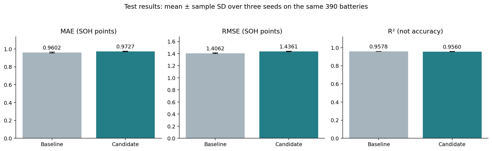
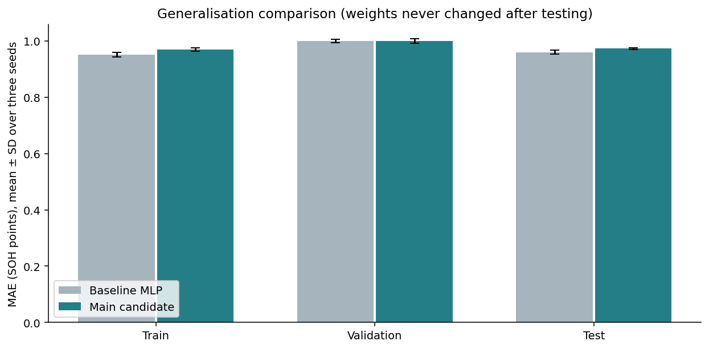
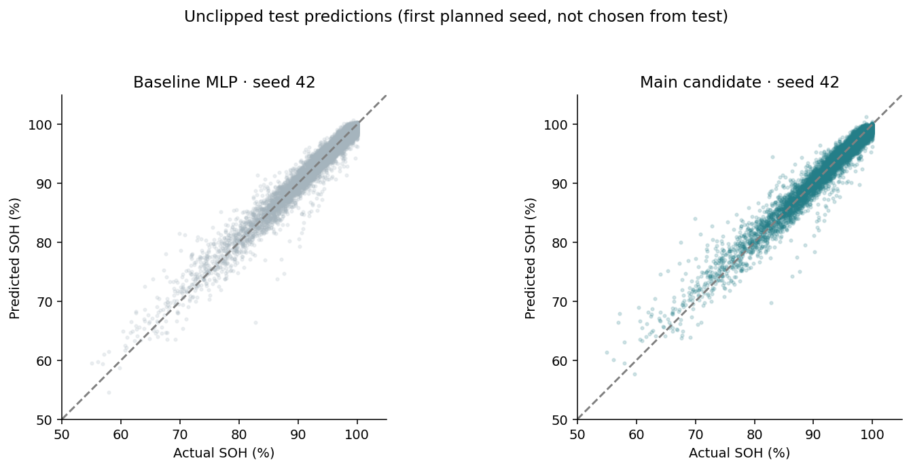
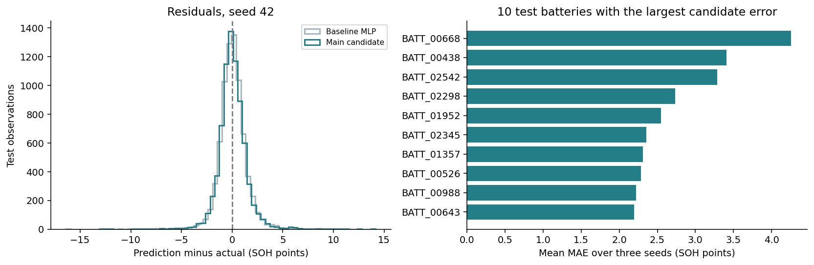
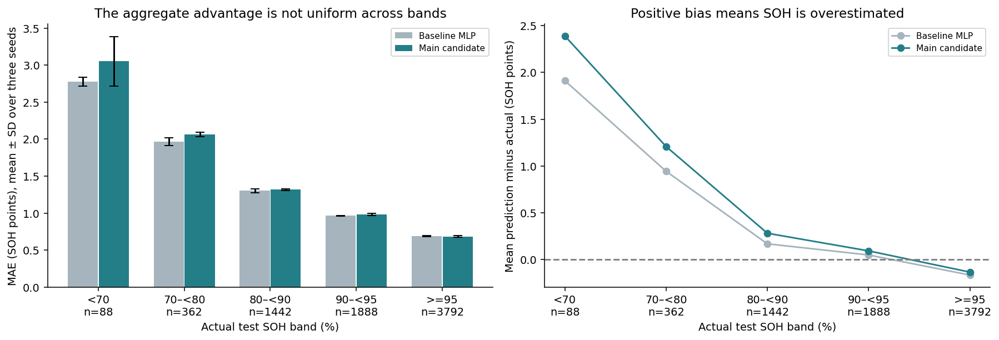
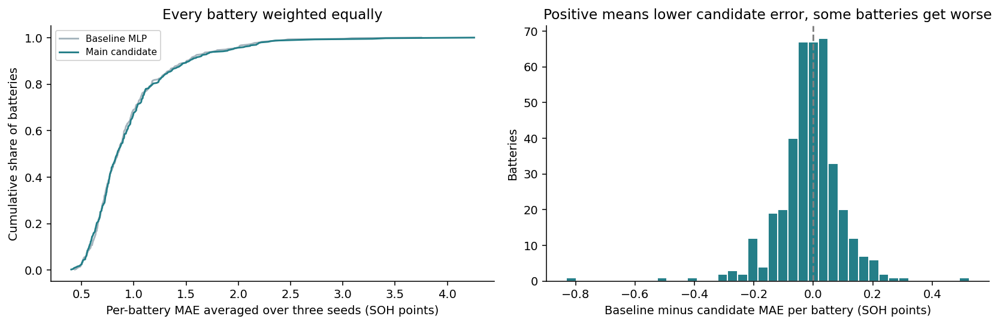

# Final Test Evaluation of the Backpropagation MLP

## Key results

The final evaluation covers **7,572 observations from 390 test batteries** that never appear in train or validation. Six checkpoints and the preprocessing were locked before any test prediction was computed. There was no fitting, retraining, seed selection, feature engineering, prediction clipping or tuning after seeing the test split.

- Main candidate, fixed before test: mean MAE **0.97268 ± 0.00325 SOH points**, RMSE **1.43615 ± 0.00465**, R² **0.95603 ± 0.00028**.
- Baseline MLP: mean MAE **0.96018 ± 0.00641 points**. The candidate is **0.01250 points higher** (about 1.30% of the baseline MAE).
- Parameters: baseline 2,209, candidate 553. All results use seeds 42, 123 and 2026, with no best-seed selection and no ensembling.
- Key limitation: for **SOH < 70%** the candidate MAE is **3.0534** versus **2.7753** for the baseline (higher), on 88 observations from 23 batteries. Errors on the rare, most degraded batteries are about 3.1 times the average candidate error.

## 1. What was locked before testing

`configs/final_evaluation.json` fixes the baseline and candidate configurations, the three seeds, best-validation checkpoints, the SOH bands, and the candidate as the main model family. The candidate uses `baseline_standard`, 67 inputs, hidden [8] sigmoid, linear output, MSE loss, gradient descent with learn_rate 0.1, batch size 32, sample weighting `none`, max_error 0. The baseline uses `baseline_standard`, 67 inputs, hidden [32] sigmoid, linear output, MSE loss, gradient descent with learn_rate 0.1, batch size 32, sample weighting `none`, max_error 0. Both share the same early-stopping policy. Best epochs come from validation, never from test.

The validation study in notebook 03 selects the same candidate configuration. Feature engineering remains a validation ablation. Its recommendation before testing was `control_no_domain_features`, and engineered features are not added to the test comparison.

`evaluation_lock.json` was created at `2026-11-11T02:40:51.948278+00:00` before test inference, with fingerprint `4a8a221ceb6dc36ad4ac43d127b4d0519cf718fb6a6bd643d7465452a7f90558`. The lock records content hashes of the six checkpoints, the fitted preprocessing, the test arrays, the configurations and the split manifest, together with the best epoch and validation MAE of every checkpoint and the evaluator source. Every locked file is verified to be unchanged after inference.

### History of the test split

This test split is not untouched. The original PyTorch version of the project (commit `479ed84`, archived in `archive/pytorch/`) scored the same batteries on 2026-11-06. The project was then rewritten to the from-scratch NumPy implementation to follow the course modules, and the NumPy configurations were scored on 2026-11-07 (record in `archive/numpy_first_evaluation/`). Every NumPy setting was chosen on validation, and no setting was changed because of a test result. Re-running this evaluation scores the same frozen checkpoints again, which is a reproduction, not a new independent test.

## 2. Final metrics and their units

| group | test_mae_mean_pp | test_mae_sd_pp | test_rmse_mean_pp | test_rmse_sd_pp | test_r2_mean | test_r2_sd | test_battery_mae_mean_pp | parameters |
| --- | --- | --- | --- | --- | --- | --- | --- | --- |
| baseline | 0.96018 | 0.00641 | 1.40619 | 0.00799 | 0.95785 | 0.00048 | 0.96278 | 2209 |
| candidate | 0.97268 | 0.00325 | 1.43615 | 0.00465 | 0.95603 | 0.00028 | 0.97442 | 553 |

MAE and RMSE are computed after inverting the target scaling. An MAE of 0.97 means an average absolute error of about 0.97 **SOH percentage points**. R² measures explained variance relative to the test target mean.

SD is the sample SD (ddof = 1) over three training seeds on the same test batteries. It is not a population confidence interval, does not cover the uncertainty over all possible splits, and does not represent three independent test sets. Mean R² and RMSE are averages of per-seed metrics, not metrics of an ensemble.

## 3. Results per seed

| group | seed | run_id | best_epoch_from_validation | test_mae_pp | test_rmse_pp | test_r2 | test_battery_mean_mae_pp |
| --- | --- | --- | --- | --- | --- | --- | --- |
| baseline | 42 | run_57ffa55b9468 | 62 | 0.95973 | 1.40074 | 0.95817 | 0.96168 |
| baseline | 123 | run_751e42b98db0 | 41 | 0.954 | 1.40248 | 0.95807 | 0.9569 |
| baseline | 2026 | run_13e6ccd6012a | 49 | 0.9668 | 1.41536 | 0.9573 | 0.96977 |
| candidate | 42 | run_d38f33266c77 | 96 | 0.97244 | 1.4402 | 0.95578 | 0.97377 |
| candidate | 123 | run_33f5d9ade4e4 | 56 | 0.96956 | 1.43107 | 0.95634 | 0.9705 |
| candidate | 2026 | run_b5aa2af40e50 | 58 | 0.97604 | 1.43717 | 0.95597 | 0.979 |

Every seed is shown, including those with higher errors. Scatter plots use seed 42, the first seed in the existing plan, not a seed chosen after seeing the test ranking. The main comparison remains the mean and SD over all three seeds.

## 4. Does the validation pattern hold?

| group | train_mae_mean_pp | validation_mae_mean_pp | test_mae_mean_pp | test_minus_validation_pp |
| --- | --- | --- | --- | --- |
| baseline | 0.95088 | 0.99997 | 0.96018 | -0.03979 |
| candidate | 0.96941 | 0.99988 | 0.97268 | -0.0272 |

The candidate's test MAE differs from validation by -0.02720 points, and the baseline test score differs slightly as well. Such differences can come from the battery and sample composition of each split and are not a reason to adjust scalers or weights. A test score lower than validation neither proves leakage nor guarantees generalisation to other distributions.

The candidate was chosen before testing. The result supports its usefulness on the held-out synthetic test split, but does not prove freedom from overfitting on every dataset. Train and validation curves and the selection process are discussed in notebook 03, and the test split does not become a new tuning set.

## 5. Actual vs predicted and residuals

Predictions are not clipped to 0 to 100. On average **0.7440%** of candidate predictions fall outside that range, reported as a limitation of the linear output. A positive residual means the model predicts a higher SOH than the actual value. The candidate's mean bias over the whole test split is +0.0962 points, which must not hide larger biases in subgroups.

## 6. Low SOH remains a weakness

| group | soh_band | rows | batteries | mae_mean_pp | mae_sd_pp | rmse_mean_pp | bias_mean_pp |
| --- | --- | --- | --- | --- | --- | --- | --- |
| baseline | <70 | 88 | 23 | 2.77533 | 0.05902 | 3.6492 | 1.91158 |
| baseline | 70–<80 | 362 | 83 | 1.96402 | 0.05101 | 2.59212 | 0.9439 |
| baseline | 80–<90 | 1442 | 226 | 1.30142 | 0.0261 | 1.80092 | 0.16923 |
| baseline | 90–<95 | 1888 | 324 | 0.96419 | 0.00521 | 1.3746 | 0.05032 |
| baseline | >=95 | 3792 | 385 | 0.69046 | 0.00686 | 0.9073 | -0.16422 |
| candidate | <70 | 88 | 23 | 3.05337 | 0.33421 | 4.10635 | 2.3892 |
| candidate | 70–<80 | 362 | 83 | 2.06491 | 0.0288 | 2.70881 | 1.20826 |
| candidate | 80–<90 | 1442 | 226 | 1.31848 | 0.01148 | 1.8181 | 0.28224 |
| candidate | 90–<95 | 1888 | 324 | 0.98387 | 0.01453 | 1.38786 | 0.09385 |
| candidate | >=95 | 3792 | 385 | 0.68305 | 0.01067 | 0.89912 | -0.13281 |

For SOH < 70% the candidate has MAE **3.0534 ± 0.3342** and the baseline **2.7753 ± 0.0590**. The candidate's bias in this band is **+2.3892 points**, so the health of the most degraded synthetic batteries tends to be overestimated.

This subgroup has only 88 observations from 23 batteries, so no statistical superiority is inferred from a three-seed mean and SD. The finding must still be reported, because the EDA showed that train is dominated by high SOH. Loss, features, weighting and thresholds are not changed in response to this test finding. Any follow-up work needs a new independent validation and evaluation.

## 7. Per-battery evaluation

The main MAE weights every observation equally. `test_battery_mean_mae_pp` averages the MAE of each battery so that batteries with many observations do not dominate. Candidate: **0.97442 ± 0.00429 points**, baseline **0.96278 ± 0.00650**.

After averaging each battery's MAE over three seeds, the candidate has the lower error on 182 of 390 batteries. This is descriptive, not 390 independent training experiments. The ten batteries with the largest candidate errors are listed below for final diagnosis, not for tuning the model on test.

| group | battery_id | rows | mean_actual_soh | mae_mean_pp | mae_sd_pp | rmse_mean_pp | bias_mean_pp |
| --- | --- | --- | --- | --- | --- | --- | --- |
| candidate | BATT_00668 | 21 | 82.61143 | 4.25742 | 0.16137 | 5.46338 | 4.08086 |
| candidate | BATT_00438 | 20 | 79.008 | 3.40969 | 0.09089 | 4.3258 | 3.14142 |
| candidate | BATT_02542 | 18 | 82.20667 | 3.2858 | 0.08603 | 3.69991 | -2.01104 |
| candidate | BATT_02298 | 22 | 73.88773 | 2.73278 | 0.80431 | 3.52739 | 2.32897 |
| candidate | BATT_01952 | 17 | 78.47765 | 2.54612 | 0.04755 | 2.7529 | 2.54612 |
| candidate | BATT_02345 | 21 | 87.20238 | 2.35342 | 0.20302 | 2.63732 | -1.9748 |
| candidate | BATT_01357 | 20 | 87.055 | 2.30826 | 0.16076 | 2.96279 | 2.20617 |
| candidate | BATT_00526 | 18 | 94.165 | 2.28581 | 0.10527 | 3.64134 | -1.69016 |
| candidate | BATT_00988 | 18 | 87.065 | 2.21796 | 0.20264 | 2.83937 | 2.11245 |
| candidate | BATT_00643 | 7 | 87.17429 | 2.19533 | 0.11091 | 2.60781 | 2.17546 |

## 8. Constant references from train

| reference | constant_from_train | mae | rmse | r2 | bias_pp | outside_0_100_pct | battery_mean_mae |
| --- | --- | --- | --- | --- | --- | --- | --- |
| train_median | 95.23 | 4.93024 | 7.22279 | -0.11211 | 2.29327 | 0.0 | 4.93412 |
| train_mean | 92.91875 | 5.1975 | 6.84908 | -1e-05 | -0.01799 | 0.0 | 5.21201 |

The median and mean are learned from `y_train` only and serve as a sanity check. They are not additional models, the only trained model is the MLP. The final result shows a clear benefit over predicting the centre of the target distribution, without equating that improvement with physical validation.

## 9. Defensible conclusions

Under the group-split protocol on this synthetic dataset, the candidate chosen on validation does **not** beat the baseline on test: it is lower on 0 of 3 seeds and the mean difference is -0.01250 points. The three-seed validation confirmation already showed the two models within seed noise of each other, so the seed-42 advantage that selected the candidate did not generalise. The candidate reaches almost the same accuracy with 4.0 times fewer parameters, which is the practical argument for the smaller network. Both MLPs clearly beat the constant references.

The claim is limited to estimating SOH at observation time for new batteries from the same simulator. Forecasting, remaining useful life, real vehicle data and distribution shift are not tested. The low-SOH weakness and predictions outside the physical range remain open. There is no claim of "95% accuracy", universal freedom from overfitting, or readiness for real batteries.

The candidate family remains the main model because it was chosen **before** testing. Because the PyTorch version was scored on the same test batteries first, a comparison between the two implementations is descriptive. Independent evidence would require a new evaluation set.

## 10. Artifacts and reproduction

- `notebooks/05_final_evaluation.ipynb`: protocol, metrics, figures, error analysis and checks.
- `configs/final_evaluation.json`: frozen configurations, seeds and SOH bands.
- `evaluation_lock.json`: content hashes and lock time before test inference.
- `metrics_by_seed.csv`, `metrics_summary.csv`: all seed results and the summary.
- `test_band_summary.csv`, `test_battery_summary.csv`: results per SOH band and per battery, with detailed per-seed tables alongside.
- `predictions/`: per-observation test predictions, local and ignored by Git.
- Weights and fitted preprocessing stay in the local `models/` folder.

Command: `python -m ev_battery evaluate`, then run notebook 05. The evaluator reuses complete results that match the lock and never retrains or replaces checkpoints. Re-running the deterministic checks on the same results is not a new independent evaluation.

Training is deterministic for a given machine and package set, so rebuilding the checkpoints with `python -m ev_battery all` normally reproduces this lock. If the local checkpoints differ (for example on another CPU), the evaluator leaves these results untouched and writes a separate reproduction to `data/processed/evaluation_reproduction/<id>/`.
