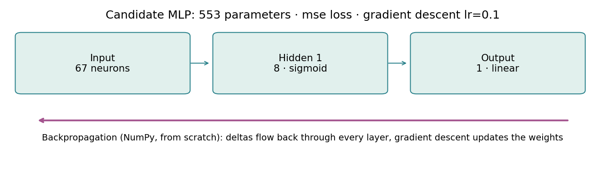
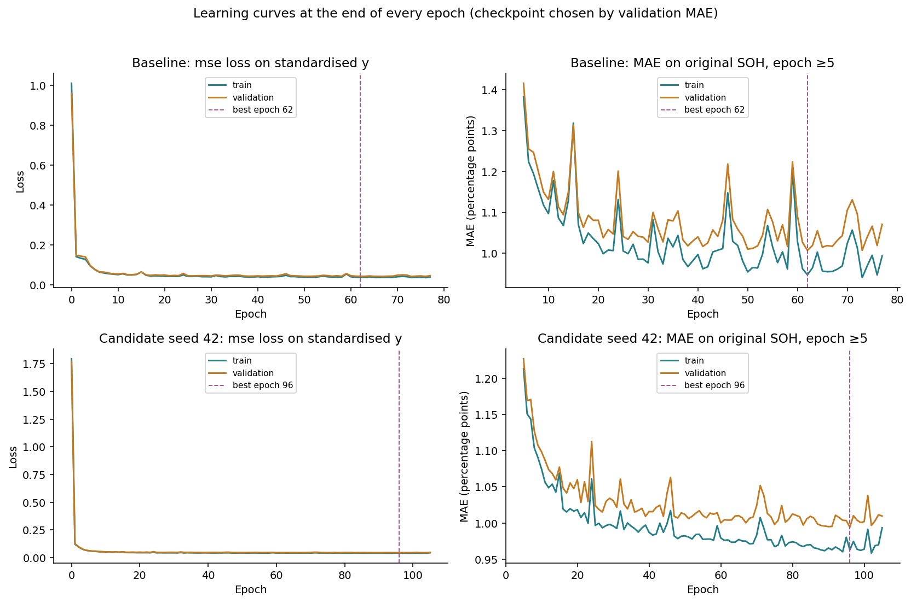
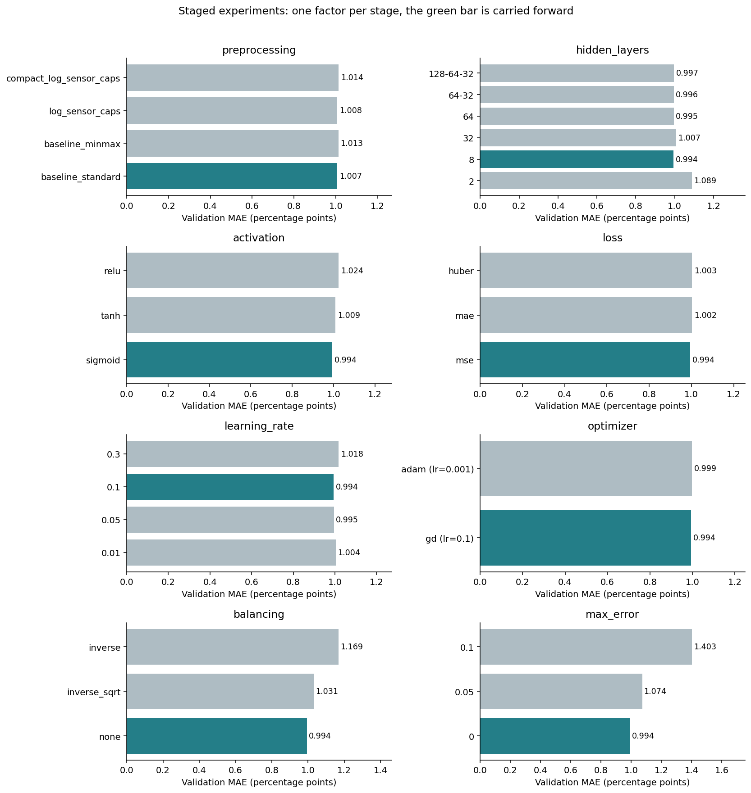
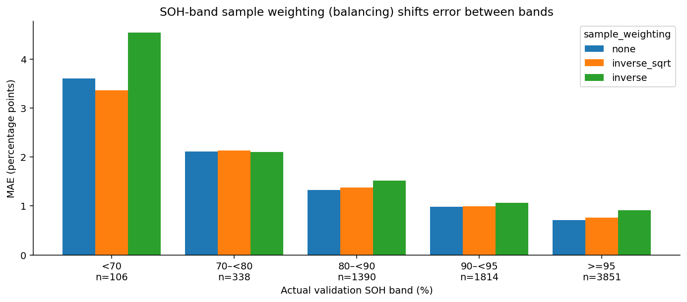
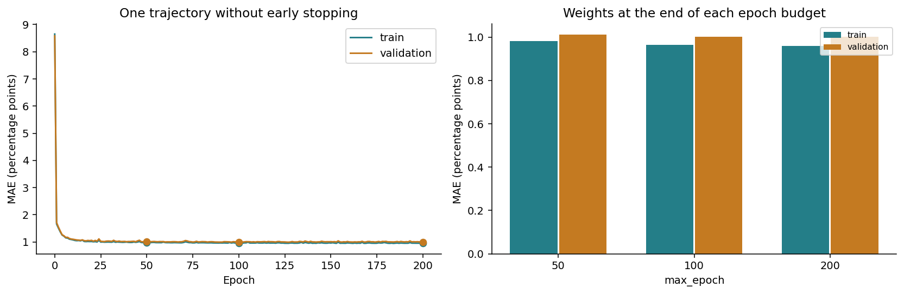
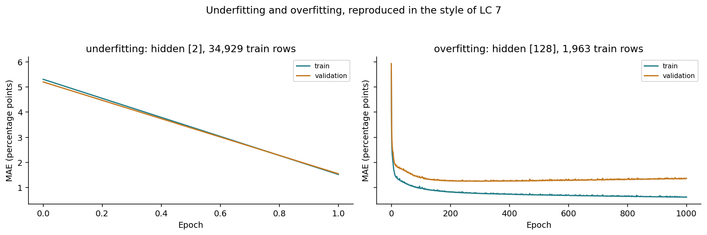
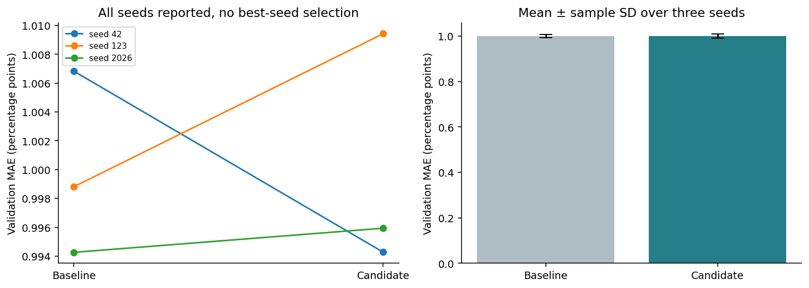
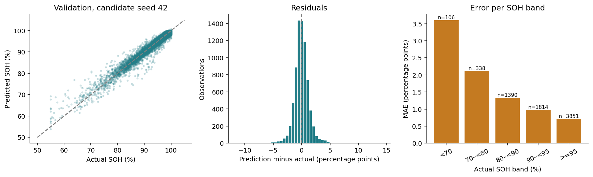

# MLP Experiments with Backpropagation

## Key results

- The MLP and backpropagation are implemented **from scratch in NumPy** (`src/ev_battery/model.py`), following `bp_fit` and `bp_predict` from the course modules. No deep-learning framework is used.
- **28 unique training runs** completed, including the three-seed confirmation and the underfitting and overfitting demonstration.
- Baseline (`baseline_standard`, 67 inputs, hidden [32] sigmoid, linear output, MSE loss, gradient descent with learn_rate 0.1, batch size 32, sample weighting `none`, max_error 0): validation MAE **1.0068** SOH percentage points.
- Candidate (`baseline_standard`, 67 inputs, hidden [8] sigmoid, linear output, MSE loss, gradient descent with learn_rate 0.1, batch size 32, sample weighting `none`, max_error 0): validation MAE **0.9943**, RMSE **1.5039**, R² **0.9541**.
- Seed confirmation: baseline **1.0000 ± 0.0064**, candidate **0.9999 ± 0.0083**, three seeds on the fixed split.
- Validation was reused throughout the search, so these are not test scores. Notebook 05 reproduces the recorded NumPy configurations on the previously evaluated test split.

## 1. Implementation

The network follows the structure of the course `bp_fit`:

- `layer_conf` lists the neurons per layer, for example `(67, 8, 1)`.
- Weights are a list of matrices of shape `(n_in + 1, n_out)`. The last row is the bias, which corresponds to an extra input neuron fixed at 1.
- Forward pass: `net = [a, 1] @ W`, then the activation (`sig`, `tanh` or `relu`) in hidden layers and a linear output for regression.
- Backward pass: the output delta is the loss gradient, `delta = (delta_next @ W_next[:-1].T) * f'(net)` for hidden layers, and the weight gradient is `[a, 1].T @ delta`.
- Update: plain gradient descent `W = W - learn_rate * gradient` as in the course, or Adam (written by hand) as a comparison.
- Stopping: `max_epoch`, `max_error` on the epoch MSE (as in the course), and early stopping on validation MAE with patience 15.

Updates use mini-batches of 32 samples, because per-sample updates over 34,929 rows would make each experiment take hours. The gradient formula is identical: with `batch_size=1`, no shuffling and a sigmoid output, a unit test shows that the implementation produces exactly the same weights as the course `bp_fit`. A second test checks every gradient against finite differences.

## 2. Reference configuration

The baseline mirrors the course defaults: sigmoid hidden units, MSE loss and plain gradient descent with learn_rate 0.1, batch size 32, at most 200 epochs and seed 42 during the search.

| model | recipe | hidden | activation | loss | optimizer | learn_rate | parameters | best_epoch | epochs_actual | train_MAE_pp | validation_MAE_pp | validation_R2 |
| --- | --- | --- | --- | --- | --- | --- | --- | --- | --- | --- | --- | --- |
| Baseline seed 42 | baseline_standard | [32] | sigmoid | mse | gd | 0.1 | 2209 | 62 | 77 | 0.9473 | 1.0068 | 0.9551 |
| Candidate seed 42 | baseline_standard | [8] | sigmoid | mse | gd | 0.1 | 553 | 96 | 105 | 0.9629 | 0.9943 | 0.9541 |

Train and validation losses are computed with the same weights at the end of every epoch. Epoch 0 is the untrained network and serves only as a reference.

## 3. Staged experiment matrix

The search changes one factor per stage and carries the validation winner forward:

| stage | values tested | selected | validation MAE (pp) |
| --- | --- | --- | --- |
| preprocessing | baseline_standard, baseline_minmax, log_sensor_caps, compact_log_sensor_caps | baseline_standard | 1.0068 |
| hidden_layers | 2, 8, 32, 64, 64-32, 128-64-32 | 8 | 0.9943 |
| activation | sigmoid, tanh, relu | sigmoid | 0.9943 |
| loss | mse, mae, huber | mse | 0.9943 |
| learning_rate | 0.01, 0.05, 0.1, 0.3 | 0.1 | 0.9943 |
| optimizer | gd (lr=0.1), adam (lr=0.001) | gd (lr=0.1) | 0.9943 |
| balancing | none, inverse_sqrt, inverse | none | 0.9943 |
| max_error | 0, 0.05, 0.1 | 0 | 0.9943 |

All runs:

| stage | value | validation_mae_pp | train_mae_pp | epochs_actual | best_epoch | stop_reason | selected |
| --- | --- | --- | --- | --- | --- | --- | --- |
| preprocessing | baseline_standard | 1.0068 | 0.9473 | 77 | 62 | early_stopping | True |
| preprocessing | baseline_minmax | 1.0129 | 0.9567 | 135 | 120 | early_stopping | False |
| preprocessing | log_sensor_caps | 1.0077 | 0.9605 | 65 | 50 | early_stopping | False |
| preprocessing | compact_log_sensor_caps | 1.0137 | 0.9714 | 67 | 52 | early_stopping | False |
| hidden_layers | 2 | 1.0892 | 1.0888 | 54 | 39 | early_stopping | False |
| hidden_layers | 8 | 0.9943 | 0.9629 | 105 | 96 | early_stopping | True |
| hidden_layers | 32 | 1.0068 | 0.9473 | 77 | 62 | early_stopping | False |
| hidden_layers | 64 | 0.995 | 0.9491 | 65 | 50 | early_stopping | False |
| hidden_layers | 64-32 | 0.996 | 0.938 | 77 | 62 | early_stopping | False |
| hidden_layers | 128-64-32 | 0.9966 | 0.9495 | 77 | 65 | early_stopping | False |
| activation | sigmoid | 0.9943 | 0.9629 | 105 | 96 | early_stopping | True |
| activation | tanh | 1.0093 | 0.9771 | 56 | 41 | early_stopping | False |
| activation | relu | 1.0244 | 0.9823 | 77 | 62 | early_stopping | False |
| loss | mse | 0.9943 | 0.9629 | 105 | 96 | early_stopping | True |
| loss | mae | 1.0025 | 0.9951 | 27 | 12 | early_stopping | False |
| loss | huber | 1.0031 | 0.974 | 75 | 60 | early_stopping | False |
| learning_rate | 0.01 | 1.0035 | 0.9847 | 189 | 187 | early_stopping | False |
| learning_rate | 0.05 | 0.995 | 0.974 | 75 | 67 | early_stopping | False |
| learning_rate | 0.1 | 0.9943 | 0.9629 | 105 | 96 | early_stopping | True |
| learning_rate | 0.3 | 1.018 | 0.9766 | 46 | 37 | early_stopping | False |
| optimizer | gd (lr=0.1) | 0.9943 | 0.9629 | 105 | 96 | early_stopping | True |
| optimizer | adam (lr=0.001) | 0.9985 | 0.9544 | 42 | 39 | early_stopping | False |
| balancing | none | 0.9943 | 0.9629 | 105 | 96 | early_stopping | True |
| balancing | inverse_sqrt | 1.0306 | 0.9921 | 63 | 48 | early_stopping | False |
| balancing | inverse | 1.1688 | 1.125 | 28 | 13 | early_stopping | False |
| max_error | 0 | 0.9943 | 0.9629 | 105 | 96 | early_stopping | True |
| max_error | 0.05 | 1.0737 | 1.0487 | 12 | 12 | max_error | False |
| max_error | 0.1 | 1.4028 | 1.3743 | 3 | 3 | max_error | False |

This is a sequential search, **not a full factorial design**: it does not isolate every interaction and does not prove a global optimum. Raw loss values are never compared across MSE, MAE and Huber, every decision uses validation MAE in original SOH units. The Huber delta of 1 on the standardised target corresponds to about 7.19 SOH points.

## 4. Optimizer: gradient descent vs Adam

Plain gradient descent (the course rule) uses one fixed learn_rate for every weight. Adam keeps running averages of each gradient and its square, which gives every weight its own adaptive step size. The optimizer stage compares the two on the configuration selected so far, see the `optimizer` rows above.

## 5. Balancing with SOH-band weights

The target is continuous, so class balancing in the classification sense does not apply. The regression counterpart is to weight each training sample by the inverse frequency of its SOH band, so that rare low-SOH observations contribute more to the loss. Weights are computed on train only and normalised to a mean of 1. Inverse frequency equalises the total raw weight per band over the training set. Mini-batch updates divide by their own weight sum, so effective gradient contributions depend on batch composition.

| sample_weighting | soh_band | rows | batteries | mae_pp |
| --- | --- | --- | --- | --- |
| none | <70 | 106 | 28 | 3.6015 |
| none | 70–<80 | 338 | 80 | 2.1118 |
| none | 80–<90 | 1390 | 218 | 1.3309 |
| none | 90–<95 | 1814 | 305 | 0.9797 |
| none | >=95 | 3851 | 384 | 0.7098 |
| inverse_sqrt | <70 | 106 | 28 | 3.3613 |
| inverse_sqrt | 70–<80 | 338 | 80 | 2.1282 |
| inverse_sqrt | 80–<90 | 1390 | 218 | 1.3814 |
| inverse_sqrt | 90–<95 | 1814 | 305 | 0.9894 |
| inverse_sqrt | >=95 | 3851 | 384 | 0.7629 |
| inverse | <70 | 106 | 28 | 4.5456 |
| inverse | 70–<80 | 338 | 80 | 2.1022 |
| inverse | 80–<90 | 1390 | 218 | 1.517 |
| inverse | 90–<95 | 1814 | 305 | 1.0639 |
| inverse | >=95 | 3851 | 384 | 0.9176 |

For SOH below 70%, validation MAE is **3.601** without weighting, **3.361** with `inverse_sqrt` and **4.546** with `inverse` weights. The selection rule uses overall validation MAE, so balancing is only selected if it also improves the aggregate error.

## 6. Epoch budget

| epoch | train_mae | validation_mae | validation_rmse | validation_r2 |
| --- | --- | --- | --- | --- |
| 50 | 0.9822 | 1.0119 | 1.5298 | 0.9525 |
| 100 | 0.9638 | 1.0019 | 1.5176 | 0.9533 |
| 200 | 0.9596 | 1.0029 | 1.4954 | 0.9546 |

The table uses the **endpoint weights at epochs 50, 100 and 200** of one trajectory without early stopping. Because the trajectories are nested, this is a controlled budget experiment, not three independent replicates. The best checkpoint of this diagnostic trajectory is at epoch 127 (MAE 0.9917). The run is not promoted to the candidate.

## 7. Underfitting and overfitting

Reproducing LC 7 on this dataset:

| scenario | run_id | hidden_layers | train_rows | max_epochs | max_error | epochs_actual | stop_reason | train_mae_pp | validation_mae_pp | gap_pp | final_train_mae_pp | final_validation_mae_pp | final_gap_pp |
| --- | --- | --- | --- | --- | --- | --- | --- | --- | --- | --- | --- | --- | --- |
| underfitting | run_990e876cb506 | 2 | 34929 | 50 | 0.5 | 1 | max_error | 1.5179 | 1.5465 | 0.0286 | 1.5179 | 1.5465 | 0.0286 |
| overfitting | run_19e4fd829263 | 128 | 1963 | 1000 | 0.0 | 1000 | max_epoch | 0.7704 | 1.2468 | 0.4764 | 0.6173 | 1.3662 | 0.7489 |

- **Underfitting:** hidden [2], max_epoch 50 and max_error 0.5. Training stopped after 1 epoch(s) (max_error). Train MAE 1.518 and validation MAE 1.547 are both high: the model is too small and stops learning too early.
- **Overfitting:** hidden [128] trained for 1000 epochs without early stopping on only 1,963 rows (5% of train). After the last epoch, train MAE is 0.617 while validation MAE is 1.366, a gap of 0.749 points: the network memorises the small training set. Its best validation epoch was 278, after which validation error rises while train error keeps falling.

The full study does not overfit strongly because it trains on 34,929 rows with early stopping.

## 8. Seed confirmation

| group | seed | run_id | validation_mae_pp | validation_rmse_pp | validation_r2 | train_mae_pp | best_epoch |
| --- | --- | --- | --- | --- | --- | --- | --- |
| baseline | 42 | run_cd4e6f80a183 | 1.0068 | 1.4866 | 0.9551 | 0.9473 | 62 |
| baseline | 123 | run_96e0465b8c5f | 0.9988 | 1.5041 | 0.9541 | 0.9601 | 41 |
| baseline | 2026 | run_27c8116694bb | 0.9943 | 1.4917 | 0.9548 | 0.9452 | 49 |
| candidate | 42 | run_0015e8ebf51d | 0.9943 | 1.5039 | 0.9541 | 0.9629 | 96 |
| candidate | 123 | run_17e82e31806b | 1.0094 | 1.514 | 0.9535 | 0.9749 | 56 |
| candidate | 2026 | run_125d105f67b2 | 0.9959 | 1.492 | 0.9548 | 0.9705 | 58 |

SD is the sample standard deviation (ddof = 1) over three training seeds, which control the initial weights and the shuffling order. It is not a confidence interval over batteries.

## 9. Validation error analysis

| soh_band | rows | batteries | mae_pp |
| --- | --- | --- | --- |
| <70 | 106 | 28 | 3.6015 |
| 70–<80 | 338 | 80 | 2.1118 |
| 80–<90 | 1390 | 218 | 1.3309 |
| 90–<95 | 1814 | 305 | 0.9797 |
| >=95 | 3851 | 384 | 0.7098 |

Predictions are not clipped to 0 to 100. The seed-42 candidate produces 0.240% predictions outside that range. The mean per-battery MAE is **0.9970** points.

## 10. Sanity check against train constants

| reference | constant_soh | mae | rmse | r2 | bias_pp | outside_0_100_pct | battery_mean_mae |
| --- | --- | --- | --- | --- | --- | --- | --- |
| train_median | 95.23 | 4.9432 | 7.3623 | -0.1 | 2.2199 | 0.0 | 4.9363 |
| train_mean | 92.9187 | 5.2697 | 7.0202 | -0.0002 | -0.0913 | 0.0 | 5.2737 |

The train median and mean are not competing models. They show that the MLP does more than predict the dominant high-SOH region.

## 11. Artifacts and reproduction

- `configs/mlp_study.json`: baseline, stages and protocol.
- `results/experiments/run_summary.csv`: one row per unique training run.
- `runs/<run_id>/`: config, per-epoch history, summary and status.
- `models/mlp/<run_id>/`: best, last and fixed-epoch weights as `.npz`, local and ignored by Git.

Command: `python -m ev_battery train`, or run notebook 03. Identical runs are reused through a fingerprint of the code, data and configuration.
