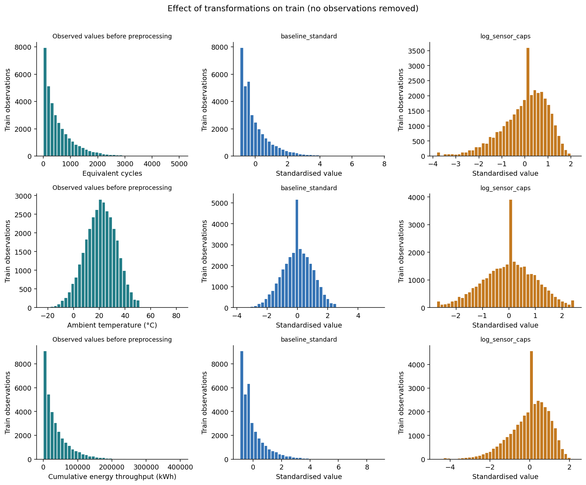
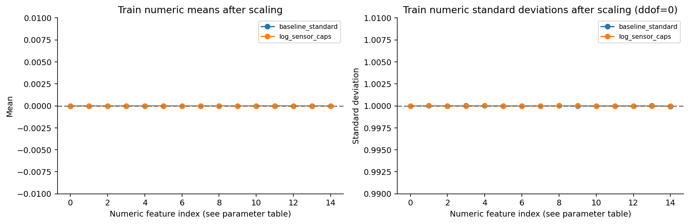
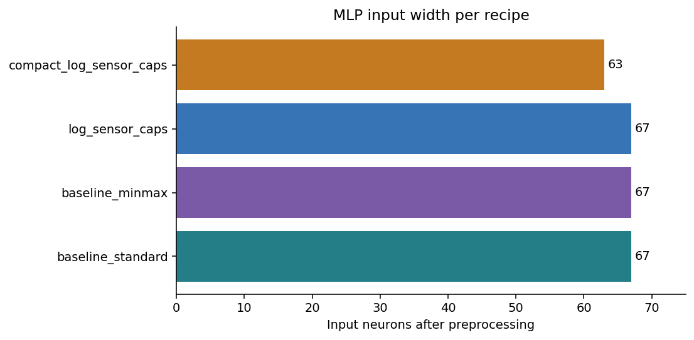

# Preprocessing for the Backpropagation MLP

## Scope

Every pipeline is fitted **only on the 34,929 train observations (1,820 batteries)**. Validation (7,499 rows) and test (7,572 rows) are transformed with the frozen train parameters. This stage trains no model, performs no tuning, and makes no claim about overfitting or underfitting.

Preprocessing puts inputs on a scale that suits gradient-based optimisation, handles absent information explicitly, and provides a redundancy ablation. Generalisation is judged later from train and validation learning curves, MLP capacity, regularisation, early stopping and seed variation. The initial feature contract and the split manifest are unchanged.

## Recipes

| recipe | raw_features | input_neurons | capped_train_feature_cells | log_features |
| --- | --- | --- | --- | --- |
| baseline_standard | 21 | 67 | 0 | none |
| baseline_minmax | 21 | 67 | 0 | none |
| log_sensor_caps | 21 | 67 | 720 | cycle_count, total_energy_throughput_kwh, avg_daily_distance_km, altitude_m, service_count |
| compact_log_sensor_caps | 19 | 63 | 389 | cycle_count, avg_daily_distance_km, altitude_m, service_count |

The default recipe is **baseline_standard** because it keeps all 21 permitted raw features as a reference. The other recipes were fixed before training. They are alternatives, not experiment winners. `baseline_standard` vs `baseline_minmax` compares two normalisation methods. `baseline_standard` vs `log_sensor_caps` tests log transforms and caps together, so their individual effects are not isolated. `compact_log_sensor_caps` vs `log_sensor_caps` tests dropping two redundant features.

## 1. Processing order

1. Validate the named schema. IDs, the target, derived health labels, dates and sensor proxies may not enter the main pipeline. Column order may differ. Missing or extra columns are rejected.
2. Convert numerics and require finite values. Values that violate a definitional bound (ratios, percentages, binary flags, selected non-negative counters) become missing. Extreme but valid values are kept, and negative altitude is valid. There is no monotonic repair, forward/backward fill, or cross-row imputation.
3. Numeric features: train-median imputation. A missing indicator is created for every numeric feature, including features that were complete during fit, so new missingness at inference is still encoded.
4. Alternative recipes only: cap the selected sensors at the 0.5% and 99.5% quantiles of **non-missing train values before imputation**. No rows, old batteries or low-SOH observations are removed. Caps are a robustness hypothesis for heavy tails, not a verified error label.
5. Signed `log1p` for selected right-skewed features: `log1p(x)` for non-negative values and `sign(x) * log1p(abs(x))` for altitude. The target is not log-transformed.
6. Numeric features are scaled on train **after** imputation, capping and log transforms. Most recipes use `StandardScaler` (train mean 0, standard deviation 1). `baseline_minmax` uses `MinMaxScaler` (train range mapped to [0, 1]), the normalisation used in the course modules. Validation and test are never rescaled to their own statistics.
7. `recall_flag` is imputed with the train mode, stays 0/1, and gets a missing indicator. The rare flag is excluded from IQR outlier rules.
8. Categorical features: trim whitespace, encode empty values as the explicit `__MISSING__` category, and one-hot encode without an artificial order. Unseen categories map to an all-zero block, do not become the missing category, and do not change the input width. The missing token is allocated at fit time even when a feature is complete in train.
9. Concatenate numeric values, numeric indicators, binary values, binary indicators and one-hot blocks into a dense **float32** array. Output names and order are stored. The target is stored separately.

No value is filled from future observations or battery-level groupings. Inference needs only a single row of features that are available at prediction time.

## 2. Feature selection

- `capacity_fade_pct` (100 minus SOH), RUL, risk and degradation labels, and IDs are excluded to prevent leakage and memorisation. The four sensor proxies stay outside the main scope.
- The compact recipe drops `total_energy_throughput_kwh` (train Spearman correlation 0.984 with `cycle_count`) and `peak_temp_during_fast_charge_c` (0.920 with ambient temperature).
- Age and cycle count are both kept despite their correlation because they represent calendar ageing and usage respectively. Features with a weak marginal correlation to the target are not removed automatically, since an MLP can use interactions.
- Removing redundancy reduces input width and parameter count but can discard information. The compact recipe is therefore an ablation, **not the final feature selection**. Recipes are compared on validation.

## 3. Target and balancing

The original SOH is kept: no target clipping, no binning into classes, no oversampling, no SMOTE and no removal of low-SOH rows. Class balancing does not apply to a continuous target, and evaluation follows the original split distribution. The regression counterpart, weighting the loss by SOH band, is tested as an experiment in notebook 03.

The target scaler is fitted on `y_train` only: mean **92.918747**, scale **7.192673** percentage points. A standardised target lets the linear output neuron start near zero. It does not fix tail behaviour and does not guarantee better scores.

Arrays store `y_scaled` for optimisation and `y_original` for evaluation. Convert predictions back with `bundle['target_scaler'].inverse_transform(...)`. MAE and RMSE are always reported in original SOH percentage points. The Huber delta is defined on the scaled target, because changing the scale also changes loss and gradient magnitudes.

## 4. Input readiness

| recipe | rows | raw_features | input_neurons | numeric_missing_after | finite |
| --- | --- | --- | --- | --- | --- |
| baseline_standard | 34929 | 21 | 67 | 0 | True |
| baseline_minmax | 34929 | 21 | 67 | 0 | True |
| log_sensor_caps | 34929 | 21 | 67 | 0 | True |
| compact_log_sensor_caps | 34929 | 19 | 63 | 0 | True |

All splits keep aligned ID, X and y arrays. Holdout summaries are limited to shape and validity. No target distribution or model score is computed for them here. All arrays are finite, output names are unique and consistent, and the target round trip is checked. Per-split details are in `split_readiness.csv`.



Train only. The spike at the median is a consequence of imputation. The missing indicator keeps the information that the value was absent instead of pretending the median was measured. Log transforms and caps compress tails but also remove detail, which is why the recipes are compared on validation.



The mean and standard deviation checks cover the numeric block only. One-hot, binary and indicator columns are not forced to unit variance. Per-feature standardisation does not remove correlation between features.



The number of input neurons is counted **after preprocessing**, including indicators and one-hot columns. For a `[64, 32]` network with one output, the parameter count is `(p*64 + 64) + (64*32 + 32) + (32*1 + 1)`.

## 5. Integrity checks

| recipe | check | result |
| --- | --- | --- |
| baseline_standard | transform_state_unchanged | PASS |
| baseline_standard | all_split_float32_finite_and_same_width | PASS |
| baseline_standard | target_inverse_max_error_pp | 0.000001712 |
| baseline_standard | serialization_exact_first_16_rows | PASS |
| baseline_minmax | transform_state_unchanged | PASS |
| baseline_minmax | all_split_float32_finite_and_same_width | PASS |
| baseline_minmax | target_inverse_max_error_pp | 0.000001712 |
| baseline_minmax | serialization_exact_first_16_rows | PASS |
| log_sensor_caps | transform_state_unchanged | PASS |
| log_sensor_caps | all_split_float32_finite_and_same_width | PASS |
| log_sensor_caps | target_inverse_max_error_pp | 0.000001712 |
| log_sensor_caps | serialization_exact_first_16_rows | PASS |
| compact_log_sensor_caps | transform_state_unchanged | PASS |
| compact_log_sensor_caps | all_split_float32_finite_and_same_width | PASS |
| compact_log_sensor_caps | target_inverse_max_error_pp | 0.000001712 |
| compact_log_sensor_caps | serialization_exact_first_16_rows | PASS |

`tests/test_preprocessing.py` additionally covers train-only parameters, new categories and new missingness, invalid values, column order, leaking schemas, serialisation, and that transforming holdout data does not change the fitted state. Small synthetic frames are used for behavioural checks only.

## 6. Artifacts and usage

- `data/processed/<recipe>/{train,validation,test}.npz`: float32 `X`, `y_scaled`, `y_original`, `observation_id`, `battery_id` and `feature_names`. Local only, ignored by Git.
- `models/preprocessing/<recipe>.joblib`: preprocessor, target scaler, recipe, source and split identity, feature names and package versions. Local only. Load joblib files only from trusted sources. `load_prepared_split` verifies recipe, split, feature order and state hash so arrays are never mixed with another pipeline.
- `results/preprocessing/`: this report, integrity checks, three train figures, train parameters, categories, output names and provenance.
- `configs/preprocessing.json`: reviewable recipe definitions. The initial feature contract is not overwritten.

```python
from ev_battery.preprocessing import load_prepared_split

data, bundle = load_prepared_split("baseline_standard", "train")
X_train, y_train = data["X"], data["y_scaled"]
# New rows: X_new = bundle["preprocessor"].transform(new_rows[bundle["required_columns"]])
# Back to SOH: bundle["target_scaler"].inverse_transform(pred_scaled.reshape(-1, 1)).ravel()
```

The precomputed arrays are for this fixed split only. For cross-validation inside train, **fit a fresh preprocessor and target scaler on every training fold**. scikit-learn is used for transformations only. The only predictive model in this project is the MLP.

Reproduce with `python -m ev_battery preprocess`, then `python scripts/run_notebook.py notebooks/02_preprocessing.ipynb`. The raw CSV, split manifest and feature contract are never modified.

## 7. Questions for the experiments

1. Start from `baseline_standard`, then compare alternatives with the same architecture, seeds and training policy.
2. High train and validation error suggests underfitting or an optimisation problem: check capacity, learning rate, epochs and features.
3. Improving train error with worsening validation error suggests overfitting: check hidden size, the epoch budget, early stopping and seed stability.
4. Never add or remove features, or choose caps, based on the test split.

## References

- [scikit-learn: common pitfalls and data leakage](https://scikit-learn.org/stable/common_pitfalls.html)
- [StandardScaler](https://scikit-learn.org/stable/modules/generated/sklearn.preprocessing.StandardScaler.html)
- [MinMaxScaler](https://scikit-learn.org/stable/modules/generated/sklearn.preprocessing.MinMaxScaler.html)
- [OneHotEncoder and `handle_unknown`](https://scikit-learn.org/stable/modules/generated/sklearn.preprocessing.OneHotEncoder.html)

The executed version is scikit-learn 1.7.2, recorded in `provenance.json`.
